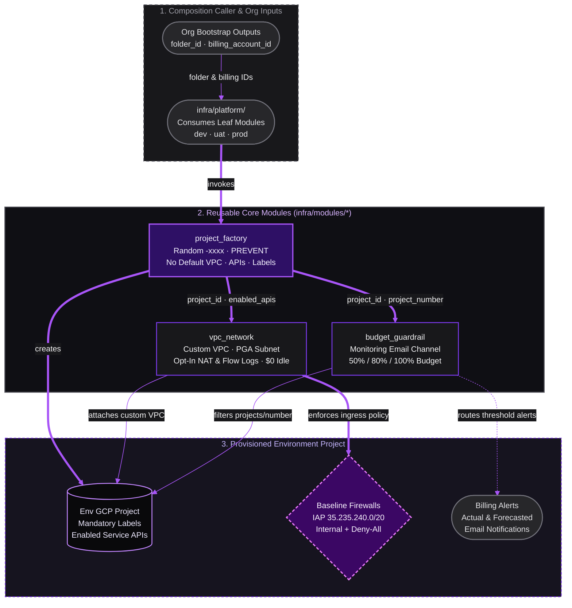

# Spec 01: Reusable GCP Core Modules (`project_factory`, `vpc_network`, `budget_guardrail`)

| Field | Value |
| :--- | :--- |
| **Status** | `Superseded` *(by [Spec 02](./02_platform_and_terragrunt_envs.md) — local `infra/modules/` removed in favor of tag-pinned public GitHub modules directly in `infra/platform/`)* |
| **Owner** | Xavier Ruiz |
| **Component** | `platform_unified_data_gcp/infra/modules/*` |
| **Stack** | OpenTofu `>= 1.8.0, < 2.0.0` · `hashicorp/google ~> 6.0` · `hashicorp/random ~> 3.6` |
| **Archetype / Tier** | Infrastructure-as-Code Contract (Reusable Modules) · Full Spec (`6 REQs`, `7 TCs`) |
| **Depends On** | External Org bootstrap [`x-ruiz/platform_gcp_org_bootstrap`](https://github.com/x-ruiz/platform_gcp_org_bootstrap) |
| **Superseded By** | [Spec 02](./02_platform_and_terragrunt_envs.md) |

---

## 1. Overview & Design

### TL;DR
The shared platform composition (`infra/platform/`, consumed by Terragrunt environments `dev`, `uat`, and `prod`) needs repeatable primitives for GCP projects, custom-mode VPC networking, and billing guardrails without duplicating HCL, leaking default networks, omitting mandatory labels, or incurring idle NAT costs. This spec encapsulates those primitives into three self-contained, offline-testable OpenTofu leaf modules (`project_factory`, `vpc_network`, and `budget_guardrail`). *(Retained as a historical contract; superseded by Spec 02's tag-pinned upstream modules.)*

### Architecture



### Key Design Decisions
- **Plain leaf modules without Terragrunt:** Each directory under `infra/modules/` stays pure reusable OpenTofu HCL so higher-level compositions wrap them cleanly in Spec 02.
- **`$0/mo` default network footprint:** `enable_cloud_nat` and `enable_flow_logs` default to `false`, preventing billable idle gateways or log volume in non-production environments.
- **Zero public SSH exposure:** Baseline firewall rules allow SSH TCP `22` strictly from Google IAP (`35.235.240.0/20`) on explicitly tagged targets, backed by an explicit low-priority deny-all-ingress fallback.
- **Safe project teardown & API preservation:** `project_factory` defaults to `deletion_policy = "PREVENT"` and sets `disable_on_destroy = false` on all enabled APIs to prevent cascading destruction errors.

### Done Looks Like
- All three modules pass every static check, security scan, and offline mocked unit test in the Verification Gates table with zero GCP credentials or cost.
- Default `vpc_network` configuration (`enable_cloud_nat = false`, `enable_flow_logs = false`) provisions zero billable idle resources (`$0/mo`).
- Acceptance cases `TC-001` through `TC-007` are verified.

| Gate | Command | Scope |
| :--- | :--- | :--- |
| Formatting & Schema | `tofu fmt -check -recursive` · `tofu validate` | All 3 modules under `infra/modules/` |
| Lint & Security | `tflint --recursive` (Google ruleset) · `trivy config` (`HIGH,CRITICAL`) | `infra/modules/` tree |
| Unit Tests | `tofu test` (`mock_provider`) | `tests/*.tftest.hcl` in each module |

---

## 2. Scope

### In Scope
- Deliver `infra/modules/project_factory` to create a folder-parented, billing-linked GCP project with no default network, safe API activation, mandatory labels, and configurable `deletion_policy`.
- Deliver `infra/modules/vpc_network` to create a custom-mode VPC, a regional subnet with Private Google Access, baseline IAP/internal/deny-all firewalls, and opt-in Flow Logs and Cloud Router + Cloud NAT.
- Deliver `infra/modules/budget_guardrail` to create a Cloud Monitoring email notification channel and a project-scoped Billing Budget with configurable threshold alerts.
- Enforce the mandatory lowercase resource labels contract across all label-supporting resources.
- Ship strict OpenTofu `validation` blocks on all critical module inputs alongside offline `tests/*.tftest.hcl` suites using `mock_provider`.

### Out of Scope (Non-Goals)
- **Environment wrappers & CI workflows:** `infra/platform/`, Terragrunt `infra/envs/{dev,uat,prod}/`, and GitHub Actions pipelines live in Specs 02–03.
- **Multi-project networking:** Shared VPC, VPC peering, and Cloud VPN are excluded; modules provision single-project isolated VPCs only.
- **Data services:** GCS medallion buckets, BigQuery datasets, BigLake catalogs, Dataproc, and Pub/Sub are out of scope.
- **Terragrunt inside leaf modules:** `infra/modules/*` remain plain reusable OpenTofu HCL modules (Terragrunt wraps `infra/platform/` in Spec 02).

---

## 3. Functional Requirements

Exact parameter names, defaults, and validation patterns live once in **Section 4**.

### Reusable Core Modules

| ID | What | Why | How |
| :--- | :--- | :--- | :--- |
| `REQ-01` | Toolchain pinning | Prevents engine and provider drift across all three leaf modules | Declare `required_version` (`>= 1.8.0, < 2.0.0`) and pin `hashicorp/google` (`~> 6.0`) in each module, plus `hashicorp/random` (`~> 3.6`) in `project_factory` for 4-char random suffixes |
| `REQ-02` | `project_factory` module | Standardizes hardened project provisioning without default VPC leakage | Create folder-parented, billing-linked project with 4-char hex suffix, `auto_create_network = false`, `deletion_policy = "PREVENT"`, un-droppable mandatory labels, and APIs enabled with `disable_on_destroy = false` |
| `REQ-03` | `vpc_network` module | Delivers isolated custom networking at `$0/mo` idle baseline | Custom-mode VPC (`auto_create_subnetworks = false`), regional subnet (`private_ip_google_access = true`), opt-in Flow Logs (`false`), baseline firewalls (IAP TCP `22` from `35.235.240.0/20` to `iap_ssh_target_tags`, intra-subnet internal, low-priority deny-all-ingress), and opt-in Cloud Router + NAT (`enable_cloud_nat = false`) |
| `REQ-04` | `budget_guardrail` module | Prevents unexpected cloud spend with project-scoped alerts | Create Cloud Monitoring email notification channel in `project_id` and Billing Budget on `billing_account_id` filtered strictly to `projects/<project_number>` with actual & forecasted thresholds (`[0.5, 0.8, 1.0]`) |

### Validation, Labels & Offline Testing

| ID | What | Why | How |
| :--- | :--- | :--- | :--- |
| `REQ-05` | Input validation & mandatory labels | Fails fast on malformed inputs and enforces cost attribution labels | Add OpenTofu `validation` blocks (§4.6) and merge lowercase GCP-compliant mandatory labels (§4.5) without allowing callers to override `managed_by` |
| `REQ-06` | Offline mocked unit tests | Guarantees zero-credential, zero-cost verification in CI and local dev | Ship `tests/*.tftest.hcl` using OpenTofu `mock_provider` in every module verifying happy-path invariants and `expect_failures` negative cases |

---

## 4. Contract & Blueprint

### 4.1 Directory Layout

```text
platform_unified_data_gcp/infra/modules/
├── project_factory/
│   └── tests/*.tftest.hcl
├── vpc_network/
│   └── tests/*.tftest.hcl
└── budget_guardrail/
    └── tests/*.tftest.hcl
```

### 4.2 Module: `infra/modules/project_factory`

#### Inputs

| Input | Type | Default | Constraint |
| :--- | :--- | :--- | :--- |
| `project_id` | `string` | *required* | Base prefix (§4.6); random `-xxxx` suffix appended |
| `project_name` | `string` | *required* | Display name (4–30 chars) |
| `folder_id` | `string` | *required* | Parent Folder ID (`folders/<id>` or numeric, normalized cleanly) |
| `billing_account_id` | `string` | *required* | Standard GCP Billing Account format (§4.6) |
| `environment` | `string` | *required* | Allowed: `dev`, `uat`, `prod` |
| `activate_apis` | `set(string)` | `[]` | Enabled with `disable_on_destroy = false` |
| `deletion_policy` | `string` | `"PREVENT"` | Allowed: `PREVENT`, `DELETE`, `ABANDON` |
| `labels` | `map(string)` | `{}` | Merged with mandatory labels (cannot override `managed_by`) |

#### Outputs

| Output | Format / Value | Consumer |
| :--- | :--- | :--- |
| `project_id` | Provisioned GCP project ID (with `-xxxx` suffix) | `vpc_network` & `budget_guardrail` |
| `project_number` | Provisioned numeric project number | `budget_guardrail` & IAM bindings |
| `enabled_apis` | `set(string)` of activated GCP service APIs | Downstream `depends_on` ordering |

### 4.3 Module: `infra/modules/vpc_network`

#### Inputs

| Input | Type | Default | Constraint |
| :--- | :--- | :--- | :--- |
| `project_id` | `string` | *required* | Target GCP Project ID |
| `network_name` | `string` | *required* | Lowercase DNS-safe VPC name |
| `region` | `string` | `"us-central1"` | Subnet and optional Cloud Router / NAT region |
| `subnet_cidr` | `string` | `"10.10.0.0/20"` | Must pass `cidrhost(var.subnet_cidr, 0)` validation |
| `enable_flow_logs` | `bool` | `false` | Toggles VPC Flow Logs on primary subnet |
| `enable_cloud_nat` | `bool` | `false` | Creates Cloud Router + NAT only when `true` (`$0/mo` default) |
| `iap_ssh_target_tags` | `list(string)` | `["allow-iap-ssh"]` | Tags permitted TCP `22` from `35.235.240.0/20` |

#### Outputs

| Output | Format / Value | Consumer |
| :--- | :--- | :--- |
| `vpc_id` | ID / self-link of custom-mode VPC | Platform outputs & compute stacks |
| `vpc_name` | Name of custom-mode VPC | Firewall & routing diagnostics |
| `subnet_id` | ID of primary regional subnet | Compute / Dataflow / serverless attachments |
| `nat_enabled` | `bool` reflecting Cloud NAT state | Cost & architecture verification |

### 4.4 Module: `infra/modules/budget_guardrail`

#### Inputs

| Input | Type | Default | Constraint |
| :--- | :--- | :--- | :--- |
| `billing_account_id` | `string` | *required* | Standard GCP Billing Account format (§4.6) |
| `project_id` | `string` | *required* | Host project for Cloud Monitoring notification channel |
| `project_number` | `string` | *required* | Numeric project number targeted by budget (`projects/<number>`) |
| `display_name` | `string` | *required* | Budget display name (e.g., `udp-dev-monthly-budget`) |
| `monthly_amount_usd` | `number` | `50` | Must be `> 0` |
| `alert_email` | `string` | *required* | Non-empty valid email address |
| `threshold_percents` | `list(number)` | `[0.5, 0.8, 1.0]` | Each value `> 0` and `<= 2.0` |

#### Outputs

| Output | Format / Value | Consumer |
| :--- | :--- | :--- |
| `budget_id` | Resource ID of GCP Billing Budget | Platform outputs & cost audits |
| `notification_channel_id` | Resource ID of Cloud Monitoring email channel | Alerting & monitoring audits |

### 4.5 Mandatory Labels Contract

Every label-supporting resource must carry these lowercase GCP-compliant labels (hyphens and underscores only):

| Label Key | Requirement |
| :--- | :--- |
| `managed_by` | Fixed to `"opentofu"` (cannot be overridden by callers) |
| `platform` | Lowercase platform slug |
| `environment` | Matches `dev`, `uat`, or `prod` |
| `cost_center` | Lowercase cost attribution slug |

### 4.6 Validation Patterns & Constraints

| Field | Validation Rule / Regex |
| :--- | :--- |
| `project_id` | `^[a-z][a-z0-9-]{2,23}[a-z0-9]$` |
| `billing_account_id` | `^[A-Z0-9]{6}-[A-Z0-9]{6}-[A-Z0-9]{6}$` |
| `environment` | Enum: `dev`, `uat`, or `prod` |
| `subnet_cidr` | Valid IPv4 CIDR via `cidrhost(var.subnet_cidr, 0)` |
| `monthly_amount_usd` | Numeric `> 0` |
| `threshold_percents` | Every element `> 0` and `<= 2.0` |
| `deletion_policy` | Enum: `PREVENT`, `DELETE`, or `ABANDON` |
| `alert_email` | Non-empty valid email format |

---

## 5. Invariants & Failure Modes

### Key Invariants
- **Default `$0/mo` network footprint:** With default inputs (`enable_cloud_nat = false`, `enable_flow_logs = false`), `vpc_network` creates zero Cloud NAT gateways, zero static external IPs, and zero default VPCs.
- **Safe project destruction & API preservation:** `project_factory` defaults to `deletion_policy = "PREVENT"` and sets `disable_on_destroy = false` on every `google_project_service`.
- **Zero public SSH exposure:** SSH firewalling allows only Google IAP (`35.235.240.0/20`) on explicitly tagged targets and never `0.0.0.0/0`.
- **Provider-propagation ordering:** Dependent resources (VPC and Cloud Monitoring channels) declare explicit `depends_on` or module-output dependency chains after API enablement.

### Failure Modes

| Condition | Expected Behavior | Guarantee |
| :--- | :--- | :--- |
| Invalid `environment`, `billing_account_id`, `project_id`, `subnet_cidr`, or `monthly_amount_usd <= 0` | OpenTofu variable validation error during `validate` / `plan` | Fails fast before any provider API call |
| Public `0.0.0.0/0` SSH rule or unhardened resource introduced | `trivy config` non-zero exit | Blocks PR in static security checks |
| API propagation lag right after `google_project_service` enablement | Transient `403 SERVICE_NOT_ACTIVATED` | Mitigated via explicit dependency ordering after API enablement |
| Global GCP project ID collision on apply | GCP `409 ALREADY_EXISTS` | Random `-xxxx` suffix minimizes collisions; no orphaned state |

---

## 6. Acceptance & Verification (`TC-*`)

| Case | Scenario | Pass Condition |
| :--- | :--- | :--- |
| `TC-001` (`REQ-01`) | Formatting & syntax validation | `tofu fmt -check -recursive` and `tofu validate` exit `0` across all 3 module directories under `infra/modules/`. |
| `TC-002` (`REQ-01`, `REQ-03`) | Linting & IaC security scan | `tflint --recursive` (Google ruleset) and `trivy config` exit `0` across `infra/modules/` with zero HIGH/CRITICAL findings. |
| `TC-003` (`REQ-02`, `REQ-05`, `REQ-06`) | `project_factory` happy path (Mocked) | `tofu test` with valid inputs and APIs creates project with `auto_create_network = false`, `deletion_policy = "PREVENT"`, mandatory labels merged, and `disable_on_destroy = false` on all APIs. |
| `TC-004` (`REQ-02`, `REQ-05`, `REQ-06`) | `project_factory` input validation (Mocked) | Invalid `environment = "qa"`, malformed `billing_account_id`, or uppercase `project_id` fails plan with explicit variable validation error (`expect_failures`). |
| `TC-005` (`REQ-03`, `REQ-06`) | `vpc_network` `$0/mo` default path (Mocked) | Default inputs (`enable_cloud_nat = false`, `enable_flow_logs = false`) create custom-mode VPC, PGA-enabled subnet, IAP SSH (`35.235.240.0/20`) + internal + deny-all-ingress firewalls, and `0` Cloud Router/NAT resources. |
| `TC-006` (`REQ-03`, `REQ-05`, `REQ-06`) | `vpc_network` opt-in NAT & invalid CIDR (Mocked) | `enable_cloud_nat = true` creates Router + NAT (`nat_enabled == true`); negative test with `subnet_cidr = "not-a-cidr"` fails validation. |
| `TC-007` (`REQ-04`, `REQ-05`, `REQ-06`) | `budget_guardrail` thresholds & validation (Mocked) | `monthly_amount_usd = 50` with default `[0.5, 0.8, 1.0]` creates email channel + project-scoped budget with 3 thresholds; negative test with `monthly_amount_usd = 0` fails validation. |
