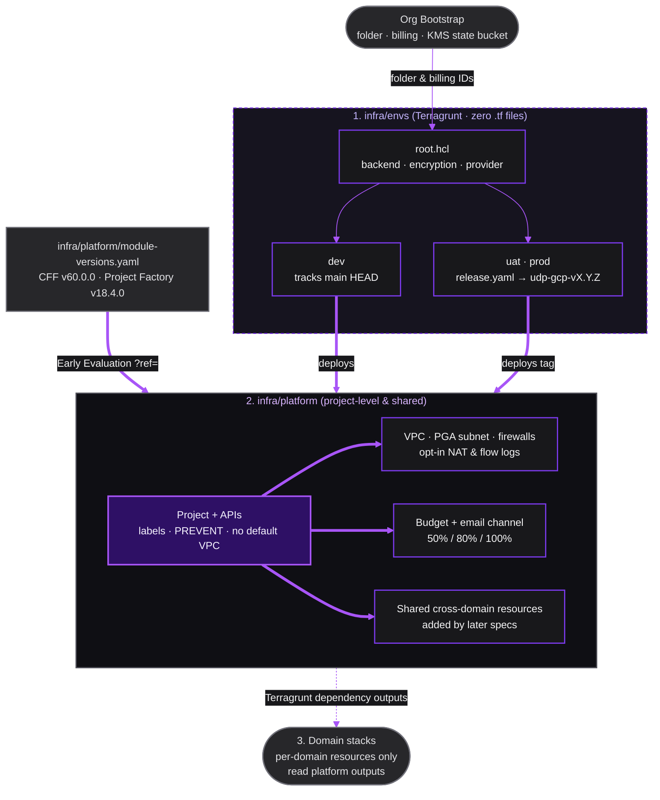

# Spec 01: Platform Module Setup & Ownership Model

| Field | Value |
| :--- | :--- |
| **Status** | `Approved` |
| **Owner** | Xavier Ruiz |
| **Component** | `platform_unified_data_gcp/infra/{platform, envs}` · repository layout for `infra/domains` and `lakehouse/` |
| **Stack** | OpenTofu `>= 1.12.2` · Terragrunt `>= 0.72` · `google ~> 8.10` · CFF `v60.0.0` · Project Factory `v18.4.0` |
| **Archetype / Tier** | Infrastructure-as-Code & GitOps · Full Spec (`7 REQs`, `7 TCs`) |
| **Depends On** | External Org bootstrap [`x-ruiz/platform_gcp_org_bootstrap`](https://github.com/x-ruiz/platform_gcp_org_bootstrap) |
| **Companion Spec** | [Spec 02](./02_github_actions_cicd.md) (Trunk-Based GitOps CI/CD & Tag Promotion) |
| **Consolidates** | Former Spec 01 (local `infra/modules/`, superseded) and former Spec 02 (tag-pinned platform & Terragrunt envs) |

---

## 1. Overview & Design

### TL;DR
Each environment (`dev`, `uat`, `prod`) gets one GCP project built by a single OpenTofu module, `infra/platform/`, which composes tag-pinned public Google Cloud modules read from an atomic `module-versions.yaml`. Thin Terragrunt wrappers in `infra/envs/` deploy it: `dev` tracks `main` HEAD, while `uat` and `prod` pin immutable `udp-gcp-vX.Y.Z` tags. A strict **ownership model** decides where every resource lives: anything project-level or shared across domains belongs to `infra/platform`, and domain stacks hold only per-domain resources.

### Architecture



### Key Design Decisions
- **Upstream modules, not local copies:** `infra/platform/` sources Google's public modules by immutable tag, avoiding the drift of hand-rolled `infra/modules/`.
- **Atomic release unit:** Upstream tags live in `infra/platform/module-versions.yaml` and are read through OpenTofu Early Evaluation, so a `udp-gcp-vX.Y.Z` tag freezes platform HCL and upstream versions together.
- **Ownership model:** Project-level and cross-domain resources live in exactly one place, so adding a domain can never change project-wide settings or race another stack on API enablement.
- **`$0/mo` idle baseline:** Cloud NAT and flow logs are opt-in, and destructive teardown is blocked by `deletion_policy = "PREVENT"`.

### Done Looks Like
- Every gate below passes offline with zero GCP credentials.
- Acceptance cases `TC-001` through `TC-007` are verified.

| Gate | Command | Scope |
| :--- | :--- | :--- |
| Formatting | `tofu fmt -check -recursive` · `terragrunt hcl fmt --check` | `infra/` |
| Render & Schema | `terragrunt render --json` · `tofu validate` · `terragrunt validate` | `platform` & `envs/{dev,uat,prod}` |
| Lint & Security | `tflint --recursive` · `trivy config` (`HIGH,CRITICAL`) | `infra/` |
| Unit Tests | `tofu test` · `terragrunt test` (`mock_provider`) | `tests/platform_composition.tftest.hcl` |

---

## 2. Scope

### In Scope
- One `infra/platform/` module composing 5 tag-pinned upstream modules, with a multi-platform lockfile and offline mocked tests.
- `infra/platform/module-versions.yaml` as the single source of upstream repository URLs and `vX.Y.Z` tags.
- `infra/envs/root.hcl` plus thin `dev`/`uat`/`prod` wrappers with `release.yaml` pins for `uat` and `prod`.
- The resource ownership model (§4.1) and the repository layout and stack map (§4.3) that every later stack must follow.

### Out of Scope (Non-Goals)
- **CI/CD workflow YAML:** PR checks, path-scoped plans/applies, and tag promotion live in [Spec 02](./02_github_actions_cicd.md).
- **Local or vendored modules:** No `infra/modules/`, vendored upstream clones, or version-sync scripts.
- **Floating Git refs:** Never `?ref=main`, `?ref=master`, or unpinned module URLs.
- **Lakehouse resources:** The shared lakehouse platform extension is specified in [Spec 04](./04_lakehouse_platform_extension.md), and per-domain resources start in [Spec 05](./05_domain_bronze_layer.md).

---

## 3. Functional Requirements

Exact parameter names, defaults, and validation patterns live once in **Section 4**.

### Platform Composition

| ID | What | Why | How |
| :--- | :--- | :--- | :--- |
| `REQ-01` | Atomic version manifest | Freezes platform HCL and upstream tags together in every `udp-gcp-vX.Y.Z` release | `module-versions.yaml` loaded via `yamldecode` into `local.cff_version` and `local.project_factory_version`, used as `?ref=${local.*}` |
| `REQ-02` | 5-module platform composition | Standardizes a hardened project, network, and budget per environment | The 5 upstream modules in §4.2, with a random `-xxxx` project suffix, mandatory labels, and `PREVENT` deletion |
| `REQ-03` | Resource ownership model | Keeps project-wide settings in one stack and gives domain stacks a small, safe blast radius | Apply the §4.1 rules; `infra/platform` exposes every output that domain stacks need |

### Environments & Verification

| ID | What | Why | How |
| :--- | :--- | :--- | :--- |
| `REQ-04` | DRY Terragrunt root | Removes duplicated backend, encryption, and provider blocks | `infra/envs/root.hcl` generates `backend.tf`, `encryption.tf`, and `provider.tf`, and exposes `platform_git_source` (§4.6) |
| `REQ-05` | Thin env wrappers & release pins | Isolates `uat`/`prod` from `main` HEAD while `dev` iterates | Zero `.tf` files in `infra/envs/`; `dev` tracks the local module; `uat`/`prod` resolve `release.yaml` (§4.6) |
| `REQ-06` | Input validation & multi-platform lock | Fails fast on bad config and pins providers for macOS and Linux CI | Validation blocks per §4.4; `.terraform.lock.hcl` committed for `darwin_arm64` and `linux_amd64` |
| `REQ-07` | Offline composition tests | Verifies wiring and cost/security invariants without credentials | `tests/platform_composition.tftest.hcl` with `mock_provider` and `expect_failures` |

---

## 4. Contract & Blueprint

### 4.1 Resource Ownership Model

**Decision test:** if a resource would still exist with zero domains, or it affects the whole project, it belongs in `infra/platform`.

| Resource Kind | Owner | Example |
| :--- | :--- | :--- |
| Project, billing link, labels | `infra/platform` | CFF `project` module |
| Every project API (`services`) | `infra/platform` | `storage.googleapis.com` for any stack |
| Project-level IAM & org-policy-style config | `infra/platform` | Project role bindings |
| Network, firewalls, NAT, budget | `infra/platform` | `net-vpc`, `budget` |
| Shared cross-domain resources | `infra/platform` | A catalog or connection used by all domains |
| Resources derived from one domain | Domain stack | A domain's bucket and that bucket's IAM |

| Rule | Detail |
| :--- | :--- |
| No project-level resources in domain stacks | Domain stacks never declare `google_project_service`, `google_project_iam_*`, or shared resources |
| Platform outputs are the interface | Domain stacks read `infra/platform` outputs through a Terragrunt `dependency`, never by hardcoding IDs |
| Release ordering | A platform change a domain stack needs ships in a `udp-gcp` release before the domain release that uses it |

### 4.2 Upstream Modules (`infra/platform/main.tf`)

| Concern | Upstream Module | Tag | Key Behavior |
| :--- | :--- | :--- | :--- |
| **Project & APIs** | CFF `//modules/project` | `v60.0.0` | Under `platform_folder_id`, random `-xxxx`, `auto_create_network = false`, `disable_on_destroy = false`, labels, `PREVENT` |
| **VPC & Subnet** | CFF `//modules/net-vpc` | `v60.0.0` | Custom mode, regional subnet with Private Google Access, opt-in flow logs |
| **Firewalls** | CFF `//modules/net-vpc-firewall` | `v60.0.0` | IAP SSH (`35.235.240.0/20`, TCP `22`) to `iap_ssh_target_tags`, intra-subnet allow, deny-all ingress at `65534` |
| **Cloud NAT** | CFF `//modules/net-cloudnat` | `v60.0.0` | Created only when `enable_cloud_nat = true` |
| **Budget** | Project Factory `//modules/budget` + `google_monitoring_notification_channel` | `v18.4.0` | Monthly USD budget with `[0.5, 0.8, 1.0]` thresholds to `budget_alert_email` |

### 4.3 Repository Layout & Stack Map

```text
platform_unified_data_gcp/
├── infra/
│   ├── platform/                         # Project-level & shared stack (tagged udp-gcp-vX.Y.Z)
│   │   ├── module-versions.yaml          # Upstream repos + vX.Y.Z tags
│   │   ├── versions.tf · variables.tf · main.tf · outputs.tf
│   │   ├── .terraform.lock.hcl           # darwin_arm64 + linux_amd64
│   │   └── tests/platform_composition.tftest.hcl
│   ├── envs/                             # Platform wrappers (zero .tf files)
│   │   ├── root.hcl
│   │   ├── dev/terragrunt.hcl
│   │   ├── uat/{terragrunt.hcl, release.yaml}
│   │   └── prod/{terragrunt.hcl, release.yaml}
│   └── domains/                          # Per-domain stack (tagged udp-domains-vX.Y.Z)
│       ├── stack/                        # Same file set as infra/platform
│       └── envs/                         # Own root.hcl + dev/uat/prod wrappers (zero .tf files)
└── lakehouse/                            # Definitions only, no OpenTofu state
    ├── schemas/                          # Manifest JSON Schemas (e.g., domain.schema.json)
    └── domains/<domain>/                 # domain.yaml, table definitions, Silver/Gold views
```

| Stack | Holds | State Prefix | Release Tag | `release.yaml` Key |
| :--- | :--- | :--- | :--- | :--- |
| `infra/platform` | Project-level & shared resources (§4.1) | `envs/<env>` | `udp-gcp-vX.Y.Z` | `platform_version` |
| `infra/domains` | Per-domain resources from `lakehouse/domains/*/domain.yaml` | `envs/<env>/domains` | `udp-domains-vX.Y.Z` | `domains_version` |

| Lakehouse Pipeline Stage (Spec 03) | Implemented By |
| :--- | :--- |
| Stage 1 · OpenTofu foundations | `infra/platform` (shared catalog, connection, APIs) and `infra/domains` (domain buckets) |
| Stage 2 · Bronze namespaces & tables | `sdk-lakehouse` reading `lakehouse/domains/<domain>/` |
| Stage 3 · Silver & Gold views | View deployer reading `lakehouse/domains/<domain>/` |

Every stack follows the same conventions: a `stack/` (or `platform/`) module with `module-versions.yaml`, a lockfile and mocked tests; Terragrunt wrappers with zero `.tf` files; `dev` tracking the local module; and `uat`/`prod` pinning their own release tag.

### 4.4 Platform Inputs & Validation

| Input | Type | Default | Constraint |
| :--- | :--- | :--- | :--- |
| `environment` | `string` | *required* | `dev`, `uat`, or `prod` |
| `platform_folder_id` | `string` | *required* | `^(folders/)?[0-9]+$` |
| `billing_account_id` | `string` | *required* | `^[A-Z0-9]{6}-[A-Z0-9]{6}-[A-Z0-9]{6}$` |
| `project_id` | `string` | *required* | Base prefix `^[a-z][a-z0-9-]{2,23}[a-z0-9]$`; `-xxxx` appended |
| `project_name` | `string` | *required* | Display name, 4–30 chars |
| `region` | `string` | `"us-central1"` | `^[a-z]+-[a-z]+[0-9]+$` |
| `subnet_cidr` | `string` | *required* | Valid IPv4 CIDR, unique per env |
| `enable_cloud_nat` | `bool` | `false` | Opt-in |
| `enable_flow_logs` | `bool` | `false` | Opt-in |
| `monthly_budget_usd` | `number` | `50` | `> 0` |
| `budget_alert_email` | `string` | *required* | Email format |
| `deletion_policy` | `string` | `"PREVENT"` | `PREVENT`, `DELETE`, or `ABANDON` |
| `platform_name` | `string` | `"unified-data-platform"` | Lowercase label value |
| `cost_center` | `string` | `"engineering-playground"` | Lowercase label value |
| `iap_ssh_target_tags` | `list(string)` | `["allow-iap-ssh"]` | Non-empty |

**Mandatory labels** on every label-supporting resource: `managed_by = "opentofu"`, `platform`, `environment`, `cost_center`. Later stacks may add labels (e.g., `layer`, `domain`) but never drop these.

### 4.5 Platform Outputs

| Output | Value | Consumer |
| :--- | :--- | :--- |
| `project_id` | Env project ID with `-xxxx` | Domain stacks & CI |
| `project_number` | Numeric project number | IAM & budget audits |
| `vpc_id` | Custom VPC ID | Compute and data stacks |
| `subnet_id` | Primary subnet ID | Workloads |
| `nat_enabled` | Whether Cloud NAT exists | Cost audits |
| `budget_id` | Billing budget ID | Cost governance |
| `notification_channel_id` | Email channel ID | Alerting |

### 4.6 Terragrunt Root & Environment Wrappers

| Root Artifact / Env Var | Contract |
| :--- | :--- |
| `backend.tf` | `backend "gcs"` on `UDP_GCP_STATE_BUCKET`, `prefix = "envs/<env>"` |
| `encryption.tf` | Enforced `gcp_kms` + `aes_gcm` state and plan encryption from `UDP_GCP_STATE_KMS_KEY_ID` |
| `provider.tf` | `google` and `google-beta` bound to the region |
| `UDP_GCP_PLATFORM_REPO` | Sets `platform_git_source` in one place for graduation portability |
| `UDP_GCP_OFFLINE_TEST` | Disables remote state and uses the local module for offline checks |
| `UDP_GCP_EPHEMERAL_PLAN_STATE` | Disables remote state for a read-only PR plan before the first apply |

| Setting | `dev` | `uat` | `prod` |
| :--- | :--- | :--- | :--- |
| **Source** | `../../platform//.` | `${platform_git_source}?ref=<release.yaml>` | `${platform_git_source}?ref=<release.yaml>` |
| **`project_id` prefix** | `UDP_GCP_DEV_PROJECT_ID` (`udp-dev`) | `UDP_GCP_UAT_PROJECT_ID` (`udp-uat`) | `UDP_GCP_PROD_PROJECT_ID` (`udp-prod`) |
| **`subnet_cidr`** | `10.10.0.0/20` | `10.20.0.0/20` | `10.30.0.0/20` |
| **`enable_flow_logs`** | `false` | `false` | `true` |
| **`monthly_budget_usd`** | `50` | `100` | `250` |

### 4.7 External Config Payloads

```yaml
# infra/platform/module-versions.yaml (versions must match ^v[0-9]+\.[0-9]+\.[0-9]+$)
modules:
  cloud-foundation-fabric:
    repository: "https://github.com/GoogleCloudPlatform/cloud-foundation-fabric.git"
    version: "v60.0.0"
  terraform-google-project-factory:
    repository: "https://github.com/terraform-google-modules/terraform-google-project-factory.git"
    version: "v18.4.0"
```

```yaml
# infra/envs/{uat,prod}/release.yaml (must match ^(unreleased|udp-gcp-v[0-9]+\.[0-9]+\.[0-9]+)$)
platform_version: "unreleased"
```

---

## 5. Invariants & Failure Modes

### Key Invariants
- **Single owner per resource:** Every project-level or shared resource is declared only in `infra/platform` (§4.1).
- **Immutable pinning:** Upstream versions and `platform_version` always match their regexes; floating branches are forbidden.
- **Environment isolation on one trunk:** Changes to `infra/platform/**` reach `dev` only until a tag is promoted to `uat`/`prod`.
- **No local modules or wrapper code:** Neither `infra/modules/` nor any `.tf` file under `infra/envs/` exists.
- **Fail-closed state encryption:** Remote state is always KMS-encrypted; it is disabled only by `UDP_GCP_OFFLINE_TEST` or `UDP_GCP_EPHEMERAL_PLAN_STATE`.
- **`$0/mo` idle network:** Default inputs create no Cloud NAT and no flow logs.

### Failure Modes

| Condition | Expected Behavior | Guarantee |
| :--- | :--- | :--- |
| Floating or malformed tag in `module-versions.yaml` / `release.yaml` | CI schema check fails before GCP auth | Only immutable tags deploy |
| Missing key in `module-versions.yaml` | Early Evaluation error at `init` | No state mutation |
| `uat`/`prod` plan while `release.yaml` is `"unreleased"` | CI skips the env; a local run fails on `?ref=unreleased` | No accidental provisioning |
| Missing state bucket or KMS key env var | Terragrunt `get_env()` fails | Fails closed before remote state init |
| Domain stack declares an API or project IAM | Review and `TC-007` fail | Ownership model holds |
| Accidental project destroy | `deletion_policy = "PREVENT"` error | Teardown needs an explicit override |

---

## 6. Acceptance & Verification (`TC-*`)

| Case | Scenario | Pass Condition |
| :--- | :--- | :--- |
| `TC-001` (`REQ-04`, `REQ-06`) | Format, validate, lint & scan | `tofu fmt`, `terragrunt hcl fmt`, `tofu validate`, offline `terragrunt validate`, `tflint`, and `trivy config` exit `0`. |
| `TC-002` (`REQ-01`, `REQ-05`) | Wrapper & module hygiene | `infra/modules/` does not exist, `infra/envs/` has zero `.tf` files, and `infra/platform/*.tf` has no hardcoded `?ref=v...` literals. |
| `TC-003` (`REQ-01`, `REQ-05`) | Version & release manifest audit | `module-versions.yaml` and both `release.yaml` files are valid YAML matching their §4.7 regexes. |
| `TC-004` (`REQ-04`, `REQ-05`) | Source & state resolution | `terragrunt render --json` shows the local source with `envs/dev`, tagged sources with `envs/uat` and `envs/prod`, KMS encryption, and both providers. |
| `TC-005` (`REQ-02`, `REQ-06`, `REQ-07`) | Mocked composition test | `tofu test` wires all 5 modules from `module-versions.yaml` and rejects a bad `environment`, CIDR, and non-positive budget. |
| `TC-006` (`REQ-06`) | Lockfile & portability | The lockfile covers `darwin_arm64` and `linux_amd64`; `platform_git_source` is defined only in `root.hcl`. |
| `TC-007` (`REQ-03`) | Ownership boundary | No `google_project_service`, `google_project_iam_*`, or `google_project` resource exists in any stack outside `infra/platform`. |
