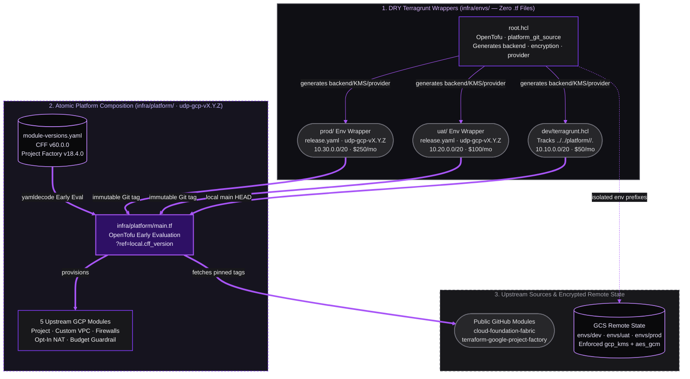

# Spec 02: Tag-Pinned Platform Module & DRY Terragrunt Environments (`dev`/`uat`/`prod`)

| Field | Value |
| :--- | :--- |
| **Status** | `Approved` |
| **Owner** | Xavier Ruiz |
| **Component** | `platform_unified_data_gcp/infra/{platform, envs}` |
| **Stack** | OpenTofu `>= 1.12.2` · Terragrunt `>= 0.72` · CFF `v60.0.0` · Project Factory `v18.4.0` |
| **Archetype / Tier** | Infrastructure-as-Code Contract (Multi-Env Composition & Release Tagging) · Full Spec (`6 REQs`, `6 TCs`) |
| **Depends On** | External Org bootstrap [`x-ruiz/platform_gcp_org_bootstrap`](https://github.com/x-ruiz/platform_gcp_org_bootstrap) |
| **Companion Spec** | [Spec 03](./03_github_actions_cicd.md) (Trunk-Based GitOps CI/CD & Tag Promotion) |
| **Supersedes** | [Spec 01](./01_gcp_core_modules.md) (removes local `infra/modules/` in favor of tag-pinned public GitHub modules) |

---

## 1. Overview & Design

### TL;DR
Maintaining hand-rolled or vendored GCP modules under `infra/modules/` causes drift from Google Cloud best practices, while pointing `uat` and `prod` at a mutable `../../platform//.` path couples production directly to `main` HEAD. This spec replaces `infra/modules/` with a single `infra/platform/` composition using OpenTofu 1.8+ Early Evaluation over an atomic `module-versions.yaml`, wrapped by DRY Terragrunt environments where `dev` tracks `main` HEAD and `uat`/`prod` pin immutable `udp-gcp-vX.Y.Z` Git tags via `release.yaml`.

### Architecture



### Key Design Decisions
- **Atomic upstream manifest via Early Evaluation:** Storing `module-versions.yaml` inside `infra/platform/` and reading it natively via `yamldecode(file(...))` freezes platform HCL and upstream tags together in every `udp-gcp-vX.Y.Z` Git tag without sync scripts or generated `.tf` files.
- **Immutable release promotion for `uat` and `prod`:** `dev` tracks `../../platform//.` (`main` HEAD) for fast iteration while `uat` and `prod` pin explicit `udp-gcp-vX.Y.Z` tags (or `"unreleased"` on Day 0) via 1-line `release.yaml` files.
- **Zero local module boilerplate:** Removing `infra/modules/` in favor of 5 tag-pinned public Google Cloud modules eliminates vendored drift and keeps `infra/platform/` independently validatable.
- **Fail-closed KMS state with explicit read-only escape hatches:** `root.hcl` enforces `gcp_kms` + `aes_gcm` with no plaintext fallback, permitting local bypasses strictly via `UDP_GCP_OFFLINE_TEST` or `UDP_GCP_EPHEMERAL_PLAN_STATE` for pre-first-apply PR plans.

### Done Looks Like
- `infra/modules/` and custom module-version sync scripts do not exist, zero `.tf` files exist under `infra/envs/`, and zero hardcoded `?ref=vX.Y.Z` tags appear in `infra/platform/*.tf`.
- Every static check, Terragrunt render, security scan, and offline mocked composition test in the Verification Gates table passes cleanly, with `$0/month` steady-state default network cost in `dev` and `uat`.
- Acceptance cases `TC-001` through `TC-006` are verified.

| Gate | Command | Scope |
| :--- | :--- | :--- |
| Formatting | `tofu fmt -check -recursive` · `terragrunt hcl fmt --check` | `infra/platform/` & `infra/envs/` |
| Render & Schema | `terragrunt render --json` · `tofu validate` · `terragrunt validate` | `platform` & `envs/{dev,uat,prod}` |
| Lint & Security | `tflint --recursive` · `trivy config` (`HIGH,CRITICAL`) | Full `infra/` tree |
| Unit Tests | `tofu test` · `terragrunt test` (`mock_provider`) | `tests/platform_composition.tftest.hcl` |

---

## 2. Scope

### In Scope
- Remove `platform_unified_data_gcp/infra/modules/` and any custom module-version sync scripts (`sync_module_versions.sh`).
- Maintain `infra/platform/module-versions.yaml` as the single atomic manifest of upstream GitHub module repository URLs and semantic tags (`vX.Y.Z`), evaluated natively via OpenTofu Early Evaluation.
- Consolidate all 5 upstream Google Cloud modules into a single independently validatable `infra/platform/` composition with a multi-platform lockfile (`darwin_arm64` and `linux_amd64`) and offline mocked tests.
- Provide `infra/envs/root.hcl` pinning `tofu`, exposing a graduation-portable `platform_git_source`, supporting `UDP_GCP_OFFLINE_TEST` and `UDP_GCP_EPHEMERAL_PLAN_STATE`, and generating only `backend.tf`, `encryption.tf`, and `provider.tf`.
- Provide thin DRY Terragrunt wrappers in `infra/envs/{dev,uat,prod}/` with zero `.tf` files, tracking `../../platform//.` in `dev` and pinned `release.yaml` tags in `uat` and `prod`.

### Out of Scope (Non-Goals)
- **CI/CD workflow YAML:** GitHub Actions PR checks, path-scoped plans/applies, and tag-promotion pipelines live in [Spec 03](./03_github_actions_cicd.md).
- **Local or vendored modules:** Zero `infra/modules/` directory, vendored upstream clones, or custom version-sync scripts.
- **Floating Git refs:** Never use `?ref=main`, `?ref=master`, or unpinned module URLs in `module-versions.yaml` or `release.yaml`.
- **Duplicated env roots or CLI workspaces:** State isolation is strictly per-environment Terragrunt directory plus GCS prefix.
- **Data-layer services:** GCS medallion buckets, BigQuery, BigLake, Dataproc, Composer, and Pub/Sub remain deferred to future specs and independent domain stacks.

---

## 3. Functional Requirements

Exact parameter names, defaults, and validation patterns live once in **Section 4**.

### Atomic Platform Composition

| ID | What | Why | How |
| :--- | :--- | :--- | :--- |
| `REQ-01` | Atomic version manifest & Early Evaluation | Freezes platform HCL and upstream module tags together in every `udp-gcp-vX.Y.Z` release without sync scripts | Remove `infra/modules/` and sync scripts; declare upstream URLs & `vX.Y.Z` tags once in `infra/platform/module-versions.yaml`; load via `yamldecode` into `local.cff_version` & `local.project_factory_version` for `?ref=${local.*}` |
| `REQ-02` | 5-module platform composition | Standardizes hardened GCP project, VPC, firewall, opt-in NAT, and budget provisioning | Declare all 5 tag-parameterized upstream modules directly in `infra/platform/main.tf` (§4.2) with random `-xxxx` project suffix, mandatory labels, `PREVENT` deletion, PGA subnet, IAP/internal/deny-all firewalls, `$0/mo` default NAT, and `[0.5, 0.8, 1.0]` budget alerts |

### DRY Terragrunt Environments & Verification

| ID | What | Why | How |
| :--- | :--- | :--- | :--- |
| `REQ-03` | DRY Terragrunt root generation | Eliminates duplicated backend, KMS encryption, and provider blocks across environments | `infra/envs/root.hcl` pins `terraform_binary = "tofu"`, exposes `UDP_GCP_PLATFORM_REPO`-parameterized `platform_git_source`, supports `UDP_GCP_OFFLINE_TEST` & `UDP_GCP_EPHEMERAL_PLAN_STATE`, and generates only `backend.tf` (`envs/<env>`), enforced `encryption.tf` (`gcp_kms` + `aes_gcm`), and `provider.tf` (`google` + `google-beta`) |
| `REQ-04` | Thin env wrappers & release pins | Isolates `uat` and `prod` from `main` HEAD while letting `dev` iterate continuously | Zero `.tf` files in `infra/envs/{dev,uat,prod}/`; `include` `root.hcl` (`expose = true`); `dev` tracks `../../platform//.`; `uat`/`prod` resolve `release.yaml` (`"unreleased"` or `udp-gcp-vX.Y.Z`, falling back locally only when `offline_test == true`) with per-env inputs (§4.6) |
| `REQ-05` | Strict input validation & multi-platform lock | Fails fast on invalid env config and pins deterministic provider binaries across macOS & Linux CI | Enforce validation blocks in `infra/platform/variables.tf` (§4.4) and commit `infra/platform/.terraform.lock.hcl` for `darwin_arm64` and `linux_amd64` |
| `REQ-06` | Offline platform composition tests | Verifies multi-env wiring and cost/security invariants without GCP credentials | `infra/platform/tests/platform_composition.tftest.hcl` validates `dev`/`uat`/`prod` wiring, `$0/mo` default NAT, mandatory labels, and `expect_failures` via `mock_provider` (runnable via Terragrunt and `tofu test`) |

---

## 4. Contract & Blueprint

### 4.1 Directory Layout

```text
platform_unified_data_gcp/
├── scripts/
│   ├── detect_affected_envs.sh       # Spec 03 path-scoped CI change detection
│   └── test_detect_affected_envs.sh  # Offline unit tests for change detection
└── infra/
    ├── platform/                     # Single OpenTofu platform module (tagged atomically as udp-gcp-vX.Y.Z)
    │   ├── module-versions.yaml      # Single source of truth for upstream module tags (read via OpenTofu Early Eval)
    │   ├── versions.tf
    │   ├── variables.tf
    │   ├── main.tf                   # Upstream modules using ?ref=${local.cff_version} / ?ref=${local.project_factory_version}
    │   ├── outputs.tf
    │   ├── .terraform.lock.hcl       # Locked for darwin_arm64 + linux_amd64
    │   └── tests/
    │       └── platform_composition.tftest.hcl
    └── envs/                         # Thin DRY Terragrunt wrappers (ZERO .tf files)
        ├── root.hcl                  # Exposes platform_git_source; generates backend.tf, encryption.tf, provider.tf
        ├── dev/
        │   └── terragrunt.hcl        # Tracks ../../platform//. (main HEAD)
        ├── uat/
        │   ├── release.yaml          # Machine-promoted pin: platform_version: "unreleased" | "udp-gcp-vX.Y.Z"
        │   └── terragrunt.hcl        # Fetches tagged platform ref from release.yaml
        └── prod/
            ├── release.yaml          # Machine-promoted pin: platform_version: "unreleased" | "udp-gcp-vX.Y.Z"
            └── terragrunt.hcl        # Fetches tagged platform ref from release.yaml
```

### 4.2 Upstream Module Composition & Root Generation

#### Upstream Modules (`infra/platform/main.tf`)

| Concern | Upstream Module (`manifest key`) | Tag | Key Defaults & Behavior |
| :--- | :--- | :--- | :--- |
| **Project, Billing & APIs** | `cloud-foundation-fabric//modules/project` | `v60.0.0` | Under `platform_folder_id`, random `-xxxx` (`random_id`), `auto_create_network = false`, `disable_on_destroy = false`, mandatory labels, `PREVENT` |
| **Custom VPC & Subnet** | `cloud-foundation-fabric//modules/net-vpc` | `v60.0.0` | `auto_create_subnetworks = false`, regional subnet with Private Google Access, opt-in `enable_flow_logs` (`false`) |
| **Baseline Firewalls** | `cloud-foundation-fabric//modules/net-vpc-firewall` | `v60.0.0` | Allow IAP SSH (`35.235.240.0/20`, TCP `22`) to `iap_ssh_target_tags`, allow intra-subnet internal, explicit deny-all-ingress (`65534`) |
| **Opt-In Cloud NAT** | `cloud-foundation-fabric//modules/net-cloudnat` | `v60.0.0` | Provisioned only when `enable_cloud_nat == true` (`false` default → `$0/mo` baseline) |
| **Budget Guardrail** | `terraform-google-project-factory//modules/budget` + `google_monitoring_notification_channel` | `v18.4.0` | Project-scoped monthly USD budget with `[0.5, 0.8, 1.0]` thresholds routed to `budget_alert_email` |

#### Terragrunt Root Generated Files & Runtime Variables (`infra/envs/root.hcl`)

| Artifact / Env Var | Role & Contract |
| :--- | :--- |
| `backend.tf` | Generates `backend "gcs"` using `UDP_GCP_STATE_BUCKET` and `prefix = "envs/${path_relative_to_include()}"` |
| `encryption.tf` | Generates enforced OpenTofu `gcp_kms` + `aes_gcm` encryption (`enforced = true`, zero plaintext fallback) reading `UDP_GCP_STATE_KMS_KEY_ID` |
| `provider.tf` | Generates `provider "google"` and `provider "google-beta"` bound to the configured region |
| `UDP_GCP_PLATFORM_REPO` | Parameterizes `locals.platform_git_source` in one place for graduation portability |
| `UDP_GCP_OFFLINE_TEST` | Enables offline `validate` / mocked unit tests and local `../../platform//.` source fallback |
| `UDP_GCP_EPHEMERAL_PLAN_STATE` | Enables pre-first-apply read-only PR plan when `default.tfstate` does not yet exist in GCS |

### 4.3 Platform Inputs (`infra/platform/variables.tf`)

| Input | Type | Default | Constraint |
| :--- | :--- | :--- | :--- |
| `environment` | `string` | *required* | Allowed: `dev`, `uat`, `prod` |
| `platform_folder_id` | `string` | *required* | Platform Folder ID from bootstrap (`folders/<id>` or numeric) |
| `billing_account_id` | `string` | *required* | Standard GCP Billing Account format (§4.4) |
| `project_id` | `string` | *required* | Base prefix (4–25 chars, §4.4); `random_id` appends `-xxxx` |
| `project_name` | `string` | *required* | Human-readable GCP project display name (4–30 chars) |
| `region` | `string` | `"us-central1"` | Primary GCP region |
| `subnet_cidr` | `string` | *required* | Valid IPv4 CIDR block (non-overlapping per environment) |
| `enable_cloud_nat` | `bool` | `false` | Opt-in Cloud Router + Cloud NAT toggle |
| `enable_flow_logs` | `bool` | `false` | Opt-in VPC Flow Logs on primary subnet |
| `monthly_budget_usd` | `number` | `50` | Must be `> 0` |
| `budget_alert_email` | `string` | *required* | Valid email address for budget threshold alerts |
| `deletion_policy` | `string` | `"PREVENT"` | Allowed: `PREVENT`, `DELETE`, `ABANDON` |
| `platform_name` | `string` | `"unified-data-platform"` | Applied to mandatory `platform` label |
| `cost_center` | `string` | `"engineering-playground"` | Applied to mandatory `cost_center` label |
| `iap_ssh_target_tags` | `list(string)` | `["allow-iap-ssh"]` | Non-empty network tags permitted SSH TCP `22` from `35.235.240.0/20` |

### 4.4 Validation Patterns & Mandatory Labels

#### Validation Patterns

| Field | Regex |
| :--- | :--- |
| `billing_account_id` | `^[A-Z0-9]{6}-[A-Z0-9]{6}-[A-Z0-9]{6}$` |
| `project_id` | `^[a-z][a-z0-9-]{2,23}[a-z0-9]$` |
| `module-versions.yaml` (`version`) | `^v[0-9]+\.[0-9]+\.[0-9]+$` |
| `release.yaml` (`platform_version`) | `^(unreleased\|udp-gcp-v[0-9]+\.[0-9]+\.[0-9]+)$` |

#### Mandatory Labels

| Label Key | Source |
| :--- | :--- |
| `managed_by` | `"opentofu"` |
| `platform` | `var.platform_name` |
| `environment` | `var.environment` |
| `cost_center` | `var.cost_center` |

### 4.5 Platform Outputs (`infra/platform/outputs.tf`)

| Output | Format / Value | Consumer |
| :--- | :--- | :--- |
| `project_id` | Provisioned environment GCP Project ID (with `-xxxx`) | Downstream domain stacks & CI |
| `project_number` | Provisioned numeric GCP Project number | Downstream IAM & budget audits |
| `vpc_id` | Custom-mode VPC ID | Downstream compute / data stacks |
| `subnet_id` | Primary regional subnet ID | Downstream workloads |
| `nat_enabled` | `bool` indicating whether Cloud NAT was provisioned | Cost & architecture audits |
| `budget_id` | Project-scoped Billing Budget ID | Cost governance audits |
| `notification_channel_id` | Cloud Monitoring email notification channel ID | Alerting audits |

### 4.6 Environment Wrapper Configuration (`infra/envs/*/terragrunt.hcl`)

| Setting | `dev` | `uat` | `prod` |
| :--- | :--- | :--- | :--- |
| **`terraform.source`** | `../../platform//.` (`main` HEAD) | `${platform_git_source}?ref=<release.yaml>` | `${platform_git_source}?ref=<release.yaml>` |
| **GCS State Prefix** | `envs/dev` | `envs/uat` | `envs/prod` |
| **`project_id` Prefix** | `UDP_GCP_DEV_PROJECT_ID` (default `udp-dev`) | `UDP_GCP_UAT_PROJECT_ID` (default `udp-uat`) | `UDP_GCP_PROD_PROJECT_ID` (default `udp-prod`) |
| **`subnet_cidr`** | `10.10.0.0/20` | `10.20.0.0/20` | `10.30.0.0/20` |
| **`enable_cloud_nat`** | `false` | `false` | `false` (opt-in) |
| **`enable_flow_logs`** | `false` | `false` | `true` |
| **`monthly_budget_usd`** | `50` | `100` | `250` |

### 4.7 External Config Payloads

```yaml
# infra/platform/module-versions.yaml
modules:
  cloud-foundation-fabric:
    repository: "https://github.com/GoogleCloudPlatform/cloud-foundation-fabric.git"
    version: "v60.0.0"
  terraform-google-project-factory:
    repository: "https://github.com/terraform-google-modules/terraform-google-project-factory.git"
    version: "v18.4.0"
```

```yaml
# infra/envs/{uat,prod}/release.yaml
platform_version: "unreleased"   # or "udp-gcp-vX.Y.Z"
```

---

## 5. Invariants & Failure Modes

### Key Invariants
- **Atomic platform & upstream release units:** Upstream module tags appear only in `infra/platform/module-versions.yaml`, read directly inside `infra/platform/main.tf` via OpenTofu 1.8+ Early Evaluation, so cutting a `udp-gcp-vX.Y.Z` tag freezes platform HCL and upstream versions together.
- **Environment isolation on single trunk (`main`):** Changes to `infra/platform/**` (including upstream module bumps) affect `dev` only; `uat` and `prod` remain pinned to their respective `release.yaml` tags until promoted.
- **Zero local module duplication:** Neither `infra/modules/` nor any `.tf` files under `infra/envs/` exist.
- **Immutable pinning everywhere:** Every upstream `version` matches `^v[0-9]+\.[0-9]+\.[0-9]+$` and every `platform_version` matches `^(unreleased|udp-gcp-v[0-9]+\.[0-9]+\.[0-9]+)$`; floating branches (`main`/`master`) are forbidden.
- **OpenTofu-backed Terragrunt & fail-closed encryption:** `terraform_binary = "tofu"` generates enforced `gcp_kms` + `aes_gcm` state encryption; disabling remote backend/encryption is permitted only via `UDP_GCP_OFFLINE_TEST=true` or `UDP_GCP_EPHEMERAL_PLAN_STATE=true` (pre-first-apply read-only PR plan).
- **Default `$0/mo` network footprint (`dev` & `uat`):** `enable_cloud_nat = false` and `enable_flow_logs = false` provision zero billable idle network resources.

### Failure Modes

| Condition | Expected Behavior | Guarantee |
| :--- | :--- | :--- |
| Malformed or floating tag (`main`/`master`) in `module-versions.yaml` or `release.yaml` | Schema check fails in CI before any GCP auth | Enforces immutable semantic tags (`vX.Y.Z` / `udp-gcp-vX.Y.Z`) |
| Missing key in `infra/platform/module-versions.yaml` | OpenTofu early-evaluation error during `init` | Fails fast with zero GCP or state mutation |
| Running `terragrunt plan/apply` on `uat`/`prod` while `release.yaml` is `"unreleased"` | CI skips unreleased env cleanly; local run fails resolving `?ref=unreleased` | Prevents accidental provisioning prior to first `dev-to-uat` promotion |
| Non-existent Git tag written into `release.yaml` | `terragrunt init` Git checkout fails during PR check | Caught before merge to `main` |
| Upstream module requires newer `google` / `google-beta` provider | `tofu validate` / `terragrunt init` error | Prompts provider constraint alignment & re-locking `.terraform.lock.hcl` |
| Missing `UDP_GCP_STATE_BUCKET` or `UDP_GCP_STATE_KMS_KEY_ID` during plan/apply | Terragrunt `get_env()` failure | Fails closed before OpenTofu initializes remote state |
| Accidental `terragrunt destroy` on any environment | `deletion_policy = "PREVENT"` error | Requires explicit override to `"DELETE"` for deliberate teardown |

---

## 6. Acceptance & Verification (`TC-*`)

| Case | Scenario | Pass Condition |
| :--- | :--- | :--- |
| `TC-001` (`REQ-03`, `REQ-05`) | OpenTofu & Terragrunt formatting and validation | `tofu fmt -check -recursive`, `terragrunt hcl fmt --check`, `tofu validate` (`infra/platform`), `terragrunt validate` (`envs/dev` offline), `tflint`, and `trivy config` exit `0`. |
| `TC-002` (`REQ-01`, `REQ-04`) | Zero local modules, sync scripts & DRY wrapper hygiene | `infra/modules/` and `sync_module_versions.sh` do not exist; zero `.tf` files exist under `infra/envs/`; zero hardcoded `?ref=v...` literals exist in `infra/platform/*.tf` (all use `?ref=${local.*}`). |
| `TC-003` (`REQ-01`, `REQ-04`) | Upstream & release manifest schema audit | Valid YAML in `module-versions.yaml` and `envs/{uat,prod}/release.yaml`; upstream versions match `^v[0-9]+\.[0-9]+\.[0-9]+$` and `platform_version` matches `^(unreleased\|udp-gcp-v[0-9]+\.[0-9]+\.[0-9]+)$`. |
| `TC-004` (`REQ-03`, `REQ-04`) | Terragrunt root & source resolution (`dev`/`uat`/`prod`) | `terragrunt render --json` renders `../../platform//.` with `envs/dev` for `dev`, and `${platform_git_source}?ref=<platform_version>` with `envs/uat` & `envs/prod` for `uat`/`prod`, plus `gcp_kms` encryption and `google`/`google-beta` providers. |
| `TC-005` (`REQ-02`, `REQ-05`, `REQ-06`) | Mocked platform composition test | `terragrunt test` on `infra/envs/dev` and `tofu test` on `infra/platform` wire all 5 upstream modules via Early Evaluation from `module-versions.yaml` and enforce `dev \| uat \| prod` enum, CIDR, and positive budget (`expect_failures`). |
| `TC-006` (`REQ-03`, `REQ-05`) | Multi-platform provider lock & graduation portability | `infra/platform/.terraform.lock.hcl` includes `darwin_arm64` + `linux_amd64` hashes; `platform_git_source` is parameterized in one place (`root.hcl`). |
