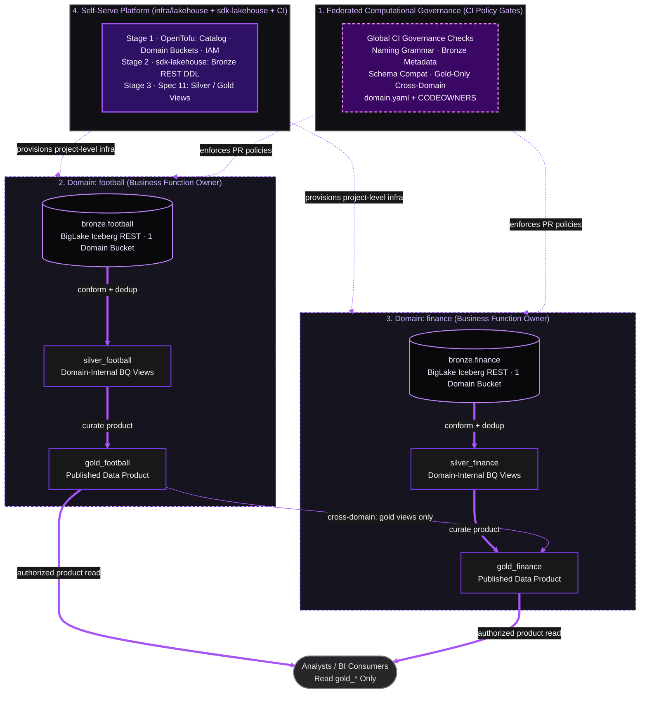

# Spec 03: GCP Data Lakehouse Reference Architecture

| Field | Value |
| :--- | :--- |
| **Status** | `Approved` |
| **Owner** | Xavier Ruiz |
| **Component** | `platform_unified_data_gcp/infra/lakehouse` · `platform_unified_data_gcp/lakehouse/` |
| **Stack** | OpenTofu · Terragrunt · BigLake Iceberg REST Catalog · `sdk-lakehouse` · BigQuery · Cloud Run · Pub/Sub |
| **Archetype / Tier** | Data Pipeline + Infrastructure as Code (IaC) & GitOps · Full Spec (Parent of Mini-Specs `04`–`11`, `13 REQs`, `14 TCs`) |
| **Depends On** | [`x-ruiz/platform_gcp_org_bootstrap`](https://github.com/x-ruiz/platform_gcp_org_bootstrap), [Spec 01](./01_platform_module_setup.md), [Spec 02](./02_github_actions_cicd.md) |
| **Related** | `playground-data-engineering/maven_projects/sdk_lakehouse/specs/05_iceberg_gcp_biglake_plugin.md` (`gcp_biglake` SPI) |

---

## 1. Overview & Design

### TL;DR
Org bootstrap and Specs 02–03 deliver per-environment Google Cloud Platform (GCP) projects, networking, budgets, and GitOps promotion, but no data layer. This architecture spec defines a **Data Mesh on a view-first Extract, Load, Transform (ELT) lakehouse**: each business-function domain owns one dedicated Google Cloud Storage (GCS) bucket (`raw/`, `quarantine/`, and `iceberg/` prefixes) and publishes curated `gold_<domain>` products, while a 3-stage self-serve platform (`infra/lakehouse` OpenTofu → `sdk-lakehouse` BigLake Representational State Transfer (REST) Data Definition Language (DDL) → BigQuery Silver/Gold views) enforces global Continuous Integration (CI) policies and keeps idle compute at `$0/mo`.

### Architecture

#### Data Mesh Topology



#### Data Flow Within One Domain

```mermaid
%%{init: {"theme": "base", "themeCSS": "svg { background-color: #09090B !important; border-radius: 8px; }", "themeVariables": {"darkMode": true, "background": "#09090B", "mainBkg": "#18181B", "textColor": "#F4F4F5", "primaryColor": "#18181B", "primaryTextColor": "#F4F4F5", "primaryBorderColor": "#7C3AED", "lineColor": "#A855F7", "secondaryColor": "#16141F", "tertiaryColor": "#0F0F14", "edgeLabelBackground": "#18181B", "clusterBkg": "#0F0F14", "clusterBorder": "#52525B", "titleColor": "#D8B4FE", "fontFamily": "Inter, ui-sans-serif, system-ui, -apple-system, sans-serif", "fontSize": "13px"}, "flowchart": {"curve": "basis", "nodeSpacing": 42, "rankSpacing": 56, "padding": 14}}}%%
flowchart LR
    subgraph IngestZone["1. Domain Ingestion (Batch Default · Opt-In Stream)"]
        SRC(["Batch Sources\nAPIs · Files"])
        CRJ["Cloud Run Job\nsa-ingest-<domain>\nZero Idle Compute"]
        EVT(["Streaming Events\nReal-Time Producers"])
        PS(["Pub/Sub Topic\nSchema Validation + DLQ"])
    end

    subgraph DomainBucket["2. Single Domain GCS Bucket: udp-<env>-<domain>-<suffix>"]
        RAW[("raw/ & quarantine/ Prefixes\nImmutable Replay · Prefix Lifecycle")]
        BRZ[("iceberg/ Prefix · bronze.<domain>.<entity>\nBigLake Iceberg REST Catalog\nCatalog: OpenTofu · Tables: sdk-lakehouse")]
    end

    subgraph ServeZone["3. View-First BigQuery Serving Layer"]
        SIL["silver_<domain>.<entity>\nBQ View: Conform & Dedup\nLatest _ingested_at per _event_key"]
        CUR["gold_<domain>.<kind>__<entity>__*\nCurated Data Product View\nAuthorized External Interface"]
    end

    SRC ==>|"raw payload"| CRJ
    CRJ <-->|"write raw & quarantine / replay"| RAW
    CRJ ==>|"append + metadata cols"| BRZ
    EVT -.->|"publish event"| PS
    PS -.->|"opt-in enable_streaming"| BRZ
    BRZ ==>|"pruned Iceberg read"| SIL
    SIL ==>|"domain-internal read"| CUR

    classDef core fill:#2E1065,stroke:#A855F7,stroke-width:2px,color:#F5F3FF
    classDef service fill:#18181B,stroke:#7C3AED,stroke-width:1.5px,color:#F4F4F5
    classDef store fill:#09090B,stroke:#C084FC,stroke-width:1.5px,color:#EDE9FE
    classDef external fill:#27272A,stroke:#71717A,stroke-width:1.5px,color:#E4E4E7
    classDef async fill:#1E1B2E,stroke:#6B7280,stroke-width:1.25px,stroke-dasharray:4 3,color:#D4D4D8

    class SRC,EVT external
    class CRJ,SIL service
    class PS async
    class RAW,BRZ store
    class CUR core

    style IngestZone fill:#16141F,stroke:#6D28D9,stroke-width:1.25px,stroke-dasharray:4 3,color:#C4B5FD
    style DomainBucket fill:#0F0F14,stroke:#52525B,stroke-width:1.5px,color:#D8B4FE
    style ServeZone fill:#0F0F14,stroke:#52525B,stroke-width:1.5px,color:#D8B4FE
```



### Key Design Decisions (Architecture Decision Register)

| ID | Decision | Rationale & Scope | Verify In |
| :--- | :--- | :--- | :--- |
| `ADR-01` | Data Mesh by business-function domain: 1 dedicated GCS bucket per domain (`raw/`, `quarantine/`, `iceberg/`) and strictly project-level Identity and Access Management (IAM) inside each env project | Clean domain isolation, billing attribution, and IAM without org/folder IAM sprawl or a separate shared landing bucket; project-per-domain deferred | `04`, `05`, `06` |
| `ADR-02` | Separate `infra/lakehouse` stack with its own state prefix and `udp-lakehouse-v*` tag namespace | Isolates data-bearing infra from `infra/platform` blast radius | `04`, `05` |
| `ADR-03` | View-first Silver & Gold in BigQuery on Day 1; `REQ-10` materialization escape hatch | `$0` idle compute and fast iteration; multi-engine physical Iceberg Silver/Gold deferred | `10` |
| `ADR-04` | 3-stage pipeline: OpenTofu (catalog/infra) → `sdk-lakehouse` (namespaces/tables via BigLake REST) → View deploy (Mini-Spec `10`) | Zero circular dependency; `sdk-lakehouse` never owns catalog lifecycle; logical catalog `bronze` stays env-agnostic | `04`, `07`, `10` |
| `ADR-05` | Open BigLake Iceberg REST Catalog (`CATALOG_TYPE_BIGLAKE`, multi-bucket, vended credentials) for Bronze; streaming opt-in via `enable_streaming` | Keeps Bronze aligned with open Apache Iceberg REST so future platforms (e.g., `platform_unified_data_aws`) swap only IaC and `sdk-lakehouse` Service Provider Interface (SPI) config rather than redesigning Bronze | `04`, `07`, `09` |
| `ADR-06` | Defer raw passthrough (`raw__`) views from gold | Preserves analyst isolation and avoids exposing unmasked raw/Personally Identifiable Information (PII) bronze columns before policy tags exist | Future |
| `ADR-07` | Spike required before build: BigQuery authorized views over BigLake REST tables, namespace-scoped catalog IAM, and streaming writer delivery (Pub/Sub → Iceberg vs. Cloud Run writer) | Depends on current GCP BigLake and Pub/Sub feature parity | `06`, `07`, `09` |

### Done Looks Like
- Onboarding a new domain requires only adding `lakehouse/domains/<domain>/` (with `domain.yaml`) and a `CODEOWNERS` entry so the platform provisions its dedicated bucket and project-level resources automatically.
- With `enable_streaming = false`, an environment runs zero always-on compute and stays within the Spec 01 budgets (`$50` / `$100` / `$250`).
- The reference domain (`football`) flows source → `raw/` → `iceberg/` (`bronze.football`) → `silver_football` → `gold_football` in `dev` across the 3-stage deployment pipeline with full name and lineage traceability.
- Acceptance cases `TC-001` through `TC-014` pass across Mini-Specs `04`–`11`.

### Acronyms

| Acronym | Definition |
| :--- | :--- |
| `ADR` | Architecture Decision Record |
| `API` | Application Programming Interface |
| `AWS` | Amazon Web Services |
| `BI` | Business Intelligence |
| `BQ` | BigQuery |
| `CCPA` | California Consumer Privacy Act |
| `CFF` | Cloud Foundation Fabric (Google Cloud OpenTofu/Terraform module library) |
| `CI/CD` | Continuous Integration / Continuous Delivery |
| `CMEK` | Customer-Managed Encryption Key |
| `DDL` | Data Definition Language |
| `DLQ` | Dead-Letter Queue |
| `DQ` | Data Quality |
| `ELT` | Extract, Load, Transform |
| `GCP` | Google Cloud Platform |
| `GCS` | Google Cloud Storage |
| `GDPR` | General Data Protection Regulation |
| `HCL` | HashiCorp Configuration Language |
| `IAM` | Identity and Access Management |
| `IaC` | Infrastructure as Code |
| `JSON` | JavaScript Object Notation |
| `PAP` | Public Access Prevention (GCS control blocking public access) |
| `PII` | Personally Identifiable Information |
| `PR` | Pull Request |
| `Protobuf` | Protocol Buffers |
| `Pub/Sub` | Publish/Subscribe (Google Cloud asynchronous messaging service) |
| `REQ` | Functional Requirement |
| `REST` | Representational State Transfer |
| `SA` | Service Account |
| `SDK` | Software Development Kit |
| `SPI` | Service Provider Interface |
| `SQL` | Structured Query Language |
| `TC` | Test Case |
| `UBLA` | Uniform Bucket-Level Access (GCS control disabling legacy object Access Control Lists) |
| `UDP` | Unified Data Platform |
| `UI` | User Interface |
| `URI` | Uniform Resource Identifier |
| `UTC` | Coordinated Universal Time |
| `VPC` / `VPC-SC` | Virtual Private Cloud / Virtual Private Cloud Service Controls |
| `WIF` | Workload Identity Federation |
| `YAML` | YAML Ain't Markup Language |
| `dev` / `uat` / `prod` | Development / User Acceptance Testing / Production environments |
| `dim` / `fct` / `agg` / `rpt` | Dimension / Fact / Aggregate / Report Gold view kinds |

---

## 2. Scope

### In Scope
- Define the Data Mesh operating model covering domain ownership, gold-as-data-product, self-serve platform provisioning, and federated CI governance (§4.1).
- Establish an isolated `infra/lakehouse/` Terragrunt stack per environment (`envs/<env>/lakehouse` state, `udp-lakehouse-vX.Y.Z` tags) consuming `infra/platform` outputs with strictly project-level IAM.
- Lock the 3-stage deployment boundary separating OpenTofu durable foundations (Stage 1), `sdk-lakehouse` namespace/table REST DDL (Stage 2), and Silver/Gold view deployment referencing shared table definitions (Stage 3, finalized in Mini-Spec `10`).
- Standardize a multi-bucket BigLake Iceberg REST Catalog (`CATALOG_TYPE_BIGLAKE`) for Bronze with one dedicated GCS bucket per domain (`raw/`, `quarantine/`, `iceberg/`), batch ingestion enabled by default, and Pub/Sub streaming opt-in via `enable_streaming`.
- Specify cross-cutting contracts for naming, collision-free lineage, schema compatibility, runtime Data Quality (DQ) and alerting, selective materialization, and the Mini-Spec `04`–`11` roadmap (§4.7).

### Out of Scope (Non-Goals)
- **Org- or folder-level IAM changes:** Org and folder foundations belong exclusively in `x-ruiz/platform_gcp_org_bootstrap`; all lakehouse principals and bindings live at the environment project level.
- **Separate shared landing bucket:** Raw payloads and quarantined records reside inside each domain's dedicated bucket under `raw/` and `quarantine/` prefixes—no cross-domain landing bucket is created.
- **Catalog lifecycle in `sdk-lakehouse`:** The Software Development Kit (SDK) never creates, alters, or deletes catalogs—it manages only namespaces and tables via BigLake REST endpoints.
- **Raw passthrough (`raw__`) views in gold:** Analyst access to raw bronze (with PII controls/masking) is deferred to a future spec (`ADR-06`).
- **Non-BigQuery engines or physical Silver/Gold on Day 1:** Multi-engine physical Iceberg Silver/Gold (Spark/Trino/DuckDB readers), Spark/Dataflow pipelines, and Cloud Composer are deferred beyond the in-BigQuery `REQ-10` materialization escape hatch.
- **Per-domain GCP projects on Day 1:** Domains isolate via dedicated domain bucket, Bronze namespace, Silver/Gold datasets, and project-level IAM inside each environment project.
- **Advanced governance & shared marts:** Customer-Managed Encryption Keys (CMEK), Virtual Private Cloud Service Controls (VPC-SC), Dataplex catalog/lineage User Interface (UI), column-level policy tags and PII masking, automated General Data Protection Regulation (GDPR) / California Consumer Privacy Act (CCPA) purge workflows, and cross-domain shared marts (`gold_shared`) are deferred to future specs.

---

## 3. Functional Requirements

Exact storage patterns, metadata schemas, naming rules, IAM scopes, and CI policy gates live once in **Section 4**.

### Platform Stack & Domain Onboarding

| ID | What | Why | How |
| :--- | :--- | :--- | :--- |
| `REQ-01` | Separate `infra/lakehouse/` stack | Isolates data-bearing infra and state from `infra/platform` blast radius | Consumes `project_id`, `project_number`, `region`, and `subnet_id` from `infra/platform` outputs; follows Spec 02 promotion (`dev` tracks `main`; `uat`/`prod` pin `udp-lakehouse-vX.Y.Z`) |
| `REQ-02` | Self-serve domain onboarding | Lets business domains onboard with zero domain-written HashiCorp Configuration Language (HCL) | Each domain declares `lakehouse/domains/<domain>/domain.yaml` (§4.1) + `CODEOWNERS`; Stage 1 provisions its dedicated GCS bucket (`udp-<env>-<domain>-<suffix>`), `silver_<domain>`, `gold_<domain>`, `sa-ingest-<domain>`, and owner-group IAM |

### Ingestion & Open Iceberg REST Bronze

| ID | What | Why | How |
| :--- | :--- | :--- | :--- |
| `REQ-03` | Immutable per-domain `raw/` prefix | Guarantees deterministic replay and backfill without maintaining a separate cross-domain landing bucket | Batch sources land raw payloads under `gs://udp-<env>-<domain>-<suffix>/raw/<source>/ingest_date=YYYY-MM-DD/<run_id>/`; objects stay immutable within `raw_retention_days` |
| `REQ-04` | Multi-bucket BigLake Iceberg REST Bronze | Preserves open Apache Iceberg REST portability across clouds while isolating each domain's storage | Stage 1 provisions one BigLake Iceberg REST catalog (`bronze`, `CATALOG_TYPE_BIGLAKE`, backed by an immutable catalog root bucket), one hardened bucket per domain, and a BigQuery connection; Stage 2 (`sdk-lakehouse` `gcp_biglake`) creates namespace `bronze.<domain>` at `<domain-bucket>/iceberg/` and tables from `table.yaml`/`table.proto`; `enable_streaming = true` adds Pub/Sub + schema + Dead-Letter Queue (DLQ) (`ADR-05`/`ADR-07`), while `false` provisions zero streaming resources |
| `REQ-05` | Ingestion-time hygiene & quarantine | Prevents silent data loss and keeps ingestion free of business logic | Every bronze row carries mandatory §4.3 metadata columns; schema failures route to `<domain-bucket>/quarantine/<source>/ingest_date=YYYY-MM-DD/<run_id>/` (batch) or Pub/Sub DLQ (streaming) |

### View-First Serving, 3-Stage Deployment & Performance

| ID | What | Why | How |
| :--- | :--- | :--- | :--- |
| `REQ-06` | Domain-internal Silver views | Standardizes typing, conformation, and deduplication with zero idle compute | Each bronze entity has one `silver_<domain>.<entity>` BigQuery view deduplicating on `_event_key` (latest `_ingested_at`), unreadable outside its domain |
| `REQ-07` | Gold views as published data products | Enforces strict domain sovereignty and authorized cross-domain contracts | `gold_<domain>` is the sole published interface; reads only own domain's silver or other domains' `gold_*` views (never bronze directly or another domain's silver), authorized against upstream sources |
| `REQ-08` | 3-stage definitions as code | Eliminates drift and circular dependencies across infra, tables, and views | `table.yaml`/`table.proto` and Silver/Gold views live under `lakehouse/domains/<domain>/`, reviewed via `CODEOWNERS`, deployed by CI in strict order Stage 1 → Stage 2 → Stage 3 (tool finalized in Mini-Spec `10`); manual DDL forbidden in `uat`/`prod` |
| `REQ-09` | Pruning-friendly Bronze layout | Keeps view-first BigQuery scans fast and low-cost | Bronze Iceberg tables declare partitioning (default `day(_ingested_at)`, overridable per table) and sort order on `_event_key` in Iceberg table metadata |
| `REQ-10` | Selective materialization escape hatch | Controls scan cost and latency on hot views without breaking consumers | Silver dedup or curated gold views exceeding measured cost/latency thresholds materialize incrementally into BigQuery-managed Iceberg tables via `lakehouse/materializations.yaml`, preserving exact names and labels |

### Access Control, Observability & Federated Governance

| ID | What | Why | How |
| :--- | :--- | :--- | :--- |
| `REQ-11` | Project-level least-privilege IAM | Enforces domain isolation without org/folder IAM sprawl | All principals and bindings (§4.5) scope strictly inside each env GCP project: ingest writes own domain bucket/namespace only, CI owns DDL without catalog create/delete, domain owners read own domain, analysts read `gold_*` only |
| `REQ-12` | Iceberg maintenance, DQ & alerting | Protects table health and routes domain failures to the right owners | Scheduled Iceberg table maintenance (snapshot expiry, compaction, safe orphan retention `>= 72h`) plus runtime DQ (freshness, Silver `_event_key` uniqueness, non-null keys), ingest failures, and DLQ backlogs alert the Spec 01 channel with `domain` label |
| `REQ-13` | Federated computational governance | Blocks policy violations automatically on every Pull Request (PR) before merge | Automated CI checks enforce naming/label limits, `domain.yaml` + `CODEOWNERS`, bronze metadata/backward-compatible schemas, layer isolation, and BigQuery dry-run source parity (§4.6) |

---

## 4. Contract & Blueprint

### 4.1 Data Mesh Ownership & Domain Manifest

| Mesh Principle | Implementation | Owned By |
| :--- | :--- | :--- |
| Domain ownership | One business function = one folder, one dedicated GCS bucket, bronze namespace, `silver_`/`gold_` datasets, and project-level ingest Service Account (SA) | Domain owner group |
| Data as a product | `gold_<domain>` curated views described by `domain.yaml` and view sidecars | Domain owner group |
| Self-serve platform | Stage 1 OpenTofu (`infra/lakehouse`) → Stage 2 `sdk-lakehouse` (REST DDL) → Stage 3 view deploy (Spec `10`) | Platform owner |
| Federated computational governance | Global policies (`REQ-13`) run as automated CI checks on every PR | Platform defines; domains comply |

```yaml
# lakehouse/domains/football/domain.yaml (authoritative schema in Spec 04 §4.2)
schema_version: 1
domain: football
business_function: "Sports performance analytics"
owner_group: football-data-owners@<org-domain>
description: "Premier League matches, teams and player stats"
storage:
  raw_retention_days: 30
ingestion:
  enable_streaming: false
```

### 4.2 Storage, Catalog & Dataset Inventory (Per Env Project, Same Region)

| Layer | Resource & Name Pattern | Stage 1 (OpenTofu) | Contents Managed By |
| :--- | :--- | :--- | :--- |
| Bronze Catalog Root | GCS root bucket (`udp-<env>-bronze-catalog-<suffix>`, `$0` empty) + BigLake Iceberg REST catalog `bronze` (`CATALOG_TYPE_BIGLAKE`) + BQ connection | Provisioned via OpenTofu + Cloud Foundation Fabric (CFF) | Platform (immutable `default_location` & vended-credential catalog metadata) |
| Domain Storage (Raw & Bronze) | 1 dedicated GCS bucket per domain (`udp-<env>-<domain>-<suffix>`) with `raw/`, `quarantine/`, and `iceberg/` prefixes | Provisioned via CFF (`domains` / `domain.yaml`) | `sa-ingest-<domain>` (`raw/`, `quarantine/`) & Stage 2 `sdk-lakehouse` (`bronze.<domain>` tables under `iceberg/`) |
| Silver / Gold | BigQuery datasets `silver_<domain>` & `gold_<domain>` | Provisioned from `domain.yaml` | Stage 3: View deployer referencing domain `table.yaml`/`table.proto` + Structured Query Language (SQL) (Mini-Spec `10`) |

#### Cross-Cutting Storage Controls

| Control | Requirement |
| :--- | :--- |
| Bucket hardening | Uniform Bucket-Level Access (UBLA) enabled, Public Access Prevention (PAP) enforced, object versioning, and 7-day soft delete enabled on all buckets |
| Prefix-scoped lifecycle | Applied strictly to `raw/` and `quarantine/` prefixes: Nearline transition after `30d` (where retention `> 30d`) and expiry at `raw_retention_days` (`dev` `30`, `uat` `90`, `prod` `365`); zero GCS expiry on `iceberg/` |
| Mandatory labels | All Spec 01 baseline labels plus `layer` and `domain` on every lakehouse resource |

### 4.3 Bronze Row Contract (Mandatory Metadata Columns)

| Column | Type | Rule |
| :--- | :--- | :--- |
| `_ingested_at` | `timestamp` (UTC) | Set by writer at commit; default partition source (`day(_ingested_at)`) |
| `_source` | `string` | `<domain>.<source>` identifying upstream feed |
| `_batch_id` | `string` | Cloud Run execution ID or Pub/Sub message ID |
| `_source_uri` | `string` (nullable) | Raw object Uniform Resource Identifier (URI) under `<domain-bucket>/raw/...` (batch only), used for replay lineage |
| `_event_key` | `string` | Declared business key for silver deduplication & sort order |

### 4.4 Naming & Lineage Convention

All object names use `snake_case`; `__` is reserved as the token separator, and `<entity>` anchors cross-layer traceability.

| Object | Pattern | Example |
| :--- | :--- | :--- |
| Domain GCS bucket | `udp-<env>-<domain>-<suffix>` | `udp-dev-football-a1b2` |
| Bronze table (BigLake Iceberg REST) | `bronze.<domain>.<entity>` | `bronze.football.matches` |
| Silver view (1:1 per entity) | `silver_<domain>.<entity>` | `silver_football.matches` |
| Curated gold view | `gold_<domain>.<kind>__<entity>__<qualifier>` (`kind` ∈ `dim`, `fct`, `agg`, `rpt`) | `gold_football.agg__matches__team_season_standings` |

#### View Sidecar & Lineage Labels

| Artifact / Label | Requirement |
| :--- | :--- |
| View YAML sidecar | Required for every silver and gold view: `description`, `grain`, `owner`, and `sources` |
| Standard deploy labels | `domain`, `layer`, and `view_kind` applied to every deployed view |
| Collision-free lineage label | `src_<source_domain>__<entity> = "true"` validated against BigQuery limits (`<= 64` labels, `<= 63`-char keys) |
| Discovery interface | Traceable by name (`*__<entity>__*`) or via `INFORMATION_SCHEMA.TABLE_OPTIONS` |

### 4.5 Project-Level IAM & Security Principal Matrix

All service accounts and bindings below are provisioned **strictly at the environment GCP project level** (zero folder or org IAM required beyond `platform_gcp_org_bootstrap`).

| Principal | Auth / Condition | Project-Level Scope | Access |
| :--- | :--- | :--- | :--- |
| `sa-ingest-<domain>` | Cloud Run job identity | Own domain bucket (`raw/`, `quarantine/`) & `bronze.<domain>` tables | Write raw/quarantine; append Bronze rows; no DDL |
| Pub/Sub / streaming writer SA | Project service agent / writer SA | `bronze` streaming tables (opt-in) | Append table data only |
| `sa-lakehouse-ddl` | GitHub Actions Workload Identity Federation (WIF) (`main` for apply) | `bronze` namespaces/tables; `silver_*` & `gold_*` views | Namespace/table/view DDL; **no** catalog create/delete |
| BigLake catalog SA | Google-managed (project-scoped) | Catalog root + domain buckets | `roles/storage.objectUser` for downscoped vended credentials |
| BigQuery connection SA | Google-managed (project-scoped) | Catalog root + domain buckets | `roles/storage.objectViewer` read-only Iceberg access |
| `<domain>-data-owners` group | Google Group | Own domain's bucket, bronze, silver, gold | Read; PR approval via `CODEOWNERS` |
| `analysts` group / other domains | Google Group / authorized views | `gold_*` datasets only | Read curated data products only |

### 4.6 Federated Governance CI Policy Gates (`REQ-13`)

| Policy Gate | Scope | Reject Condition |
| :--- | :--- | :--- |
| Naming & BQ label limits | All domains & views | Violates §4.4 grammar, exceeds `64` labels, or exceeds `63`-char label keys |
| Ownership registration | `lakehouse/domains/<domain>/` | Missing `domain.yaml` or matching `CODEOWNERS` entry |
| Bronze schema & compat | `table.yaml` / `table.proto` | Missing §4.3 metadata columns or unapproved breaking change (column drop / type narrowing) |
| Layer & domain isolation | Silver & Gold SQL | Gold view reads bronze directly, or any cross-domain read of silver/bronze |
| Lineage parity | View sidecars vs BQ dry-run | Declared `sources` differ from tables reported by BigQuery dry-run |

### 4.7 Mini-Spec Roadmap

| Spec | Title | Delivers |
| :--- | :--- | :--- |
| `04` | Domain manifest, Bronze storage & BigLake catalog | Cloud-agnostic `domain.yaml` v1 JSON Schema + `football` seed, `infra/lakehouse` Terragrunt stack (`envs/root.hcl` parsing `domain.yaml`), catalog root bucket, per-domain Bronze GCS buckets (`raw/`, `quarantine/`, `iceberg/`), OpenTofu BigLake Iceberg REST catalog (`bronze`), BQ connection, wiring IAM |
| `05` | Lakehouse CI/CD & domain dataset onboarding | `udp-lakehouse-*.yml` GitOps workflows, `udp-lakehouse-v*` tag promotion, `CODEOWNERS` enforcement, and `domain.yaml`-driven `silver_<domain>`/`gold_<domain>` BigQuery datasets |
| `06` | Project-level Lakehouse IAM & domain access | §4.5 project-level principals (`sa-ingest-<domain>`, `sa-lakehouse-ddl`, owner/analyst groups), domain isolation, authorized-view wiring |
| `07` | Bronze namespace & table deployment (`sdk-lakehouse`) | Stage 2 CI job applying domain `table.yaml`/`table.proto` via BigLake REST endpoints (`bronze.<domain>` → `<domain-bucket>/iceberg/`) + backward-compatibility check |
| `08` | Batch ingestion framework | Cloud Run job contract, per-domain `raw/` and `quarantine/` layout, Cloud Scheduler triggers |
| `09` | Streaming ingestion (opt-in) | Pub/Sub schemas, DLQ, Iceberg streaming delivery (`enable_streaming`) |
| `10` | Bronze → Silver → Gold view deployment & governance | Stage 3 deployment tool choice (Dataform/dbt/DDL runner), Silver/Gold views from shared table metadata, `REQ-13` CI checks, `REQ-10` register |
| `11` | Iceberg maintenance, DQ, observability & alerting | Scheduled Iceberg compaction/snapshot expiry (`>= 72h` orphan retention), runtime DQ assertions, alert policies, per-domain cost views |

---

## 5. Invariants & Failure Modes

### Key Invariants
- **Domain sovereignty:** Each domain owns one dedicated GCS bucket plus its bronze namespace and datasets; bronze and silver are never read outside the domain, and `gold_<domain>` is its sole published interface.
- **Zero idle compute by default:** With `enable_streaming = false`, no always-on compute exists.
- **Strict layering and 3-stage ordering:** Curated gold never reads bronze directly, and CI always executes Stage 1 (OpenTofu infra) → Stage 2 (`sdk-lakehouse` Bronze DDL) → Stage 3 (Silver/Gold view deploy).
- **Replayable, prefix-safe, project-scoped & env-agnostic:** `raw/` objects remain immutable within retention, GCS expiry rules never touch `iceberg/`, all IAM is project-level, and domain definitions never hardcode project IDs, bucket names, or environment names.

### Failure Modes

| Condition | Expected Behavior | Guarantee |
| :--- | :--- | :--- |
| Domain folder lacks `domain.yaml` or `CODEOWNERS` | CI fails on PR | Zero partial domain resources provisioned |
| View breaks layer isolation, naming, label limits, or `sources` parity | CI rejects PR (`REQ-13`) | Invalid views never reach BigQuery |
| Breaking schema change (column drop / type narrowing) without override | Stage 2 CI check fails on PR (`REQ-13`) | Downstream Silver/Gold views protected |
| Malformed batch record or invalid streaming message | Routes to `<domain-bucket>/quarantine/` or DLQ; valid rows commit; `domain`-labeled alert fires | Zero silent drops; healthy rows unaffected |
| Duplicate or late events arrive | Bronze appends every row; silver view returns latest per `_event_key` | Deterministic replayable history + clean Silver |
| Silver or gold view exceeds scan-cost or latency threshold | Recorded in `materializations.yaml` and incrementally materialized (`REQ-10`) | Same object name and labels; zero consumer breakage |
| Manual DDL executed in `uat` or `prod` | Detected as drift on next CI run and reverted (`REQ-08`) | Git remains single source of truth |

---

## 6. Acceptance & Verification (`TC-*`)

| Case | Scenario | Pass Condition |
| :--- | :--- | :--- |
| `TC-001` (`REQ-01`) | Isolated lakehouse stack & tag promotion (`04`, `05`) | Changing only `infra/lakehouse/**` and promoting `udp-lakehouse-v0.1.0` plans/applies only the lakehouse stack for `dev`, pins `uat` to the tag, and leaves `infra/platform` state untouched. |
| `TC-002` (`REQ-02`) | Zero-HCL domain onboarding (`05`, `06`) | Adding `lakehouse/domains/finance/domain.yaml` + `CODEOWNERS` provisions `udp-<env>-finance-<suffix>`, `silver_finance`, `gold_finance`, `sa-ingest-finance`, and project-level owner IAM with zero domain HCL. |
| `TC-003` (`REQ-04`) | Stage 1 foundation apply in `dev` (`04`) | Applying `infra/lakehouse` creates the catalog root bucket, per-domain buckets (`raw/`, `quarantine/`, `iceberg/` prefix lifecycle), UBLA/PAP/labels, BQ connection, and BigLake Iceberg REST catalog `bronze` before Stage 2 runs. |
| `TC-004` (`REQ-04`) | Zero always-on compute default (`04`, `09`) | With `enable_streaming = false`, zero always-on compute and zero Pub/Sub/streaming resources exist. |
| `TC-005` (`REQ-11`) | Least-privilege project-level IAM (`06`) | `sa-ingest-football` writes only to its own domain bucket and `bronze.football` (denied `finance` and DDL); `sa-lakehouse-ddl` manages namespaces/tables but cannot create/delete catalogs; zero folder/org IAM exists. |
| `TC-006` (`REQ-06`, `REQ-07`, `REQ-11`) | Domain & analyst read isolation (`06`, `10`) | Querying as `analysts` and `finance-data-owners` succeeds on `gold_*` while direct queries to `silver_football` and `bronze.football` are denied. |
| `TC-007` (`REQ-04`, `REQ-08`, `REQ-09`, `REQ-13`) | Stage 2 `sdk-lakehouse` Bronze DDL (`07`) | Merging `football` `table.yaml` / `table.proto` creates namespace `bronze.football` (`<football-bucket>/iceberg/`) + table in the BigLake Iceberg REST `bronze` catalog; re-run is a no-op; breaking column drop fails CI. |
| `TC-008` (`REQ-03`, `REQ-05`) | Batch ingestion & metadata hygiene (`08`) | Running `football` batch ingestion lands raw payload under `udp-<env>-football-<suffix>/raw/...` and writes bronze rows carrying all §4.3 metadata columns. |
| `TC-009` (`REQ-05`, `REQ-12`) | Malformed batch quarantine & alerting (`08`, `11`) | Bad record writes to `udp-<env>-football-<suffix>/quarantine/...`, valid rows commit to bronze, and a `domain`-labeled alert fires. |
| `TC-010` (`REQ-04`, `REQ-05`) | Opt-in streaming ingestion & DLQ (`09`) | With `enable_streaming = true`, valid events land in Iceberg `bronze` and invalid events route to the DLQ. |
| `TC-011` (`REQ-06`) | Silver view deduplication (`10`) | Ingesting the same `_event_key` twice retains both rows in bronze while `silver_football.matches` returns 1 row (latest `_ingested_at`). |
| `TC-012` (`REQ-07`, `REQ-13`) | Federated governance view policy gate (`10`) | PR where `finance` gold view reads bronze directly, reads `silver_football`, breaks naming, or has undeclared sources fails CI; compliant view reading `gold_football` deploys with `domain` and `src_<domain>__<entity>` labels. |
| `TC-013` (`REQ-08`, `REQ-13`) | Collision-free cross-domain lineage (`10`) | Filtering `INFORMATION_SCHEMA.TABLE_OPTIONS` by `src_football__matches` returns every silver and gold view built on `football.matches` across domains without cross-domain label collisions. |
| `TC-014` (`REQ-12`) | Iceberg maintenance, runtime DQ & alerting (`11`) | Scheduled compaction/snapshot expiry honors `>= 72h` orphan retention; forcing an ingestion failure, DLQ backlog, or Silver uniqueness DQ violation delivers an alert to the Spec 01 notification channel carrying the `domain` label. |
