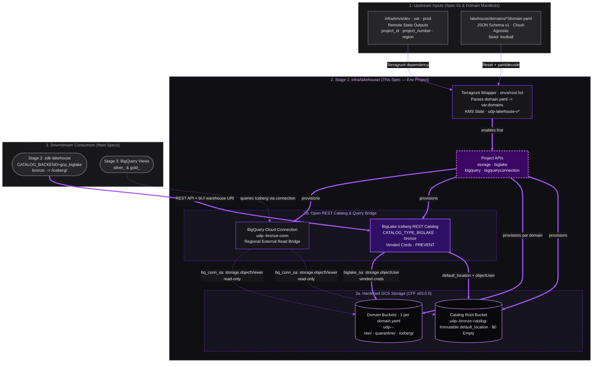

# Spec 04: Domain Manifest, Bronze Storage & BigLake Catalog

| Field | Value |
| :--- | :--- |
| **Status** | `Approved` |
| **Owner** | Xavier Ruiz |
| **Component** | `platform_unified_data_gcp/lakehouse/{schemas, domains}` · `platform_unified_data_gcp/infra/lakehouse/{stack, envs}` |
| **Stack** | OpenTofu `>= 1.12.2` · Terragrunt `>= 0.72` · `google ~> 8.10` · CFF `v60.0.0` · JSON Schema Draft 2020-12 |
| **Archetype / Tier** | Infrastructure-as-Code & GitOps · Mini-Spec (`9 REQs`, `9 TCs`) |
| **Depends On** | [Spec 01](./01_platform_module_setup.md), [Spec 03](./03_data_lakehouse_architecture.md) |
| **Related** | `sdk_lakehouse/specs/05_iceberg_gcp_biglake_plugin.md` (`gcp_biglake` SPI) |

---

## 1. Overview & Design

### TL;DR
Spec 03 splits the lakehouse into a 3-stage pipeline: **Stage 1 (OpenTofu)** provisions durable storage and catalog foundations, **Stage 2 (`sdk-lakehouse`)** manages Apache Iceberg namespaces and tables over the BigLake Representational State Transfer (REST) Application Programming Interface (API), and **Stage 3** deploys Silver and Gold views. This Mini-Spec defines the cloud-agnostic **`domain.yaml` manifest contract** (validated via JavaScript Object Notation (JSON) Schema and OpenTofu, seeded with `football`) and the Stage 1 foundation (`infra/lakehouse/`): an isolated Terragrunt stack per environment that parses `lakehouse/domains/*/domain.yaml` to provision **one hardened Google Cloud Storage (GCS) bucket per Data Mesh domain** (`raw/`, `quarantine/`, and `iceberg/` prefixes), a lightweight catalog root bucket, a multi-bucket BigLake Iceberg REST Catalog (`CATALOG_TYPE_BIGLAKE`), and a BigQuery Cloud Resource connection—with `$0/mo` idle compute.

### Architecture



### Key Design Decisions
- **Cloud-agnostic `domain.yaml` manifest (dual-validated):** Every Data Mesh domain is registered via `lakehouse/domains/<domain>/domain.yaml` using strictly cloud-neutral fields (`schema_version`, identity, optional `cost_center`, optional `storage.raw_retention_days`, and `ingestion.enable_streaming`) so future platforms (e.g., `platform_unified_data_aws`) reuse the exact same manifest contract verbatim. Validated both by `lakehouse/schemas/domain.schema.json` (for fast Continuous Integration (CI) / Integrated Development Environment (IDE) feedback) and OpenTofu variable validations.
- **Terragrunt parses manifests; OpenTofu stack stays pure:** `envs/root.hcl` discovers `lakehouse/domains/*/domain.yaml` from the repository root and passes a typed `domains` map into `infra/lakehouse/stack/`. This avoids fragile relative-path traversal when `uat`/`prod` pull `stack/` from remote Git tags and keeps offline `tofu test` self-contained.
- **One bucket per Data Mesh domain with DNS/S3-safe bucket slugs:** Each manifest provisions one dedicated GCS bucket (`udp-<env>-<slug>-<suffix>`, normalizing `_` → `-` for Domain Name System (DNS) and Amazon Simple Storage Service (S3) bucket-name compatibility while keeping `snake_case` for BigQuery and Iceberg namespaces) separated by prefix (`raw/`, `quarantine/`, `iceberg/`). No separate shared landing bucket exists.
- **Open BigLake Iceberg REST Catalog (`CATALOG_TYPE_BIGLAKE`):** Uses Google Cloud's open Apache Iceberg REST catalog with a dedicated, `$0`-when-empty catalog root bucket as `default_location`. Supports multiple domain buckets under one logical `bronze` catalog, avoids catalog recreation when domains change, and mints downscoped GCS tokens via `CREDENTIAL_MODE_VENDED_CREDENTIALS`.
- **Prefix-scoped lifecycle without `dev` Nearline penalties:** Lifecycle rules apply strictly to `raw/` and `quarantine/` prefixes (never `iceberg/`), resolving effective retention from `domain.storage.raw_retention_days` or the env default (`30` / `90` / `365`) and omitting Nearline@30d whenever effective retention is `<= 30` days.
- **Isolated state, tag train & zero idle compute:** `infra/lakehouse/` gets its own Key Management Service (KMS)-encrypted state prefix (`envs/<env>/lakehouse`) and release tags (`udp-lakehouse-vX.Y.Z`), provisioning only storage, catalog metadata, and a BigQuery connection (`$0/mo` idle).

### Done Looks Like
- Every static check, manifest schema check, security scan, and offline mocked test in the Verification Gates table passes cleanly.
- `lakehouse/domains/football/domain.yaml` validates cleanly against `lakehouse/schemas/domain.schema.json` and drives the `football` domain bucket in `infra/lakehouse/envs/*`.
- Stack outputs plug directly into `sdk-lakehouse` (`CATALOG_BACKEND=gcp_biglake`) with zero manual glue.
- Acceptance cases `TC-001` through `TC-009` are verified.

| Gate | Command | Scope |
| :--- | :--- | :--- |
| Manifest Schema | `check-jsonschema --schemafile lakehouse/schemas/domain.schema.json lakehouse/domains/*/domain.yaml` | All `domain.yaml` manifests |
| Formatting | `tofu fmt -check` · `terragrunt hcl fmt --check` | `stack/` and `envs/` |
| Render & Schema | `terragrunt render` · `tofu validate` | All env wrappers and stack |
| Lint & Security | `tflint --recursive` · `trivy config` (`HIGH,CRITICAL`) | Full `infra/lakehouse/` |
| Unit Tests | `tofu test` (mocked provider) | `tests/bronze_storage.tftest.hcl` |

### Acronyms

| Acronym | Definition |
| :--- | :--- |
| `ADR` | Architecture Decision Record |
| `API` | Application Programming Interface |
| `AWS` | Amazon Web Services |
| `BQ` | BigQuery |
| `CFF` | Cloud Foundation Fabric (Google Cloud OpenTofu/Terraform module library) |
| `CI/CD` | Continuous Integration / Continuous Delivery |
| `CMEK` | Customer-Managed Encryption Key |
| `DDL` | Data Definition Language |
| `DNS` | Domain Name System |
| `DRY` | Don't Repeat Yourself |
| `FinOps` | Cloud Financial Operations |
| `GCP` | Google Cloud Platform |
| `GCS` | Google Cloud Storage |
| `HCL` | HashiCorp Configuration Language |
| `IAM` | Identity and Access Management |
| `IaC` | Infrastructure as Code |
| `IDE` | Integrated Development Environment |
| `JSON` | JavaScript Object Notation |
| `KMS` | Key Management Service (Google Cloud KMS) |
| `PAP` | Public Access Prevention (GCS control blocking public access) |
| `Pub/Sub` | Publish/Subscribe (Google Cloud asynchronous messaging service) |
| `REQ` | Functional Requirement |
| `REST` | Representational State Transfer |
| `S3` | Amazon Simple Storage Service |
| `SA` | Service Account |
| `SDK` | Software Development Kit |
| `SPI` | Service Provider Interface |
| `TC` | Test Case |
| `UBLA` | Uniform Bucket-Level Access (GCS control disabling legacy object Access Control Lists) |
| `UDP` | Unified Data Platform |
| `URI` | Uniform Resource Identifier |
| `VPC-SC` | Virtual Private Cloud Service Controls |
| `YAML` | YAML Ain't Markup Language |
| `dev` / `uat` / `prod` | Development / User Acceptance Testing / Production environments |

---

## 2. Scope

### In Scope
- Define the cloud-agnostic `domain.yaml` v1 manifest contract (`lakehouse/schemas/domain.schema.json`) and seed the reference domain (`lakehouse/domains/football/domain.yaml`).
- Stand up the isolated `infra/lakehouse/` Terragrunt scaffold (`envs/root.hcl` discovering `lakehouse/domains/*/domain.yaml`, KMS-encrypted state, pinned Cloud Foundation Fabric (CFF) `v60.0.0`).
- Activate the four required Lakehouse Google Cloud Platform (GCP) APIs at the environment project level.
- Provision one hardened GCS bucket per declared `domain.yaml` with prefix-separated `raw/`, `quarantine/`, and `iceberg/` zones plus a lightweight catalog root bucket via the CFF `gcs` module.
- Provision the regional BigLake Iceberg REST catalog (`bronze`, `CATALOG_TYPE_BIGLAKE`) and BigQuery Cloud Resource connection.
- Bind minimal IAM on the catalog root and domain buckets so BigLake credential vending and BigQuery reads work out of the box.
- Commit a multi-platform provider lockfile (`darwin_arm64` and `linux_amd64`) alongside offline unit tests.

### Out of Scope (Non-Goals)
- **Separate shared landing bucket:** Raw payloads and quarantined records live inside each domain's dedicated bucket under `raw/` and `quarantine/` prefixes—no shared cross-domain landing bucket is provisioned.
- **Iceberg namespaces & tables:** Strictly owned by Stage 2 (`sdk-lakehouse`), which creates namespace `bronze.<domain>` pointing at `gs://udp-<env>-<slug>-<suffix>/iceberg`.
- **CI/CD workflows, `CODEOWNERS` gates & Silver/Gold datasets:** `udp-lakehouse-*.yml` pipelines, `CODEOWNERS` enforcement, and `silver_<domain>`/`gold_<domain>` BigQuery datasets are deferred to Mini-Spec `05`.
- **Domain/user IAM:** Ingest Service Accounts (SAs), Data Definition Language (DDL) principals, and owner/analyst group bindings belong to Mini-Spec `06`.
- **Streaming infrastructure & advanced security:** Spec 04 validates and surfaces `ingestion.enable_streaming`, while Publish/Subscribe (Pub/Sub) resource provisioning belongs to Mini-Spec `09`; Cloud Run jobs, Customer-Managed Encryption Keys (CMEK), and Virtual Private Cloud Service Controls (VPC-SC) are deferred to future specs.

---

## 3. Functional Requirements

Exact parameter names, defaults, and validation patterns live once in **Section 4**.

### Stack & Environment Wiring

| ID | What | Why | How |
| :--- | :--- | :--- | :--- |
| `REQ-01` | Isolated Terragrunt root | Keeps lakehouse state and blast radius separate from `infra/platform` | `envs/root.hcl` pins `tofu`, generates KMS-encrypted state under `envs/<env>/lakehouse`, and mirrors Spec 01 offline/ephemeral flags |
| `REQ-02` | Immutable env promotion | Ensures `uat`/`prod` deploy exact audited releases while `dev` iterates fast | `dev` tracks `../../stack//.` locally; `uat`/`prod` pin `udp-lakehouse-vX.Y.Z` (or `"unreleased"`) via `release.yaml` |
| `REQ-03` | Platform output dependency | Avoids duplicating project/region config and keeps `envs/` DRY | Each env wrapper reads `project_id`, `project_number`, and `region` via Terragrunt `dependency "platform"` with offline `mock_outputs`; zero `.tf` files in `envs/` |
| `REQ-04` | Pinned modules & API enablement | Prevents upstream drift and race conditions on first apply | `module-versions.yaml` pins CFF via OpenTofu Early Evaluation; 4 GCP APIs enabled with `disable_on_destroy = false` before dependent resources |

### Domain Manifest Contract

| ID | What | Why | How |
| :--- | :--- | :--- | :--- |
| `REQ-05` | Cloud-agnostic `domain.yaml` & dual validation | Lets domains self-register buckets and Bronze settings with zero HCL and 100% portability to future cloud platforms (e.g., AWS) | Commit Draft 2020-12 `lakehouse/schemas/domain.schema.json` (`additionalProperties: false`) + seed `lakehouse/domains/football/domain.yaml`; `envs/root.hcl` parses `lakehouse/domains/*/domain.yaml` into typed `var.domains` and enforces directory-to-`domain` match alongside OpenTofu validations (§4.2) |

### Bronze Storage & Catalog

| ID | What | Why | How |
| :--- | :--- | :--- | :--- |
| `REQ-06` | Per-domain hardened GCS buckets | Gives each declared domain one isolated bucket for raw replay, quarantine, and Bronze Iceberg tables without `dev` early-deletion fees | CFF `gcs` module (`for_each = var.domains`) using DNS/S3-safe bucket slug (`_` → `-`), Uniform Bucket-Level Access (UBLA), enforced Public Access Prevention (PAP), object versioning, 7d soft delete, `domain` + resolved `cost_center` + `layer = "bronze"` labels, `force_destroy = false`, `prevent_destroy`, and prefix-scoped lifecycle (`matches_prefix = ["raw/", "quarantine/"]`) expiring at resolved `raw_retention_days` (30d Nearline only when `> 30`; zero expiry on `iceberg/`) |
| `REQ-07` | Immutable catalog root bucket | Supplies a stable `default_location` for `CATALOG_TYPE_BIGLAKE` so adding or removing domains never recreates the catalog | CFF `gcs` module (`udp-<env>-bronze-catalog-<suffix>`, `$0` when empty) with UBLA, enforced PAP, object versioning, 7d soft delete, `domain = "platform"`, `layer = "bronze"`, `force_destroy = false`, and `prevent_destroy` |
| `REQ-08` | BigLake REST catalog & BQ connection | Provides an open multi-bucket Iceberg REST catalog with downscoped credentials and BigQuery queryability | `google_biglake_iceberg_catalog` (`bronze`, `CATALOG_TYPE_BIGLAKE`, `default_location` = catalog root, vended credentials, `PREVENT`) + regional `google_bigquery_connection` (`cloud_resource`) |
| `REQ-09` | Infra-wiring IAM, outputs & tests | Unblocks Stage 2 (`sdk-lakehouse`) and downstream specs (`05`–`09`) with offline CI verification | Bucket IAM bindings on catalog root + all domain buckets (§4.6), SDK-ready outputs including resolved per-domain metadata (§4.5), multi-platform `.terraform.lock.hcl`, and mocked `tests/bronze_storage.tftest.hcl` |

---

## 4. Contract & Blueprint

### 4.1 Directory Layout

```text
platform_unified_data_gcp/
├── lakehouse/
│   ├── schemas/
│   │   └── domain.schema.json                # JSON Schema Draft 2020-12 (cloud-agnostic v1)
│   └── domains/
│       └── football/
│           └── domain.yaml                   # Reference seed domain manifest
└── infra/lakehouse/
    ├── stack/
    │   ├── module-versions.yaml              # Pinned CFF tag (v60.0.0)
    │   ├── versions.tf                       # OpenTofu >= 1.12.2, google/google-beta ~> 8.10, random ~> 3.6
    │   ├── variables.tf                      # Typed inputs (var.domains map) & fail-fast validations
    │   ├── main.tf                           # APIs, catalog root + domain GCS buckets, BigLake catalog, BQ connection, wiring IAM
    │   ├── outputs.tf                        # SDK & downstream consumer outputs
    │   ├── .terraform.lock.hcl               # darwin_arm64 + linux_amd64
    │   └── tests/bronze_storage.tftest.hcl
    └── envs/                                 # DRY Terragrunt wrappers (zero .tf files)
        ├── root.hcl                          # Generates backend/encryption/provider; parses lakehouse/domains/*/domain.yaml
        ├── dev/terragrunt.hcl                # Tracks ../../stack//. (30d default raw retention)
        ├── uat/{terragrunt.hcl, release.yaml}   # Pinned tag (90d default raw retention)
        └── prod/{terragrunt.hcl, release.yaml}  # Pinned tag (365d default raw retention)
```

### 4.2 Domain Manifest Contract (`domain.yaml` v1)

Every domain declares `lakehouse/domains/<domain>/domain.yaml`. The schema (`lakehouse/schemas/domain.schema.json`) sets `additionalProperties: false` at every object level and forbids cloud-specific keys so future cloud platforms (e.g., `platform_unified_data_aws`) reuse the exact same file.

| Field | Type | Required / Default | Constraint & Cloud-Neutral Semantics |
| :--- | :--- | :--- | :--- |
| `schema_version` | `integer` | *required* | Must equal `1` |
| `domain` | `string` | *required* | `snake_case` ID matching parent directory name `<domain>` |
| `business_function` | `string` | *required* | 3–120 chars describing the owning business function |
| `owner_group` | `string` | *required* | Group email owning domain products & approvals |
| `description` | `string` | *required* | 10–500 chars summarizing domain scope |
| `cost_center` | `string` | optional · `var.cost_center` | Optional per-domain FinOps billing label override |
| `storage.raw_retention_days` | `integer` | optional · `var.default_raw_retention_days` | `7..3650`; overrides env default for `raw/` & `quarantine/` only |
| `ingestion.enable_streaming` | `boolean` | optional · `false` | Opt-in streaming switch consumed by Mini-Spec `09` |

#### Manifest-to-Infrastructure Derivation Rules

| Derived Property | Rule |
| :--- | :--- |
| Bucket slug (`<slug>`) | `replace(domain, "_", "-")` — guarantees DNS- and AWS S3-safe bucket names while preserving `snake_case` for BigQuery datasets and Iceberg namespaces |
| Effective `cost_center` | `coalesce(domain.cost_center, var.cost_center)` |
| Effective `raw_retention_days` | `coalesce(try(domain.storage.raw_retention_days, null), var.default_raw_retention_days)` |
| Effective `enable_streaming` | `coalesce(try(domain.ingestion.enable_streaming, null), false)` |

### 4.3 Resource Blueprint

#### GCS Buckets (via CFF `//modules/gcs`)

| Setting | Catalog Root Bucket | Domain Bucket (1 per `domain.yaml`) |
| :--- | :--- | :--- |
| **Name Pattern** | `udp-<env>-bronze-catalog-<suffix>` | `udp-<env>-<slug>-<suffix>` |
| **Storage Class** | `STANDARD` | `STANDARD` |
| **Access Control** | UBLA enabled · PAP `enforced` | UBLA enabled · PAP `enforced` |
| **Object Versioning** | Enabled | Enabled |
| **Soft Delete** | 7 days (`604800s`) | 7 days (`604800s`) |
| **Destroy Protection** | `force_destroy = false` + `prevent_destroy` | `force_destroy = false` + `prevent_destroy` |
| **Lifecycle** | None (`$0` when empty) | Prefix-scoped to `["raw/", "quarantine/"]`: Nearline@30d (iff effective retention `> 30d`) · Delete@effective retention; **none on `iceberg/`** |
| **`layer` / `domain` Labels** | `layer = "bronze"` · `domain = "platform"` | `layer = "bronze"` · `domain = <domain>` |

#### Domain Bucket Prefix Layout

| Prefix | Contents | Lifecycle |
| :--- | :--- | :--- |
| `raw/<source>/ingest_date=YYYY-MM-DD/<run_id>/` | Immutable raw source payloads for replay/backfill | Nearline@30d (iff `> 30d`) · Delete@effective `raw_retention_days` |
| `quarantine/<source>/ingest_date=YYYY-MM-DD/<run_id>/` | Malformed batch records rejected during ingest | Nearline@30d (iff `> 30d`) · Delete@effective `raw_retention_days` |
| `iceberg/` | Bronze Apache Iceberg metadata & Parquet files for `bronze.<domain>` | Never expired by GCS lifecycle (managed by Iceberg snapshots) |

#### Catalog, Connection & Project APIs

| Resource | Setting | Value |
| :--- | :--- | :--- |
| **BigLake Catalog** (`google_biglake_iceberg_catalog`) | `name` | `var.catalog_name` (default `"bronze"`) |
| **BigLake Catalog** | `catalog_type` | `"CATALOG_TYPE_BIGLAKE"` |
| **BigLake Catalog** | `default_location` | `"gs://<catalog_root_bucket_name>"` |
| **BigLake Catalog** | `credential_mode` | `"CREDENTIAL_MODE_VENDED_CREDENTIALS"` |
| **BigLake Catalog** | `deletion_policy` | `var.catalog_deletion_policy` (default `"PREVENT"`) |
| **BigQuery Connection** (`google_bigquery_connection`) | `connection_id` | `"udp-<env>-bronze-conn"` |
| **BigQuery Connection** | `location` / type | `var.region` · `cloud_resource {}` |

#### Enabled Project APIs (`disable_on_destroy = false`)

| Service API | Purpose |
| :--- | :--- |
| `storage.googleapis.com` | Catalog root and per-domain GCS buckets |
| `biglake.googleapis.com` | Open BigLake Iceberg REST catalog (`CATALOG_TYPE_BIGLAKE`) |
| `bigquery.googleapis.com` | BigQuery external Iceberg query engine |
| `bigqueryconnection.googleapis.com` | Regional Cloud Resource connection |

#### Mandatory Bucket Labels

| Label Key | Source |
| :--- | :--- |
| `managed_by` | `"opentofu"` |
| `platform` | `var.platform_name` |
| `environment` | `var.environment` |
| `cost_center` | `var.cost_center` (catalog root) or domain effective `cost_center` (domain bucket) |
| `layer` | `"bronze"` |
| `domain` | `"platform"` (catalog root) or `<domain>` (domain bucket) |

### 4.4 Stack Inputs

| Input | Type | Default | Constraint |
| :--- | :--- | :--- | :--- |
| `environment` | `string` | *required* | `dev`, `uat`, or `prod` |
| `project_id` | `string` | *required* | Valid GCP project ID (from `platform` output) |
| `region` | `string` | `"us-central1"` | Valid GCP region matching `platform` |
| `domains` | `map(object)` | *required* | Non-empty map parsed from `lakehouse/domains/*/domain.yaml`; map key must equal `domain` and satisfy §4.2 schema |
| `default_raw_retention_days` | `number` | `30` | Integer `7..3650` (`dev` 30, `uat` 90, `prod` 365); env fallback when a domain omits `storage.raw_retention_days` |
| `soft_delete_retention_seconds` | `number` | `604800` | Integer `604800..7776000` (7d–90d) |
| `catalog_name` | `string` | `"bronze"` | Lowercase ID, 3–63 chars (`ADR-04`) |
| `catalog_deletion_policy` | `string` | `"PREVENT"` | `PREVENT`, `DELETE`, or `ABANDON` |
| `platform_name` | `string` | `"unified-data-platform"` | Mandatory label value |
| `cost_center` | `string` | `"engineering-playground"` | Default billing label value |

#### Validation Patterns

| Field | Regex |
| :--- | :--- |
| `project_id` | `^[a-z][a-z0-9-]{4,28}[a-z0-9]$` |
| `region` | `^[a-z]+-[a-z]+[0-9]+$` |
| `domain` (`domain.yaml` & map key) | `^[a-z][a-z0-9_]{1,30}[a-z0-9]$` |
| `owner_group` (`domain.yaml`) | `^[a-zA-Z0-9._%+-]+@[a-zA-Z0-9.-]+\.[a-zA-Z]{2,}$` |
| `cost_center` (`domain.yaml` & stack) | `^[a-z][a-z0-9-]{1,61}[a-z0-9]$` |
| `catalog_name` | `^[a-z][a-z0-9_-]{1,61}[a-z0-9]$` |
| `release.yaml` (`lakehouse_version`) | `^(unreleased\|udp-lakehouse-v[0-9]+\.[0-9]+\.[0-9]+)$` |
| `module-versions.yaml` | `^v[0-9]+\.[0-9]+\.[0-9]+$` |

### 4.5 Stack Outputs

| Output | Format / Value | Consumer |
| :--- | :--- | :--- |
| `catalog_root_bucket_name` | `udp-<env>-bronze-catalog-<suffix>` | Catalog `default_location` & audit |
| `catalog_root_bucket_uri` | `gs://udp-<env>-bronze-catalog-<suffix>` | BigLake `default_location` |
| `domain_buckets` | Map `<domain>` → `{ name, uri, raw_uri, quarantine_uri, iceberg_uri, raw_retention_days, enable_streaming }` | Ingest jobs, Mini-Specs `05`–`09` & `sdk-lakehouse` namespace locations |
| `biglake_catalog_name` | `bronze` | `sdk-lakehouse` / CI |
| `biglake_warehouse_uri` | `bl://projects/<project_id>/catalogs/<catalog>` | `sdk-lakehouse` (`warehouse`) |
| `biglake_rest_uri` | `https://biglake.googleapis.com/iceberg/v1/restcatalog` | Iceberg REST clients |
| `biglake_service_account` | Google-managed BigLake SA email | Audit / IAM diagnostics |
| `bigquery_connection_id` | Regional BQ connection ID | Stage 3 Silver/Gold views |
| `bigquery_connection_sa` | Google-managed BQ connection SA email | Audit / IAM diagnostics |

### 4.6 Infra-Wiring IAM (Catalog Root & Domain Buckets)

| Principal | Scope & Role | Purpose |
| :--- | :--- | :--- |
| BigLake catalog SA (`biglake_service_account`) | Catalog root + every domain bucket · `roles/storage.objectUser` | Mints downscoped vended GCS tokens for Iceberg clients across domains |
| BQ connection SA (`cloud_resource[0].service_account_id`) | Catalog root + every domain bucket · `roles/storage.objectViewer` | Read-only access to Bronze Iceberg metadata & Parquet across domains |

### 4.7 External Config & Consumer Payloads

```yaml
# platform_unified_data_gcp/lakehouse/domains/football/domain.yaml
schema_version: 1
domain: football
business_function: "Sports performance analytics"
owner_group: football-data-owners@example.com
description: "Premier League matches, teams, and player statistics"
storage:
  raw_retention_days: 30
ingestion:
  enable_streaming: false
```

```yaml
# platform_unified_data_gcp/infra/lakehouse/envs/{uat,prod}/release.yaml
lakehouse_version: "unreleased"   # or "udp-lakehouse-vX.Y.Z"
```

```properties
# Consumed by sdk-lakehouse (CATALOG_BACKEND=gcp_biglake)
warehouse=bl://projects/udp-dev-xxxx/catalogs/bronze
gcp.project=udp-dev-xxxx
# Stage 2 creates namespace bronze.<domain> with:
# location=gs://udp-dev-<slug>-xxxx/iceberg
```

---

## 5. Invariants & Failure Modes

### Key Invariants
- **Manifest-to-directory parity & cloud neutrality:** Every `domain.yaml` must match its parent directory name (`<domain>`), pass `domain.schema.json` with `additionalProperties: false`, and contain zero cloud-specific keys; bucket names always normalize `_` → `-`.
- **Zero idle compute:** The stack provisions storage, catalog metadata, and a BigQuery connection only, keeping idle compute at `$0/mo` regardless of `enable_streaming` (streaming resources belong to Mini-Spec `09`).
- **Fail-closed security & teardown:** Every bucket and catalog defaults to private access and accidental-destroy protection unless explicitly overridden (§4.3).
- **Prefix lifecycle isolation:** GCS expiry rules match strictly `raw/` and `quarantine/` prefixes; objects under `iceberg/` are never expired by GCS lifecycle policies.
- **No `dev` Nearline penalty:** The 30-day Nearline transition on `raw/` and `quarantine/` is omitted whenever a domain's effective `raw_retention_days <= 30`.
- **Stable catalog root & co-location:** All resources share `var.region`, state is isolated to `envs/<env>/lakehouse`, zero `.tf` files live in `envs/`, and adding or removing `domain.yaml` files never recreates the BigLake catalog.

### Failure Modes

| Condition | Expected Behavior | Guarantee |
| :--- | :--- | :--- |
| Unknown field, wrong `schema_version`, or bad format in `domain.yaml` | JSON Schema check and OpenTofu validation fail | Rejects cloud-specific or malformed manifests before plan/apply |
| Directory `<dir>` differs from `domain:` value inside `domain.yaml` | OpenTofu `var.domains` validation fails (`key == value.domain`) | Prevents misaligned buckets, namespaces, and datasets |
| Zero `domain.yaml` files exist under `lakehouse/domains/` | OpenTofu validation fails (`length(var.domains) > 0`) | Blocks empty lakehouse applies |
| Invalid stack input (`environment`, retention, soft delete, policy) | OpenTofu variable validation error | Fails fast before any GCP call |
| Malformed `release.yaml` or floating ref | Terragrunt / regex check failure | Blocks unpinned `uat`/`prod` deploys |
| Catalog created before API or catalog root bucket | Prevented via explicit `depends_on` | Deterministic apply ordering |
| Domain manifest added or removed under `lakehouse/domains/` | Only that domain bucket + its wiring IAM change | Immutable catalog root prevents catalog recreation |
| Accidental `tofu destroy` on bucket or catalog | Blocked by `force_destroy`/`prevent_destroy`/`PREVENT` | Requires deliberate override |

---

## 6. Acceptance & Verification (`TC-*`)

| Case | Scenario | Pass Condition |
| :--- | :--- | :--- |
| `TC-001` (`REQ-04`) | Static & security gates | `tofu fmt`, `terragrunt hcl fmt`, `validate`, `tflint`, and `trivy` (`HIGH,CRITICAL`) exit `0`. |
| `TC-002` (`REQ-01`–`03`) | Terragrunt root, manifest discovery & state isolation | `terragrunt render --json` produces `envs/<env>/lakehouse` KMS state, populates `var.domains` from `lakehouse/domains/*/domain.yaml`, tracks local stack in `dev`, and pins tag in `uat`/`prod`. |
| `TC-003` (`REQ-05`) | JSON Schema manifest validation | `check-jsonschema` passes `lakehouse/domains/football/domain.yaml` and rejects fixtures with unknown/GCP-specific keys, invalid `schema_version`, bad `domain` regex, or missing required fields. |
| `TC-004` (`REQ-06`) | Domain prefix lifecycle & override resolution | Mocked `tofu test`: rules target strictly `["raw/", "quarantine/"]` (never `iceberg/`); `dev` (30d) omits Nearline; `uat`/`prod` (90d/365d) and per-domain `storage.raw_retention_days` overrides apply accurately; per-domain `cost_center` label override works. |
| `TC-005` (`REQ-06`–`07`) | Catalog root, domain hardening & slug normalization | Mocked `tofu test`: versioning, UBLA, PAP, 7d soft delete, `force_destroy = false`, and `layer = "bronze"` verified on root (`domain = "platform"`) and multi-domain manifests including `snake_case` → hyphenated bucket slug (`player_ops` → `udp-<env>-player-ops-<suffix>`). |
| `TC-006` (`REQ-08`–`09`) | BigLake catalog & vended IAM | Mocked `tofu test`: `bronze` catalog (`CATALOG_TYPE_BIGLAKE`, root `default_location`, vended creds, `PREVENT`) + `objectUser` bound on catalog root and each domain bucket. |
| `TC-007` (`REQ-08`–`09`) | BigQuery connection & read IAM | Mocked `tofu test`: regional `cloud_resource` connection created + `objectViewer` bound on catalog root and each domain bucket. |
| `TC-008` (`REQ-05`–`08`) | Negative OpenTofu validation tests | `expect_failures` triggers for empty `domains`, map key != `domain`, bad `owner_group` email, `schema_version != 1`, invalid `environment`, retention `< 7`, soft delete `< 604800`, and invalid deletion policy. |
| `TC-009` (`REQ-09`) | SDK outputs & lockfile | Exports `biglake_warehouse_uri`, `catalog_root_bucket_uri`, `domain_buckets` (with `raw_uri`, `quarantine_uri`, `iceberg_uri`, `raw_retention_days`, `enable_streaming`), and `biglake_rest_uri`; lockfile covers `darwin_arm64` + `linux_amd64`. |
