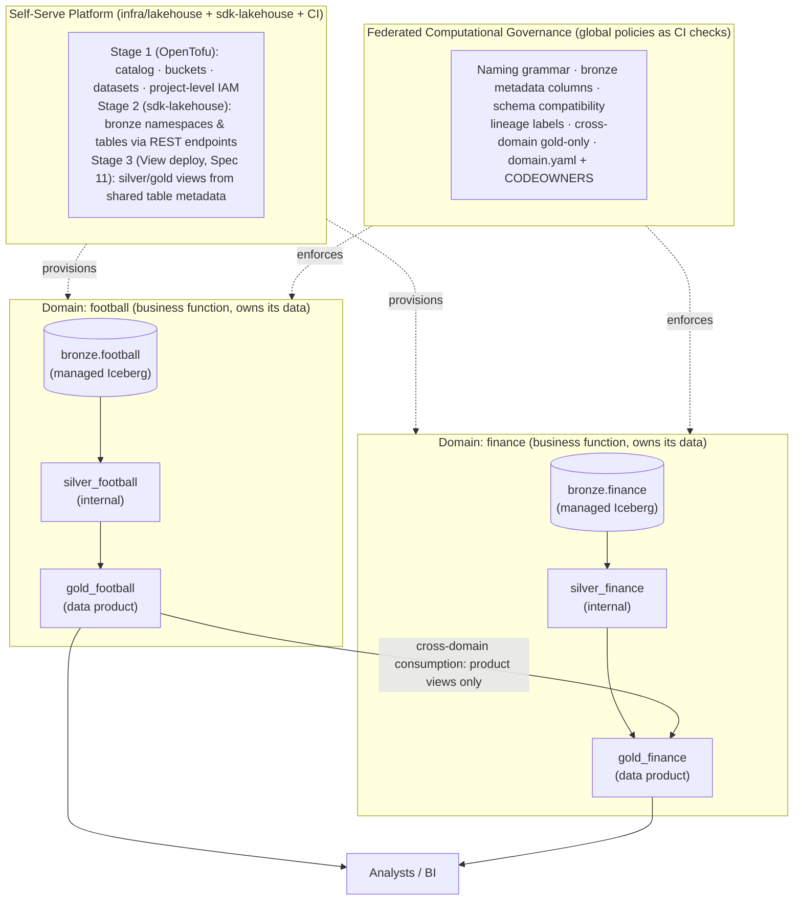
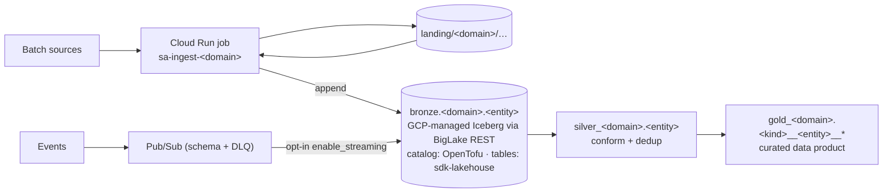

# Feature Spec: GCP Data Lakehouse Reference Architecture (`infra/lakehouse`)

- **Status:** Draft (Pending Approval)
- **Module / Component:** `platform_unified_data_gcp/infra/lakehouse` (separate Terragrunt stack per env) + `platform_unified_data_gcp/lakehouse/` (domain-owned schema- and view-as-code)
- **Archetype:** Data Pipeline Contract + Infrastructure-as-Code & GitOps (Architecture Overview / Epic)
- **Tier:** Full Spec (architecture parent of Mini-Specs `05`–`12`)
- **Owner:** Xavier Ruiz
- **Depends On:** External Org bootstrap [`x-ruiz/platform_gcp_org_bootstrap`](https://github.com/x-ruiz/platform_gcp_org_bootstrap), `specs/02_platform_and_terragrunt_envs.md`, `specs/03_github_actions_cicd.md`
- **Related:** `playground-data-engineering/maven_projects/sdk_lakehouse/specs/05_iceberg_gcp_biglake_plugin.md` (`gcp_biglake` SPI plugin)

---

## 1. Goal & Context

### Problem Statement
Org bootstrap (`platform_gcp_org_bootstrap`) and Specs 02–03 deliver per-environment GCP projects, networking, budgets, and GitOps promotion, but no data layer. We need one architecture for how data lands, is stored, governed, and served on GCP before writing implementation mini-specs. The chosen design is a **data mesh on a view-first ELT lakehouse**. Each **domain is a business function that owns its data** end to end and publishes it as a data product (`gold_<domain>`). The platform provides self-serve **project-level** infrastructure and enforces global policies in CI. Inside a domain, ingestion writes append-only **GCP-managed Apache Iceberg bronze** tables (managed via BigLake REST endpoints by `sdk-lakehouse`), and **Day-1 silver and gold are BigQuery views**, so nothing runs while idle.

### Success Metrics
- Onboarding a new domain requires only adding `lakehouse/domains/<domain>/` (with `domain.yaml`) and a `CODEOWNERS` entry; the platform provisions all project-level resources automatically.
- With `enable_streaming = false`, an environment runs **zero always-on compute**, and idle cost stays within the Spec 02 budgets (`$50` / `$100` / `$250`).
- The reference domain (`football`) flows source → landing → bronze → silver → gold in `dev` across the 3-stage deployment pipeline (`infra/lakehouse` → `sdk-lakehouse` → view deploy) with full traceability by name and lineage metadata.
- Full verification coverage of `TC-001` through `TC-014`.

---

## 2. Visual Architecture

### 2.1 Data Mesh Topology



### 2.2 Data Flow Within One Domain



---

## 3. Scope & Explicit Non-Goals

### In Scope
- **Data mesh operating model:** domain ownership, gold-as-data-product, self-serve platform, and federated computational governance (§5.1).
- **Stack & IAM boundary:** a separate `infra/lakehouse/` Terragrunt stack per env (`envs/<env>/lakehouse` state, `udp-lakehouse-vX.Y.Z` tags) consuming `infra/platform` outputs. **All lakehouse IAM is strictly project-level** inside each environment GCP project.
- **3-stage deployment boundary:** Stage 1 OpenTofu provisions durable infra (buckets, managed Iceberg catalog, BigQuery datasets/connections, project-level IAM); Stage 2 `sdk-lakehouse` manages **only namespaces and tables** via BigLake REST endpoints from domain `table.yaml` / `table.proto`; Stage 3 (Bronze → Silver → Gold view deployment mechanism designed in Mini-Spec `11`) references those same table definitions alongside Silver/Gold SQL.
- **Unified managed Iceberg Bronze:** GCS landing zone + GCP-managed Apache Iceberg bronze tables accessed via BigLake REST endpoints (batch on by default; streaming opt-in via `enable_streaming`).
- **Cross-cutting rules:** naming & collision-free lineage, schema compatibility, runtime data quality & alerting, selective materialization escape hatch, and the Mini-Spec roadmap (§5.7).

### Non-Goals (Do Not Implement)
- **No org- or folder-level IAM changes:** Org/folder foundations belong exclusively in `x-ruiz/platform_gcp_org_bootstrap`; all lakehouse principals and bindings live at the env project level.
- **No catalog lifecycle in `sdk-lakehouse`:** it never creates, alters, or deletes catalogs—only namespaces and tables via REST endpoints.
- **No raw passthrough (`raw__`) views in gold:** analyst access to raw bronze (with PII controls/masking) is deferred to a future spec.
- **No non-BigQuery engine or physical Silver/Gold on Day 1:** Silver and Gold start as BigQuery views (`REQ-10` provides an in-BigQuery materialization escape hatch). Multi-engine physical Iceberg Silver/Gold (e.g., Spark/Trino/DuckDB readers), Spark/Dataflow pipelines, and Cloud Composer are deferred as future enhancements.
- **No per-domain GCP projects on Day 1:** domains isolate via namespace, dataset, and project-level IAM inside each env project.
- **Deferred to future specs:** CMEK, VPC-SC, Dataplex catalog/lineage UI, column-level policy tags & PII masking, automated GDPR/CCPA purge workflows, and cross-domain shared marts (`gold_shared`).

---

## 4. Functional Requirements

- `REQ-01`: **Separate Lakehouse Stack.** All data-layer infra shall live in `infra/lakehouse/`, consuming `project_id`, `project_number`, `region`, and `subnet_id` from `infra/platform` outputs and following Spec 03 promotion (`dev` tracks `main`; `uat`/`prod` pin `udp-lakehouse-vX.Y.Z`).
- `REQ-02`: **Domain Ownership & Self-Serve Onboarding.** Each domain shall map to one business function declared in `lakehouse/domains/<domain>/domain.yaml` (§5.1) with a `CODEOWNERS` entry. From that file, Stage 1 (`infra/lakehouse`) shall provision project-level resources with zero domain-written HCL: `silver_<domain>` and `gold_<domain>` datasets, `sa-ingest-<domain>`, owner-group project/dataset IAM, and landing prefix access.
- `REQ-03`: **Landing Zone.** Batch sources shall first write raw, unmodified payloads to `landing/<domain>/<source>/ingest_date=YYYY-MM-DD/<run_id>/`. Objects are immutable within retention for deterministic replay and backfill.
- `REQ-04`: **Unified Managed Iceberg Bronze.** Stage 1 (OpenTofu) shall provision one GCP-managed BigLake Iceberg REST catalog per env (logical name `bronze` in every env), its GCS warehouse bucket, and BigQuery connection. Stage 2 (`sdk-lakehouse` `gcp_biglake` plugin) shall manage **only namespaces (one per domain) and tables** through the BigLake REST endpoints from domain `table.yaml` / `table.proto` files. When `enable_streaming = true`, Pub/Sub topics (with attached schemas and DLQ) shall land events into managed Iceberg bronze tables (`ADR-05`/`ADR-07`); when `false`, zero streaming resources exist.
- `REQ-05`: **Ingestion-Time Hygiene.** Every bronze row shall carry the §5.3 metadata columns. Records failing schema checks route to `landing/_quarantine/<domain>/` (batch) or the DLQ (streaming) and are never dropped silently. Ingestion contains no business logic.
- `REQ-06`: **Silver Views (Domain-Internal).** Each bronze entity shall have one `silver_<domain>.<entity>` BigQuery view that types, conforms, and **deduplicates** on `_event_key` (keeping latest `_ingested_at`). Silver shall not be readable outside its domain.
- `REQ-07`: **Gold Views = Data Product.** `gold_<domain>` is the domain's sole published interface. Gold views shall read only their own domain's silver or **other domains' `gold_*` views**—never bronze directly and never another domain's silver. Gold datasets are authorized against their upstream sources.
- `REQ-08`: **3-Stage Definitions as Code.** Every bronze table (`table.yaml` / `table.proto`), silver view, and gold view shall live under `lakehouse/domains/<domain>/`, reviewed via `CODEOWNERS` and deployed strictly by CI in order: Stage 1 (`infra/lakehouse` OpenTofu) → Stage 2 (`sdk-lakehouse` Bronze DDL) → Stage 3 (Silver/Gold view deploy referencing the same domain table metadata; implementation tool finalized in Mini-Spec `11`). Manual DDL is forbidden in `uat`/`prod`.
- `REQ-09`: **Storage Layout for View Performance.** Bronze Iceberg tables shall declare partitioning (default `day(_ingested_at)`, overridable per table) and clustering/sort order on `_event_key` where supported by managed Iceberg, so view predicates prune storage.
- `REQ-10`: **Selective Materialization Escape Hatch.** Any silver dedup view or curated gold view that exceeds measured scan-cost or latency thresholds may be incrementally materialized into a BigQuery-managed Iceberg table via `lakehouse/materializations.yaml` (citing measured cost/latency). It preserves its exact name and labels so consumers and lineage remain unaffected.
- `REQ-11`: **Project-Level Least-Privilege Access.** All principals and IAM bindings (§5.5) shall be scoped strictly within the environment GCP project (bucket/prefix, catalog namespace, dataset). Ingest identities write only their own domain; CI owns DDL without catalog create/delete; domain owners read their own domain; analysts read only `gold_*`.
- `REQ-12`: **Managed Maintenance, Data Quality & Observability.** Managed Iceberg relies on GCP-managed storage optimization/compaction, supplemented by snapshot/retention policy verification (safe orphan retention `>= 72h` where configurable). Scheduled runtime data-quality assertions (freshness, Silver `_event_key` uniqueness, non-null keys), ingestion failures, and DLQ backlogs shall alert the Spec 02 notification channel, labeled with `domain`.
- `REQ-13`: **Federated Computational Governance.** CI shall reject any PR violating global policies:
  - the §5.4 naming grammar or BigQuery label limits (`<= 64` labels, `<= 63`-char keys);
  - missing `domain.yaml` or `CODEOWNERS`;
  - missing §5.3 bronze metadata columns or unapproved breaking schema changes (column drop / type narrowing) in `table.yaml` / `table.proto`;
  - a gold view reading bronze directly or any cross-domain read of silver/bronze;
  - a view whose declared `sources` differ from the tables a BigQuery dry-run reports it references.

---

## 5. Interface & Data Contract

### 5.1 Data Mesh Ownership & 3-Stage Deployment Contract

| Mesh Principle | Implementation | Owned By |
| :--- | :--- | :--- |
| Domain ownership | One business function = one folder, bronze namespace, `silver_`/`gold_` datasets, and project-level ingest SA | Domain owner group |
| Data as a product | `gold_<domain>` curated views described by `domain.yaml` and view sidecars | Domain owner group |
| Self-serve platform | Stage 1 OpenTofu (`infra/lakehouse`) → Stage 2 `sdk-lakehouse` (REST DDL) → Stage 3 view deploy (Spec `11`) | Platform owner |
| Federated computational governance | Global policies (`REQ-13`) run as automated CI checks on every PR | Platform defines; domains comply |

```yaml
# lakehouse/domains/football/domain.yaml
domain: football
business_function: "Sports performance analytics"
owner_group: football-data-owners@<org-domain>
description: "Premier League matches, teams and player stats"
```

### 5.2 Storage, Catalog & Dataset Inventory (per env project, same region)

| Layer | Resource | Name Pattern | Provisioned By (Stage 1) | Contents Managed By |
| :--- | :--- | :--- | :--- | :--- |
| Landing | GCS bucket (per-domain prefixes) | `udp-<env>-landing-<suffix>` | OpenTofu | `sa-ingest-<domain>` |
| Bronze | GCS warehouse + BigLake managed Iceberg REST catalog `bronze` + BQ connection | `udp-<env>-bronze-<suffix>` | OpenTofu | Stage 2: `sdk-lakehouse` (namespaces & tables via REST endpoints) |
| Silver / Gold | BigQuery datasets per domain | `silver_<domain>`, `gold_<domain>` | OpenTofu (from `domain.yaml`) | Stage 3: View deployer referencing domain `table.yaml`/`table.proto` + SQL (Mini-Spec `11`) |

All buckets enforce UBLA, public access prevention, soft delete, and lifecycle rules (landing transitions to Nearline after 30d and expires after `landing_retention_days`: `dev` 30, `prod` 365). All resources carry Spec 02 labels plus `layer` and `domain`.

### 5.3 Bronze Row Contract (Mandatory Metadata Columns)

| Column | Type | Rule |
| :--- | :--- | :--- |
| `_ingested_at` | `timestamp` (UTC) | Set by writer at commit; default partition source |
| `_source` / `_batch_id` | `string` | `<domain>.<source>` / Cloud Run execution or Pub/Sub message ID |
| `_source_uri` | `string` (nullable) | Landing object URI (batch only), used for replay lineage |
| `_event_key` | `string` | Declared business key for silver deduplication |

### 5.4 Naming & Lineage Convention

Names are `snake_case`; `__` is reserved as the token separator, and `<entity>` anchors traceability.

| Object | Pattern | Example |
| :--- | :--- | :--- |
| Bronze table (managed Iceberg) | `bronze.<domain>.<entity>` | `bronze.football.matches` |
| Silver view (1:1 per entity) | `silver_<domain>.<entity>` | `silver_football.matches` |
| Curated gold view | `gold_<domain>.<kind>__<entity>__<qualifier>` (`kind` ∈ `dim`, `fct`, `agg`, `rpt`) | `gold_football.agg__matches__team_season_standings` |

Every silver and gold view has a YAML sidecar (`description`, `grain`, `owner`, `sources`). On deploy, every view receives labels `domain`, `layer`, `view_kind`, and collision-free `src_<source_domain>__<entity> = "true"` (validated against BigQuery's 64-label / 63-char key limits). Views are traceable by name (`*__<entity>__*`) or via `INFORMATION_SCHEMA.TABLE_OPTIONS`.

### 5.5 Project-Level IAM / Security Principal Matrix

All service accounts and IAM bindings below are provisioned **strictly at the environment GCP project level** (zero folder/org IAM required beyond `platform_gcp_org_bootstrap`).

| Principal | Auth / Condition | Project-Level Scope | Access |
| :--- | :--- | :--- | :--- |
| `sa-ingest-<domain>` | Cloud Run job identity | `landing/<domain>/` prefix, `bronze.<domain>` tables | Write landing; append rows; no DDL |
| Pub/Sub / streaming writer SA | Project service agent / writer SA | `bronze` streaming tables (opt-in) | Append table data only |
| `sa-lakehouse-ddl` | GitHub Actions WIF (`main` for apply) | `bronze` namespaces/tables; `silver_*` & `gold_*` views | Namespace/table/view DDL; **no** catalog create/delete |
| BigQuery connection SA | Google-managed (project-scoped) | Bronze warehouse bucket | Read / managed Iceberg storage access |
| `<domain>-data-owners` group | Google Group | Own domain's bronze, silver, gold | Read; PR approval via `CODEOWNERS` |
| `analysts` group / other domains | Google Group / authorized views | `gold_*` datasets only | Read curated data products only |

### 5.6 Architecture Decision Register

| ID | Decision | Rationale / Scope | Verify In |
| :--- | :--- | :--- | :--- |
| `ADR-01` | Data mesh by business-function domain with strictly project-level IAM inside each env project | Clean domain isolation without org/folder IAM sprawl; project-per-domain deferred | `05`, `07` |
| `ADR-02` | Separate `infra/lakehouse` stack with its own state prefix and `udp-lakehouse-v*` tag namespace | Isolates data-bearing infra from `infra/platform` blast radius | `05` |
| `ADR-03` | View-first Silver & Gold in BigQuery on Day 1; `REQ-10` materialization escape hatch | `$0` idle compute and fast iteration; multi-engine physical Iceberg Silver/Gold deferred as a future enhancement | `11` |
| `ADR-04` | 3-stage pipeline: OpenTofu (catalog/infra) → `sdk-lakehouse` (namespaces/tables via BigLake REST) → View deploy (Mini-Spec `11`) | Zero circular dependency; `sdk-lakehouse` never owns catalog lifecycle; logical catalog `bronze` stays env-agnostic | `06`, `08`, `11` |
| `ADR-05` | Unified GCP-managed Iceberg for Bronze (interfaced via BigLake REST endpoints); streaming opt-in via `enable_streaming` | Avoids operating two divergent Iceberg engines or self-managed Spark compaction | `06`, `10` |
| `ADR-06` | Defer raw passthrough (`raw__`) views from gold | Preserves analyst isolation and avoids exposing unmasked raw/PII bronze columns before policy tags exist | Future |
| `ADR-07` | Spike required before build: BigQuery authorized views over BigLake REST catalog tables, namespace-scoped catalog IAM, and direct Pub/Sub → managed Iceberg delivery (fallback: Storage Write API / Cloud Run writer) | Depends on current GCP BigLake/Pub/Sub feature parity | `06`, `07`, `10` |

### 5.7 Mini-Spec Roadmap

| Spec | Title | Delivers |
| :--- | :--- | :--- |
| `05` | Lakehouse stack & domain onboarding scaffold | `infra/lakehouse` Terragrunt stack, state prefix, `udp-lakehouse-v*` tags, CI routing, `domain.yaml` → project-level domain resources |
| `06` | Bronze storage & BigLake managed Iceberg catalog | Landing/bronze buckets, OpenTofu-managed BigLake REST catalog, BQ connection, lifecycle rules |
| `07` | Project-level Lakehouse IAM & domain access | §5.5 project-level principals, domain isolation, authorized-view wiring |
| `08` | Bronze namespace & table deployment (`sdk-lakehouse`) | Stage 2 CI job applying domain `table.yaml`/`table.proto` via BigLake REST endpoints + backward-compatibility check |
| `09` | Batch ingestion framework | Cloud Run job contract, landing layout, quarantine, Cloud Scheduler triggers |
| `10` | Streaming ingestion (opt-in) | Pub/Sub schemas, DLQ, managed Iceberg streaming delivery (`enable_streaming`) |
| `11` | Bronze → Silver → Gold view deployment & governance | Stage 3 deployment tool choice (e.g., Dataform/dbt/DDL runner), Silver/Gold views from shared table metadata, `REQ-13` CI checks, `REQ-10` register |
| `12` | Data quality, observability & alerting | Managed-Iceberg retention checks, runtime DQ assertions, alert policies, per-domain cost views |

---

## 6. Invariants, Edge Cases & Failure Modes

### Key Invariants
1. **Domain Sovereignty:** A domain's bronze and silver are never read outside the domain; `gold_<domain>` is its sole published interface.
2. **Zero Idle Compute by Default:** With `enable_streaming = false`, no always-on compute exists.
3. **Strict Layering & 3-Stage Ordering:** Curated gold never reads bronze directly; CI always executes Stage 1 (OpenTofu infra) → Stage 2 (`sdk-lakehouse` Bronze DDL) → Stage 3 (Silver/Gold view deploy).
4. **Replayable, Project-Scoped & Env-Agnostic:** Landing objects are immutable within retention, all IAM is project-level, and domain definitions never contain project IDs, bucket names, or env names.

### Failure Mode Matrix

| Failure Condition | Expected Behavior |
| :--- | :--- |
| Domain folder without `domain.yaml` or `CODEOWNERS` | CI fails; nothing is provisioned |
| View reads bronze directly, reads another domain's silver/bronze, breaks naming/label limits, or has undeclared sources | CI fails on the PR (`REQ-13`) |
| Breaking schema change (column drop / type narrowing) in `table.yaml` / `table.proto` without override | Stage 2 CI check fails on the PR (`REQ-13`) |
| Malformed batch record / invalid streaming message | Routed to `_quarantine/<domain>/` or DLQ; valid rows commit; `domain`-labeled alert fires |
| Duplicate or late events | Bronze appends every row; silver keeps latest per `_event_key` |
| Silver or gold view exceeds scan-cost/latency threshold | Recorded in `materializations.yaml` and incrementally materialized under the same name (`REQ-10`) |
| Manual DDL in `uat`/`prod` | Detected as drift on next CI run and reverted (`REQ-08`) |

---

## 7. Acceptance Criteria & Verification Matrix

| Case ID | Scenario | Expected Outcome |
| :--- | :--- | :--- |
| `TC-001` | Change only `infra/lakehouse/**`; promote `udp-lakehouse-v0.1.0` | Only lakehouse stack plans/applies for `dev`; `uat` pins tag; `infra/platform` state untouched (`05`) |
| `TC-002` | Add `lakehouse/domains/finance/domain.yaml` + `CODEOWNERS` | `silver_finance`, `gold_finance`, `sa-ingest-finance`, and project-level owner IAM provision with zero domain HCL (`05`) |
| `TC-003` | Apply Stage 1 (`infra/lakehouse`) in `dev` | All §5.2 resources exist with required names, labels, UBLA, and PAP; managed Iceberg catalog `bronze` exists before Stage 2 (`06`) |
| `TC-004` | `enable_streaming = false` | Zero always-on compute and zero Pub/Sub/streaming resources (`06`, `10`) |
| `TC-005` | Impersonate `sa-ingest-football` and `sa-lakehouse-ddl` | `sa-ingest-football` appends only to `bronze.football` (cannot write `finance` or run DDL); `sa-lakehouse-ddl` manages namespaces/tables but cannot create/delete catalogs; zero folder/org IAM (`07`) |
| `TC-006` | Query as `analysts` and as `finance-data-owners` | `gold_*` queries succeed; direct `silver_football` and `bronze.football` queries are denied (`07`, `11`) |
| `TC-007` | Merge `football` `table.yaml` / `table.proto` | Stage 2 (`sdk-lakehouse`) creates namespace + table in existing managed Iceberg `bronze` catalog via REST endpoints; re-run is a no-op; breaking column drop fails CI (`08`) |
| `TC-008` | Run `football` batch ingestion job | Raw payload lands under `REQ-03` path; bronze rows carry all §5.3 metadata columns (`09`) |
| `TC-009` | Batch contains a malformed record | Bad record written to `landing/_quarantine/football/`; valid rows commit; `domain`-labeled alert fires (`09`, `12`) |
| `TC-010` | `enable_streaming = true`; publish valid + invalid events | Valid event lands in managed Iceberg `bronze`; invalid event routes to DLQ (`10`) |
| `TC-011` | Same `_event_key` ingested twice | Bronze retains both rows; `silver_football.matches` returns 1 row (latest `_ingested_at`) (`11`) |
| `TC-012` | PR: `finance` gold view reads bronze directly, reads `silver_football`, breaks naming, or has undeclared sources | CI fails; compliant view reading `gold_football` deploys with `domain` and `src_<domain>__<entity>` labels (`11`) |
| `TC-013` | Filter `INFORMATION_SCHEMA.TABLE_OPTIONS` by `src_football__matches` | Returns every silver and gold view built on `football.matches` across domains without cross-domain label collisions (`11`) |
| `TC-014` | Force ingestion failure, DLQ backlog, or Silver uniqueness DQ violation | Alert reaches Spec 02 notification channel with `domain` label (`12`) |
