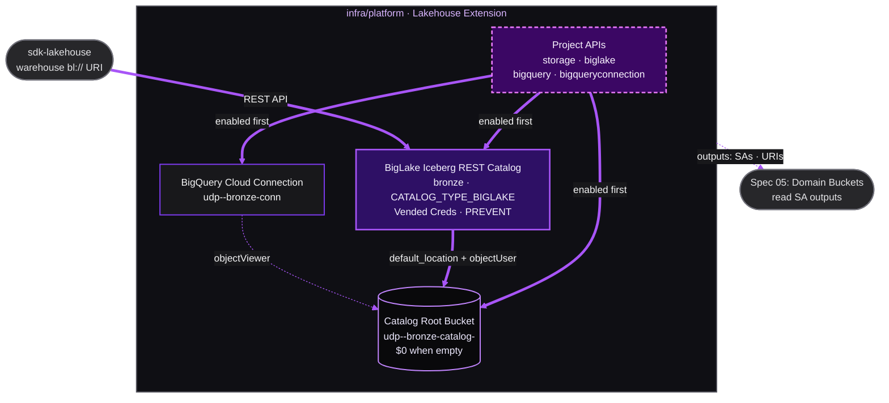

# Spec 04: Lakehouse Platform Extension (APIs, BigLake Catalog & BigQuery Connection)

| Field | Value |
| :--- | :--- |
| **Status** | `Draft (Pending Approval)` |
| **Owner** | Xavier Ruiz |
| **Component** | `platform_unified_data_gcp/infra/platform` (extension) |
| **Stack** | OpenTofu `>= 1.12.2` · `google ~> 8.10` · CFF `v60.0.0` |
| **Archetype / Tier** | Infrastructure-as-Code & GitOps · Mini-Spec (`4 REQs`, `6 TCs`) |
| **Depends On** | [Spec 01](./01_platform_module_setup.md), [Spec 03](./03_data_lakehouse_architecture.md) |
| **Required By** | [Spec 05](./05_domain_bronze_layer.md) (domain Bronze layer) |
| **Related** | `sdk_lakehouse/specs/05_iceberg_gcp_biglake_plugin.md` (`gcp_biglake` SPI) |

---

## 1. Overview & Design

### TL;DR
Spec 03's Stage 1 needs shared lakehouse foundations before any domain can store Bronze data. Following the Spec 01 ownership model, this Mini-Spec adds them to `infra/platform`: the four lakehouse Application Programming Interfaces (APIs), a lightweight catalog root Google Cloud Storage (GCS) bucket, a multi-bucket BigLake Iceberg Representational State Transfer (REST) catalog (`bronze`, `CATALOG_TYPE_BIGLAKE`), and a regional BigQuery Cloud Resource connection. It exposes the catalog URIs and both Google-managed service accounts as platform outputs, adding `$0/mo` idle cost.

### Architecture



### Key Design Decisions
- **Platform-owned because shared:** The catalog, connection, and APIs would exist with zero domains, so Spec 01 §4.1 places them in `infra/platform` and they ride the `udp-gcp-vX.Y.Z` release train.
- **Open BigLake Iceberg REST catalog:** `CATALOG_TYPE_BIGLAKE` keeps Bronze on the open Apache Iceberg REST protocol, supports many domain buckets under one logical `bronze` catalog, and mints downscoped GCS tokens via `CREDENTIAL_MODE_VENDED_CREDENTIALS`.
- **Immutable catalog root:** A dedicated, `$0`-when-empty bucket is the catalog's `default_location`, so adding or removing domains never recreates the catalog.
- **Reuse the project suffix:** The catalog root bucket reuses the platform project's random `-xxxx` suffix instead of adding a second random resource.

### Done Looks Like
- Every Spec 01 verification gate still passes for `infra/platform` with the extension in place.
- Spec 05 and `sdk-lakehouse` consume the new outputs with zero manual glue.
- Acceptance cases `TC-001` through `TC-006` are verified.

---

## 2. Scope

### In Scope
- Append the four lakehouse APIs to the platform's enabled services.
- Provision the catalog root bucket, the `bronze` BigLake catalog, and the BigQuery connection in `infra/platform`.
- Bind the catalog and connection service accounts on the catalog root bucket.
- Add three platform inputs and eight platform outputs, with offline mocked tests.

### Out of Scope (Non-Goals)
- **Domain buckets and their IAM:** Delivered by [Spec 05](./05_domain_bronze_layer.md).
- **Iceberg namespaces & tables:** Owned by Stage 2 (`sdk-lakehouse`, Mini-Spec `08`).
- **Project-level domain principals:** Ingest service accounts, DDL principals, and owner/analyst groups belong to Mini-Spec `07`.
- **Customer-Managed Encryption Keys (CMEK) and VPC Service Controls:** Deferred to future specs.

---

## 3. Functional Requirements

Exact parameter names, defaults, and validation patterns live once in **Section 4**.

| ID | What | Why | How |
| :--- | :--- | :--- | :--- |
| `REQ-01` | Lakehouse project APIs | Keeps every project API in the stack that owns the project, enabled before dependent resources | Append the 4 APIs (§4.1) to `local.platform_apis`, enabled by the existing CFF `project` module with `disable_on_destroy = false` |
| `REQ-02` | Immutable catalog root bucket | Supplies a stable `default_location` so domain changes never recreate the catalog | CFF `gcs` module per §4.2 |
| `REQ-03` | BigLake catalog & BigQuery connection | Provides one open, multi-bucket Iceberg REST catalog with BigQuery queryability for every domain | `google_biglake_iceberg_catalog` and `google_bigquery_connection` per §4.3, with explicit `depends_on` on the APIs and catalog root bucket |
| `REQ-04` | Root IAM, inputs, outputs & tests | Wires credential vending and read access, and gives Spec 05 and `sdk-lakehouse` a stable interface | Bucket IAM per §4.6, validated inputs per §4.4, outputs per §4.5, and mocked assertions in `tests/platform_composition.tftest.hcl` |

---

## 4. Contract & Blueprint

### 4.1 Enabled Project APIs (`disable_on_destroy = false`)

| Service API | Purpose |
| :--- | :--- |
| `storage.googleapis.com` | Catalog root and domain buckets |
| `biglake.googleapis.com` | BigLake Iceberg REST catalog |
| `bigquery.googleapis.com` | BigQuery external Iceberg queries |
| `bigqueryconnection.googleapis.com` | Cloud Resource connection |

### 4.2 Catalog Root Bucket (CFF `//modules/gcs`)

| Setting | Value |
| :--- | :--- |
| **Name** | `udp-<env>-bronze-catalog-<suffix>` (platform project suffix) |
| **Location / Class** | `var.region` · `STANDARD` |
| **Access Control** | Uniform Bucket-Level Access (UBLA) enabled · Public Access Prevention (PAP) `enforced` |
| **Versioning / Soft Delete** | Enabled · `var.soft_delete_retention_seconds` (default 7 days) |
| **Destroy Protection** | `force_destroy = false` (the CFF `gcs` module cannot expose `prevent_destroy`) |
| **Lifecycle** | None |
| **Labels** | Spec 01 mandatory labels plus `layer = "bronze"` and `domain = "platform"` |

### 4.3 Catalog & Connection

| Resource | Setting | Value |
| :--- | :--- | :--- |
| `google_biglake_iceberg_catalog` | `name` | `var.catalog_name` |
| `google_biglake_iceberg_catalog` | `catalog_type` | `"CATALOG_TYPE_BIGLAKE"` |
| `google_biglake_iceberg_catalog` | `default_location` | `"gs://<catalog_root_bucket_name>"` |
| `google_biglake_iceberg_catalog` | `credential_mode` | `"CREDENTIAL_MODE_VENDED_CREDENTIALS"` |
| `google_biglake_iceberg_catalog` | `deletion_policy` | `var.catalog_deletion_policy` |
| `google_bigquery_connection` | `connection_id` | `"udp-<env>-bronze-conn"` |
| `google_bigquery_connection` | `location` / type | `var.region` · `cloud_resource {}` |

### 4.4 New Platform Inputs

| Input | Type | Default | Constraint |
| :--- | :--- | :--- | :--- |
| `catalog_name` | `string` | `"bronze"` | `^[a-z][a-z0-9_-]{1,61}[a-z0-9]$`; env-agnostic name (Spec 03 `ADR-03`) |
| `catalog_deletion_policy` | `string` | `"PREVENT"` | `PREVENT`, `DELETE`, or `ABANDON` |
| `soft_delete_retention_seconds` | `number` | `604800` | Integer `604800..7776000` (7–90 days) |

### 4.5 New Platform Outputs

| Output | Value | Consumer |
| :--- | :--- | :--- |
| `catalog_root_bucket_name` | `udp-<env>-bronze-catalog-<suffix>` | Audit |
| `catalog_root_bucket_uri` | `gs://udp-<env>-bronze-catalog-<suffix>` | Catalog `default_location` |
| `biglake_catalog_name` | `bronze` | `sdk-lakehouse` & CI |
| `biglake_warehouse_uri` | `bl://projects/<project_id>/catalogs/<catalog>` | `sdk-lakehouse` `warehouse` |
| `biglake_rest_uri` | `https://biglake.googleapis.com/iceberg/v1/restcatalog` | Iceberg REST clients |
| `biglake_service_account` | Google-managed BigLake SA email | Spec 05 bucket IAM |
| `bigquery_connection_id` | Regional connection ID | Stage 3 views |
| `bigquery_connection_sa` | Google-managed connection SA email | Spec 05 bucket IAM |

### 4.6 Catalog Root IAM

| Principal | Role on Catalog Root | Purpose |
| :--- | :--- | :--- |
| BigLake catalog SA | `roles/storage.objectUser` | Mints downscoped vended GCS tokens |
| BigQuery connection SA | `roles/storage.objectViewer` | Read-only access to Iceberg metadata and Parquet |

### 4.7 Consumer Payload

```properties
# Consumed by sdk-lakehouse (CATALOG_BACKEND=gcp_biglake)
warehouse=bl://projects/udp-dev-xxxx/catalogs/bronze
gcp.project=udp-dev-xxxx
```

---

## 5. Invariants & Failure Modes

### Key Invariants
- **Platform-only:** Every resource in this spec is declared in `infra/platform`; none is per-domain.
- **Stable catalog:** Adding or removing domains never changes the catalog or its root bucket.
- **Zero idle compute:** The extension adds storage, catalog metadata, and a connection only.
- **Fail-closed:** The root bucket is private and the catalog defaults to `PREVENT`.

### Failure Modes

| Condition | Expected Behavior | Guarantee |
| :--- | :--- | :--- |
| Catalog or connection planned before its API or the root bucket | Prevented by explicit `depends_on` | Deterministic first apply |
| Invalid `catalog_name`, deletion policy, or soft-delete window | OpenTofu variable validation error | Fails before any GCP call |
| Accidental destroy | Catalog blocked by `PREVENT`; a non-empty root bucket is blocked by `force_destroy = false` | An empty root bucket can still be destroyed, so overrides stay deliberate |
| Spec 05 applied in `uat`/`prod` before a `udp-gcp` release with this spec | Terragrunt `dependency` fails on missing outputs | Spec 01 release ordering holds |

---

## 6. Acceptance & Verification (`TC-*`)

| Case | Scenario | Pass Condition |
| :--- | :--- | :--- |
| `TC-001` (`REQ-01`–`04`) | Spec 01 gates | `tofu fmt`, `tofu validate`, `tflint`, `trivy config` (`HIGH,CRITICAL`), and `tofu test` exit `0` for `infra/platform`. |
| `TC-002` (`REQ-01`) | APIs enabled | Mocked test: the project module's services include all 4 APIs from §4.1. |
| `TC-003` (`REQ-02`) | Catalog root hardening | Mocked test: name pattern, UBLA, PAP, versioning, 7-day soft delete, `force_destroy = false`, and `layer`/`domain` labels match §4.2. |
| `TC-004` (`REQ-03`, `REQ-04`) | Catalog, connection & root IAM | Mocked test: catalog settings and connection match §4.3, and both §4.6 bindings exist on the root bucket. |
| `TC-005` (`REQ-04`) | Negative validation | `expect_failures` triggers for an invalid `catalog_name`, `catalog_deletion_policy = "KEEP"`, and soft delete `< 604800`. |
| `TC-006` (`REQ-04`) | Outputs & lockfile | All 8 §4.5 outputs exist with the documented formats, and the platform lockfile still covers `darwin_arm64` and `linux_amd64`. |
