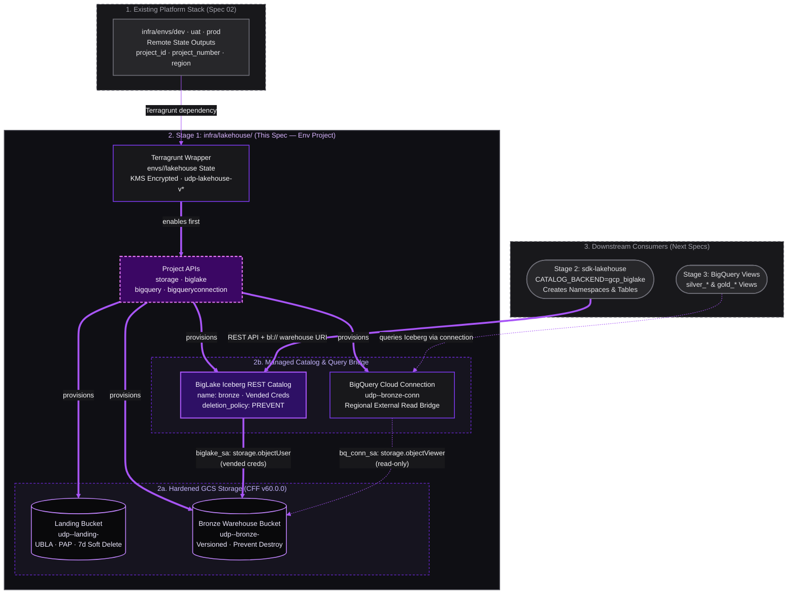

# Spec 05: Lakehouse Stack, Bronze Storage & BigLake Catalog

| Field | Value |
| :--- | :--- |
| **Status** | `Draft (Pending Approval)` |
| **Owner** | Xavier Ruiz |
| **Component** | `platform_unified_data_gcp/infra/lakehouse/{stack, envs}` |
| **Stack** | OpenTofu `>= 1.12.2` · Terragrunt `>= 0.72` · `google ~> 8.10` · CFF `v60.0.0` |
| **Archetype / Tier** | Infrastructure-as-Code & GitOps · Mini-Spec (`8 REQs`, `8 TCs`) |
| **Depends On** | [Spec 02](./02_platform_and_terragrunt_envs.md), [Spec 04](./04_data_lakehouse_architecture.md) |
| **Related** | `sdk_lakehouse/specs/05_iceberg_gcp_biglake_plugin.md` (`gcp_biglake` SPI) |

---

## 1. Overview & Design

### TL;DR
Spec 04 splits the lakehouse into a 3-stage pipeline: **Stage 1 (OpenTofu)** provisions durable storage and catalog foundations, **Stage 2 (`sdk-lakehouse`)** manages Iceberg namespaces/tables over BigLake REST, and **Stage 3** deploys Silver/Gold views. This Mini-Spec defines the Stage 1 foundation (`infra/lakehouse/`): an isolated Terragrunt stack per environment, hardened GCS Landing and Bronze buckets, a managed BigLake Iceberg REST catalog, and a BigQuery Cloud Resource connection—with `$0/mo` idle compute.

### Architecture



### Key Design Decisions
- **Isolated state & tag train:** `infra/lakehouse/` gets its own state prefix (`envs/<env>/lakehouse`) and release tags (`udp-lakehouse-vX.Y.Z`) so lakehouse changes never risk `infra/platform` networking or project state.
- **Vended credentials by default:** BigLake mints downscoped GCS tokens via `CREDENTIAL_MODE_VENDED_CREDENTIALS`, removing the need to hand out broad bucket IAM to every Iceberg client.
- **Conditional Nearline lifecycle:** The 30-day Nearline transition on the Landing bucket is omitted when retention is `<= 30` days (`dev`), avoiding GCS Nearline early-deletion charges.
- **Zero idle compute:** Provisions only storage, catalog metadata, and a BigQuery connection (`$0/mo` idle).

### Done Looks Like
- Every static check, security scan, and offline mocked test in the Verification Gates table passes cleanly.
- Stack outputs plug directly into `sdk-lakehouse` (`CATALOG_BACKEND=gcp_biglake`) with zero manual glue.
- Acceptance cases `TC-001` through `TC-008` are verified.

| Gate | Command | Scope |
| :--- | :--- | :--- |
| Formatting | `tofu fmt -check` · `terragrunt hcl fmt --check` | `stack/` and `envs/` |
| Render & Schema | `terragrunt render` · `tofu validate` | All env wrappers and stack |
| Lint & Security | `tflint --recursive` · `trivy config` (`HIGH,CRITICAL`) | Full `infra/lakehouse/` |
| Unit Tests | `tofu test` (mocked provider) | `tests/bronze_storage.tftest.hcl` |

---

## 2. Scope

### In Scope
- Stand up the isolated `infra/lakehouse/` Terragrunt scaffold with KMS-encrypted state and pinned CFF `v60.0.0`.
- Activate the four required Lakehouse GCP APIs at the environment project level.
- Provision hardened GCS Landing and Bronze buckets via the CFF `gcs` module.
- Provision the regional BigLake Iceberg REST catalog (`bronze`) and BigQuery Cloud Resource connection.
- Bind minimal Bronze-bucket IAM so BigLake credential vending and BigQuery reads work out of the box.
- Commit a multi-platform provider lockfile (`darwin_arm64` and `linux_amd64`) alongside offline unit tests.

### Out of Scope (Non-Goals)
- **Iceberg namespaces & tables:** Strictly owned by Stage 2 (`sdk-lakehouse`).
- **CI/CD workflows & domain onboarding:** `udp-lakehouse-*.yml` pipelines and `domain.yaml` wiring are deferred to the follow-up CI/CD Mini-Spec.
- **Domain/user IAM & BigQuery datasets:** Ingest service accounts, DDL principals, analyst groups, and `silver_*`/`gold_*` datasets belong to the Lakehouse IAM Mini-Spec.
- **Streaming & advanced security:** Pub/Sub ingestion, Cloud Run jobs, CMEK encryption, and VPC-SC are deferred to future specs.

---

## 3. Functional Requirements

Exact parameter names, defaults, and validation patterns live once in **Section 4**.

### Stack & Environment Wiring

| ID | What | Why | How |
| :--- | :--- | :--- | :--- |
| `REQ-01` | Isolated Terragrunt root | Keeps lakehouse state and blast radius separate from `infra/platform` | `envs/root.hcl` pins `tofu`, generates KMS-encrypted state under `envs/<env>/lakehouse`, and mirrors Spec 02 offline/ephemeral flags |
| `REQ-02` | Immutable env promotion | Ensures `uat`/`prod` deploy exact audited releases while `dev` iterates fast | `dev` tracks `../../stack//.` locally; `uat`/`prod` pin `udp-lakehouse-vX.Y.Z` (or `"unreleased"`) via `release.yaml` |
| `REQ-03` | Platform output dependency | Avoids duplicating project/region config and keeps `envs/` DRY | Each env wrapper reads `project_id`, `project_number`, and `region` via Terragrunt `dependency "platform"` with offline `mock_outputs`; zero `.tf` files in `envs/` |
| `REQ-04` | Pinned modules & API enablement | Prevents upstream drift and race conditions on first apply | `module-versions.yaml` pins CFF via OpenTofu Early Evaluation; 4 GCP APIs enabled with `disable_on_destroy = false` before dependent resources |

### Bronze Storage & Catalog

| ID | What | Why | How |
| :--- | :--- | :--- | :--- |
| `REQ-05` | Hardened Landing bucket | Stores immutable raw payloads for replay without incurring `dev` early-deletion fees | CFF `gcs` module with UBLA, enforced PAP, 7d soft delete, labels, expiry at `landing_retention_days`, and 30d Nearline rule only when retention `> 30` |
| `REQ-06` | Hardened Bronze warehouse | Protects Iceberg metadata and Parquet files from accidental deletion or public exposure | CFF `gcs` module with UBLA, enforced PAP, object versioning, 7d soft delete, labels, `force_destroy = false`, and `prevent_destroy` |
| `REQ-07` | BigLake REST catalog & BQ connection | Provides managed Iceberg governance with downscoped access and BigQuery queryability | `google_biglake_iceberg_catalog` (`bronze`, vended credentials, `PREVENT`) backed by Bronze bucket + regional `google_bigquery_connection` (`cloud_resource`) |
| `REQ-08` | Infra-wiring IAM, outputs & tests | Unblocks Stage 2 (`sdk-lakehouse`) and guarantees offline CI verification | Bronze-bucket IAM bindings (§4.5), SDK-ready outputs (§4.4), multi-platform `.terraform.lock.hcl`, and mocked `tests/bronze_storage.tftest.hcl` |

---

## 4. Contract & Blueprint

### 4.1 Directory Layout

```text
platform_unified_data_gcp/infra/lakehouse/
├── stack/
│   ├── module-versions.yaml          # Pinned CFF tag (v60.0.0)
│   ├── versions.tf                   # OpenTofu >= 1.12.2, google/google-beta ~> 8.10, random ~> 3.6
│   ├── variables.tf                  # Typed inputs & validations
│   ├── main.tf                       # APIs, GCS buckets, BigLake catalog, BQ connection, wiring IAM
│   ├── outputs.tf                    # SDK & consumer outputs
│   ├── .terraform.lock.hcl           # darwin_arm64 + linux_amd64
│   └── tests/bronze_storage.tftest.hcl
└── envs/                             # DRY Terragrunt wrappers (zero .tf files)
    ├── root.hcl                      # Generates backend.tf, encryption.tf, provider.tf
    ├── dev/terragrunt.hcl            # Tracks ../../stack//. (30d landing retention)
    ├── uat/{terragrunt.hcl, release.yaml}   # Pinned tag (90d landing retention)
    └── prod/{terragrunt.hcl, release.yaml}  # Pinned tag (365d landing retention)
```

### 4.2 Resource Blueprint

#### GCS Buckets (via CFF `//modules/gcs`)

| Setting | Landing Bucket | Bronze Warehouse Bucket |
| :--- | :--- | :--- |
| **Name Pattern** | `udp-<env>-landing-<suffix>` | `udp-<env>-bronze-<suffix>` |
| **Storage Class** | `STANDARD` | `STANDARD` |
| **Access Control** | UBLA enabled · PAP `enforced` | UBLA enabled · PAP `enforced` |
| **Object Versioning** | Disabled | Enabled |
| **Soft Delete** | 7 days (`604800s`) | 7 days (`604800s`) |
| **Destroy Protection** | `force_destroy = false` | `force_destroy = false` + `prevent_destroy` |
| **Lifecycle** | Nearline@30d (iff `> 30d`) · Delete@`landing_retention_days` | None (managed by Iceberg snapshots) |
| **`layer` Label** | `"landing"` | `"bronze"` |

#### Catalog, Connection & Project APIs

| Resource | Setting | Value |
| :--- | :--- | :--- |
| **BigLake Catalog** (`google_biglake_iceberg_catalog`) | `name` | `var.catalog_name` (default `"bronze"`) |
| **BigLake Catalog** | `catalog_type` | `"CATALOG_TYPE_BIGLAKE"` |
| **BigLake Catalog** | `default_location` | `"gs://<bronze_bucket_name>"` |
| **BigLake Catalog** | `credential_mode` | `"CREDENTIAL_MODE_VENDED_CREDENTIALS"` |
| **BigLake Catalog** | `deletion_policy` | `var.catalog_deletion_policy` (default `"PREVENT"`) |
| **BigQuery Connection** (`google_bigquery_connection`) | `connection_id` | `"udp-<env>-bronze-conn"` |
| **BigQuery Connection** | `location` / type | `var.region` · `cloud_resource {}` |

#### Enabled Project APIs (`disable_on_destroy = false`)

| Service API | Purpose |
| :--- | :--- |
| `storage.googleapis.com` | Landing and Bronze GCS buckets |
| `biglake.googleapis.com` | Managed BigLake Iceberg REST catalog |
| `bigquery.googleapis.com` | BigQuery external Iceberg query engine |
| `bigqueryconnection.googleapis.com` | Regional Cloud Resource connection |

#### Mandatory Bucket Labels

| Label Key | Source |
| :--- | :--- |
| `managed_by` | `"opentofu"` |
| `platform` | `var.platform_name` |
| `environment` | `var.environment` |
| `cost_center` | `var.cost_center` |
| `layer` | `"landing"` or `"bronze"` |

### 4.3 Stack Inputs

| Input | Type | Default | Constraint |
| :--- | :--- | :--- | :--- |
| `environment` | `string` | *required* | `dev`, `uat`, or `prod` |
| `project_id` | `string` | *required* | Valid GCP project ID (from `platform` output) |
| `region` | `string` | `"us-central1"` | Valid GCP region matching `platform` |
| `landing_retention_days` | `number` | `30` | Integer `7..3650` (`dev` 30, `uat` 90, `prod` 365) |
| `soft_delete_retention_seconds` | `number` | `604800` | Integer `604800..7776000` (7d–90d) |
| `catalog_name` | `string` | `"bronze"` | Lowercase ID, 3–63 chars (ADR-04) |
| `catalog_deletion_policy` | `string` | `"PREVENT"` | `PREVENT`, `DELETE`, or `ABANDON` |
| `platform_name` | `string` | `"unified-data-platform"` | Mandatory label value |
| `cost_center` | `string` | `"engineering-playground"` | Mandatory label value |

#### Validation Patterns

| Field | Regex |
| :--- | :--- |
| `project_id` | `^[a-z][a-z0-9-]{4,28}[a-z0-9]$` |
| `region` | `^[a-z]+-[a-z]+[0-9]+$` |
| `catalog_name` | `^[a-z][a-z0-9_-]{1,61}[a-z0-9]$` |
| `release.yaml` (`lakehouse_version`) | `^(unreleased\|udp-lakehouse-v[0-9]+\.[0-9]+\.[0-9]+)$` |
| `module-versions.yaml` | `^v[0-9]+\.[0-9]+\.[0-9]+$` |

### 4.4 Stack Outputs

| Output | Format / Value | Consumer |
| :--- | :--- | :--- |
| `landing_bucket_name` | `udp-<env>-landing-<suffix>` | Ingest jobs & IAM specs |
| `landing_bucket_uri` | `gs://udp-<env>-landing-<suffix>` | Ingest jobs |
| `bronze_bucket_name` | `udp-<env>-bronze-<suffix>` | IAM & audit scripts |
| `bronze_bucket_uri` | `gs://udp-<env>-bronze-<suffix>` | BigLake `default_location` |
| `biglake_catalog_name` | `bronze` | `sdk-lakehouse` / CI |
| `biglake_warehouse_uri` | `bl://projects/<project_id>/catalogs/<catalog>` | `sdk-lakehouse` (`warehouse`) |
| `biglake_rest_uri` | `https://biglake.googleapis.com/iceberg/v1/restcatalog` | Iceberg REST clients |
| `biglake_service_account` | Google-managed BigLake SA email | Audit / IAM diagnostics |
| `bigquery_connection_id` | Regional BQ connection ID | Stage 3 Silver/Gold views |
| `bigquery_connection_sa` | Google-managed BQ connection SA email | Audit / IAM diagnostics |

### 4.5 Infra-Wiring IAM (Bronze Bucket Only)

| Principal | Scope & Role | Purpose |
| :--- | :--- | :--- |
| BigLake catalog SA (`biglake_service_account`) | Bronze bucket · `roles/storage.objectUser` | Mints downscoped vended GCS tokens for Iceberg clients |
| BQ connection SA (`cloud_resource[0].service_account_id`) | Bronze bucket · `roles/storage.objectViewer` | Read-only access to Bronze Iceberg metadata & Parquet |

### 4.6 External Config & Consumer Payloads

```yaml
# infra/lakehouse/envs/{uat,prod}/release.yaml
lakehouse_version: "unreleased"   # or "udp-lakehouse-vX.Y.Z"
```

```properties
# Consumed by sdk-lakehouse (CATALOG_BACKEND=gcp_biglake)
warehouse=bl://projects/udp-dev-xxxx/catalogs/bronze
gcp.project=udp-dev-xxxx
```

---

## 5. Invariants & Failure Modes

### Key Invariants
- **Zero idle compute:** The stack provisions storage, catalog metadata, and a BigQuery connection only, keeping idle compute at `$0/mo`.
- **Fail-closed security & teardown:** Every bucket and catalog defaults to private access and accidental-destroy protection unless explicitly overridden (§4.2).
- **No `dev` Nearline penalty:** The 30-day Nearline transition is omitted whenever `landing_retention_days <= 30`.
- **Co-location & isolation:** All resources share `var.region`, state is isolated to `envs/<env>/lakehouse`, and zero `.tf` files live in `envs/`.

### Failure Modes

| Condition | Expected Behavior | Guarantee |
| :--- | :--- | :--- |
| Invalid input (`environment`, retention, policy) | OpenTofu variable validation error | Fails fast before any GCP call |
| Malformed `release.yaml` or floating ref | Terragrunt / regex check failure | Blocks unpinned `uat`/`prod` deploys |
| Catalog created before API or Bronze bucket | Prevented via explicit `depends_on` | Deterministic apply ordering |
| Accidental `tofu destroy` on Bronze/catalog | Blocked by `force_destroy`/`PREVENT` | Requires deliberate override |

---

## 6. Acceptance & Verification (`TC-*`)

| Case | Scenario | Pass Condition |
| :--- | :--- | :--- |
| `TC-001` (`REQ-04`) | Static & security gates | `tofu fmt`, `terragrunt hcl fmt`, `validate`, `tflint`, and `trivy` (`HIGH,CRITICAL`) exit `0`. |
| `TC-002` (`REQ-01`–`03`) | Terragrunt root & state isolation | `terragrunt render --json` produces `envs/<env>/lakehouse` KMS state; `dev` tracks local stack; `uat`/`prod` pin tag. |
| `TC-003` (`REQ-05`) | Landing lifecycle (`30` / `90` / `365`) | Mocked `tofu test`: `dev` omits Nearline; `uat`/`prod` add Nearline@30d + Delete; UBLA/PAP/soft-delete/labels verified. |
| `TC-004` (`REQ-06`) | Bronze bucket hardening | Mocked `tofu test`: versioning, UBLA, PAP, 7d soft delete, `force_destroy = false`, and `layer = "bronze"` verified. |
| `TC-005` (`REQ-07`–`08`) | BigLake catalog & vended IAM | Mocked `tofu test`: `bronze` catalog (`CATALOG_TYPE_BIGLAKE`, vended creds, `PREVENT`) + `objectUser` binding on Bronze bucket. |
| `TC-006` (`REQ-07`–`08`) | BigQuery connection & read IAM | Mocked `tofu test`: regional `cloud_resource` connection created + `objectViewer` binding scoped strictly to Bronze bucket. |
| `TC-007` (`REQ-05`–`07`) | Negative validation tests | `expect_failures` triggers for invalid `environment`, retention `< 7`, soft delete `< 604800`, and invalid deletion policy. |
| `TC-008` (`REQ-08`) | SDK outputs & lockfile | Exports `biglake_warehouse_uri`, `bronze_bucket_uri`, `biglake_rest_uri`; lockfile covers `darwin_arm64` + `linux_amd64`. |
