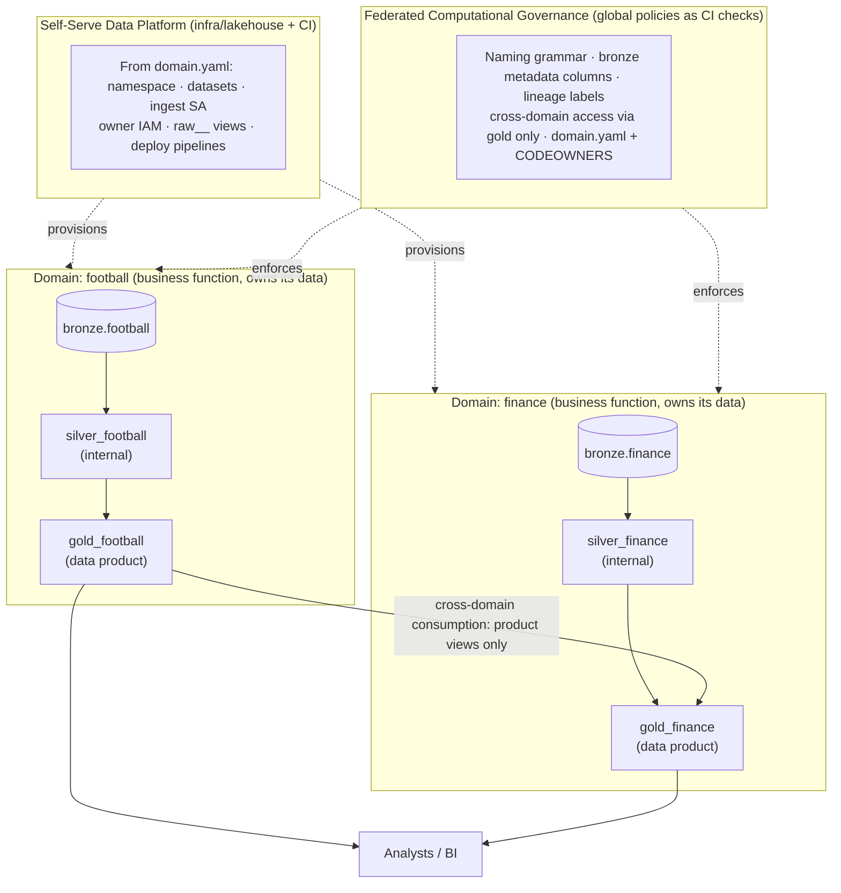
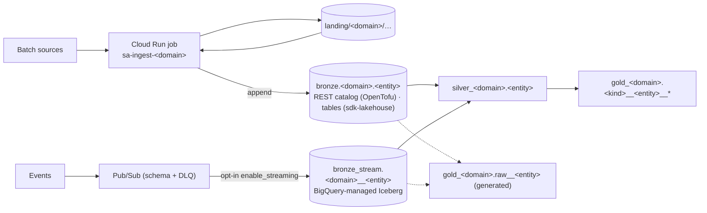

# Feature Spec: GCP Data Lakehouse Reference Architecture (`infra/lakehouse`)

- **Status:** Draft (Pending Approval)
- **Module / Component:** `platform_unified_data_gcp/infra/lakehouse` (separate Terragrunt stack per env) + `platform_unified_data_gcp/lakehouse/` (domain-owned schema- and view-as-code)
- **Archetype:** Data Pipeline Contract + Infrastructure-as-Code & GitOps (Architecture Overview / Epic)
- **Tier:** Full Spec (architecture parent of Mini-Specs `06`–`13`)
- **Owner:** Xavier Ruiz
- **Depends On:** `specs/01_gcp_bootstrap_and_wif.md`, `specs/03_platform_and_terragrunt_envs.md`, `specs/04_github_actions_cicd.md`
- **Related:** `playground-data-engineering/maven_projects/sdk_lakehouse/specs/05_iceberg_gcp_biglake_plugin.md` (`gcp_biglake` SPI plugin)

---

## 1. Goal & Context

### Problem Statement
Specs 01–04 deliver per-environment GCP projects, networking, budgets and GitOps promotion, but no data layer. We need one architecture for how data lands, is stored, governed and served on GCP before writing implementation mini-specs. The chosen design is a **data mesh on a view-first ELT lakehouse**. Each **domain is a business function that owns its data** end to end and publishes it as a data product (its `gold_<domain>` views). The platform provides self-serve infrastructure and enforces global policies automatically in CI. Inside a domain, ingestion writes append-only **Apache Iceberg bronze** tables, and **silver and gold are BigQuery views**, so nothing runs while idle.

### Success Metrics
- Onboarding a new domain only requires adding `lakehouse/domains/<domain>/` (with `domain.yaml`) and a `CODEOWNERS` entry. The platform provisions everything else.
- With `enable_streaming = false`, an environment runs **zero always-on compute**, and idle cost stays within the Spec 03 budgets (`$50` / `$100` / `$250`).
- The reference domain (`football`) flows source → landing → bronze → silver → gold in `dev`. Every view built on a bronze table can be found by name or by label.
- Full verification coverage of `TC-001` through `TC-015`.

---

## 2. Visual Architecture

### 2.1 Data Mesh Topology



### 2.2 Data Flow Within One Domain



---

## 3. Scope & Explicit Non-Goals

### In Scope
- **Data mesh operating model:** domain ownership, gold-as-data-product, the self-serve platform and federated governance (§5.1).
- **Stack boundary:** a separate `infra/lakehouse/` Terragrunt stack per env with its own state (`envs/<env>/lakehouse`) and tags (`udp-lakehouse-vX.Y.Z`), reading `infra/platform` outputs.
- **Layer model:** a landing zone; bronze Iceberg tables (batch tables in the BigLake REST catalog, streaming tables as BigQuery-managed Iceberg); per-domain silver and gold BigQuery view datasets; generated `raw__` views.
- **Ownership split:** OpenTofu provisions the infrastructure (buckets, catalog, datasets, connections). `sdk-lakehouse` manages only the **namespaces and tables** inside the catalog.
- **Cross-cutting rules:** batch and opt-in streaming ingestion, naming and lineage, IAM, maintenance, observability, the materialization escape hatch, and the Mini-Spec roadmap (§5.7).

### Non-Goals (Do Not Implement)
- **No per-domain GCP projects:** domains are isolated by namespace, dataset and IAM inside each env project. Project-per-domain is a possible future spec.
- **No catalog lifecycle in `sdk-lakehouse`**, no Spark/Dataflow transformation pipelines, no Cloud Composer.
- **No physical silver or gold by default** (only via `REQ-10`), no Iceberg catalog views, no hand-written `raw__` views.
- **Deferred to future specs:** CMEK, VPC-SC, Dataplex catalog and lineage UI, policy tags and masking, data-product SLAs and contracts beyond `domain.yaml`.

---

## 4. Functional Requirements

- `REQ-01`: **Separate Lakehouse Stack.** All data-layer resources shall live in `infra/lakehouse/`. It consumes `project_id`, `region` and `subnet_id` from platform outputs and follows Spec 04 promotion (`dev` tracks `main`; `uat`/`prod` pin `udp-lakehouse-vX.Y.Z`).
- `REQ-02`: **Domain Ownership & Self-Serve Onboarding.** Each domain shall correspond to one business function, declared in `lakehouse/domains/<domain>/domain.yaml` (§5.1), with a `CODEOWNERS` entry for its folder. From that file the platform shall provision, with no domain-written infrastructure code: bronze namespace `<domain>`, datasets `silver_<domain>` and `gold_<domain>`, `sa-ingest-<domain>`, owner-group IAM and a landing prefix.
- `REQ-03`: **Landing Zone.** Batch sources shall first write raw, unmodified payloads to `landing/<domain>/<source>/ingest_date=YYYY-MM-DD/<run_id>/`. Objects are immutable, which allows replay and backfill.
- `REQ-04`: **Bronze Tables.** OpenTofu shall provision one BigLake Iceberg REST catalog per env (logical name `bronze` in every env). `sdk-lakehouse` (`gcp_biglake`) shall manage only the namespaces and tables inside it, from domain YAML. When `enable_streaming = true`, Pub/Sub topics with an attached schema shall deliver events into BigQuery-managed Iceberg tables in `bronze_stream`, with a dead-letter topic for rejected messages. When `false`, zero streaming resources exist.
- `REQ-05`: **Ingestion-Time Hygiene.** Every bronze row shall carry the §5.3 metadata columns. Records that fail schema checks go to quarantine (`landing/_quarantine/<domain>/`) or the DLQ and are never dropped silently. Ingestion shall contain no business logic.
- `REQ-06`: **Silver Views (Domain-Internal).** Each bronze entity shall have exactly one `silver_<domain>.<entity>` view that types, conforms and **deduplicates** on `_event_key` (keeping the latest `_ingested_at`) and merges batch and streaming rows. Silver shall not be readable outside its domain.
- `REQ-07`: **Gold Views = Data Product.** `gold_<domain>` is the domain's only published interface. Curated gold views shall read their own domain's silver or **other domains' `gold_*` views**, and never another domain's silver or bronze. Gold datasets are authorized against their sources.
- `REQ-08`: **Definitions as Code.** Every namespace, table and view shall be declared under `lakehouse/domains/<domain>/` and deployed by CI after a domain-owner review (`CODEOWNERS`). Manual DDL is forbidden in `uat`/`prod`.
- `REQ-09`: **Storage Layout for View Performance.** Bronze tables shall declare Iceberg partitioning (default `day(_ingested_at)`). BigQuery-managed tables shall cluster on `_event_key`.
- `REQ-10`: **Selective Materialization Escape Hatch.** A curated gold view may be materialized into a BigQuery-managed Iceberg table by a scheduled query only with an entry in `lakehouse/materializations.yaml` citing the measured scan cost or latency. It keeps its exact name and labels.
- `REQ-11`: **Least-Privilege Access.** Access shall follow §5.5. Ingest identities are scoped to their own domain, the CI identity owns DDL, domain owners read their own domain, and analysts read only `gold_*`.
- `REQ-12`: **Maintenance & Observability.** Bronze REST-catalog tables shall get scheduled snapshot expiry, orphan-file removal and compaction. Ingestion failures, DLQ backlog and maintenance failures shall alert the Spec 03 channel, labeled with `domain`.
- `REQ-13`: **Generated Raw Views.** For every bronze table, the stack shall automatically create `gold_<domain>.raw__<entity>` as a column-for-column passthrough, created or removed in the same apply as its source table.
- `REQ-14`: **Federated Computational Governance.** CI shall reject any change that breaks a global policy:
  - the §5.4 naming grammar;
  - missing `domain.yaml` or `CODEOWNERS`;
  - missing bronze metadata columns or lineage labels;
  - a cross-domain read of silver or bronze;
  - a view whose declared `sources` differ from the tables a BigQuery dry-run reports it reads.

---

## 5. Interface & Data Contract

### 5.1 Data Mesh Ownership Contract

| Mesh Principle | Implementation | Owned By |
| :--- | :--- | :--- |
| Domain ownership | One business function = one domain = one folder, bronze namespace, `silver_`/`gold_` datasets and ingest SA | Domain owner group |
| Data as a product | `gold_<domain>` curated and `raw__` views, described by `domain.yaml` and view sidecars | Domain owner group |
| Self-serve platform | `infra/lakehouse` turns `domain.yaml` into infrastructure and runs the deploy pipelines | Platform owner |
| Federated computational governance | Global policies (`REQ-14`) run as CI checks on every PR | Platform defines; domains comply |

```yaml
# lakehouse/domains/football/domain.yaml
domain: football
business_function: "Sports performance analytics"
owner_group: football-data-owners@<org-domain>
description: "Premier League matches, teams and player stats"
```

### 5.2 Storage, Catalog & Dataset Inventory (per env, same region)

| Layer | Resource | Name Pattern | Provisioned By | Contents Managed By |
| :--- | :--- | :--- | :--- | :--- |
| Landing | GCS bucket (per-domain prefixes) | `udp-<env>-landing-<suffix>` | OpenTofu | `sa-ingest-<domain>` |
| Bronze (batch) | GCS bucket + BigLake REST catalog `bronze` | `udp-<env>-bronze-<suffix>` | OpenTofu | `sdk-lakehouse` (namespace per domain, tables) |
| Bronze (stream) | GCS bucket + dataset `bronze_stream` + connection | `udp-<env>-bronze-stream-<suffix>` | OpenTofu | OpenTofu (opt-in `enable_streaming`) |
| Silver / Gold | BigQuery datasets per domain | `silver_<domain>`, `gold_<domain>` | OpenTofu (from `domain.yaml`) | OpenTofu (views, `raw__` generation) |

All buckets use uniform bucket-level access, enforced public access prevention, soft delete and lifecycle rules (landing goes to Nearline after 30d and is deleted after `landing_retention_days`). All resources carry the Spec 03 labels plus `layer` and `domain`.

### 5.3 Bronze Row Contract (Mandatory Metadata Columns)

| Column | Type | Rule |
| :--- | :--- | :--- |
| `_ingested_at` | `timestamp` (UTC) | Set at commit; default partition source |
| `_source` / `_batch_id` | `string` | `<domain>.<source>` / Cloud Run execution or Pub/Sub message ID |
| `_source_uri` | `string` (nullable) | Landing object URI (batch only), used for replay lineage |
| `_event_key` | `string` | Declared business key for silver dedup |

### 5.4 Naming & Lineage Convention

Names are `snake_case`, and `__` is reserved as the token separator. `<entity>` (the bronze table name) is the anchor that makes every downstream object traceable.

| Object | Pattern | Example |
| :--- | :--- | :--- |
| Bronze batch / stream table | `bronze.<domain>.<entity>` / `bronze_stream.<domain>__<entity>` | `bronze.football.matches` |
| Silver view (1:1) | `silver_<domain>.<entity>` | `silver_football.matches` |
| Raw gold view (generated) | `gold_<domain>.raw__<entity>` | `gold_football.raw__matches` |
| Curated gold view | `gold_<domain>.<kind>__<entity>__<qualifier>`, where `kind` ∈ `dim`, `fct`, `agg`, `rpt` | `gold_football.agg__matches__team_season_standings` |

Every silver and curated gold view has a YAML sidecar (`description`, `grain`, `owner`, `sources`). On deploy, every view gets labels `domain`, `layer`, `view_kind`, and one `src_<entity>` label valued with that entity's domain, so cross-domain lineage stays visible. Views can be traced by name (`*__<entity>__*`) or through `INFORMATION_SCHEMA.TABLE_OPTIONS`.

### 5.5 IAM / Security Principal Matrix

| Principal | Auth / Condition | Scope | Access |
| :--- | :--- | :--- | :--- |
| `sa-ingest-<domain>` | Cloud Run job identity | `landing/<domain>/` prefix, `bronze.<domain>` tables | Write and append only; no DDL |
| Pub/Sub service agent | Google-managed | `bronze_stream` | Write table data |
| `sa-lakehouse-ddl` | GitHub Actions WIF (`main` for apply) | Namespaces, tables, datasets, views | DDL only; **no** catalog create/delete |
| `sa-maintenance` | Scheduler-invoked job | `bronze` tables | Table maintenance only |
| `<domain>-data-owners` group | Google Group | Own domain's bronze, silver, gold | Read; PR approval via `CODEOWNERS` |
| `analysts` group / other domains | Google Group / view authorization | `gold_*` datasets | Read data products only |

### 5.6 Architecture Decision Register

| ID | Decision | Verify In |
| :--- | :--- | :--- |
| `ADR-01` | Data mesh by business-function domain, with domains isolated inside the shared env project | `06`, `08` |
| `ADR-02` | Separate `infra/lakehouse` stack with its own tag namespace | `06` |
| `ADR-03` | Silver and gold as BigQuery views; gold is the data product interface | `12` |
| `ADR-04` | Catalog provisioned by OpenTofu; namespaces and tables managed by `sdk-lakehouse`; logical catalog name `bronze` in every env | `07`, `09` |
| `ADR-05` | Streaming bronze as BigQuery-managed Iceberg (opt-in) | `11` |
| `ADR-06` | Generated `raw__` views instead of granting analysts bronze access | `12` |
| `ADR-07` | To confirm: BigQuery references to REST-catalog tables, authorized views over them, namespace-scoped catalog IAM, and Pub/Sub subscriptions writing to Iceberg | `07`, `08`, `11` |

### 5.7 Mini-Spec Roadmap

| Spec | Title | Delivers |
| :--- | :--- | :--- |
| `06` | Lakehouse stack & domain onboarding scaffold | Stack, state, `udp-lakehouse-v*` tags, CI routing, `domain.yaml` → per-domain resources |
| `07` | Bronze storage & BigLake catalog provisioning | Buckets, REST catalog, BigQuery connection, lifecycle |
| `08` | Lakehouse IAM & domain access model | §5.5 principals, authorized views |
| `09` | Bronze namespace & table deployment | `sdk-lakehouse` CI job (needs the SDK graduated and published) |
| `10` | Batch ingestion framework | Cloud Run job contract, landing, quarantine, Scheduler |
| `11` | Streaming ingestion (opt-in) | Pub/Sub schemas, DLQ, BigQuery-managed Iceberg tables |
| `12` | View-as-code, raw views & governance checks | Silver/gold deploy, `raw__` generation, `REQ-14` CI policies, `REQ-10` register |
| `13` | Maintenance, observability & alerting | Maintenance jobs, alerts, per-domain cost views |

---

## 6. Invariants, Edge Cases & Failure Modes

### Key Invariants
1. **Domain Sovereignty:** A domain's silver and bronze are never read outside the domain, except through the platform-generated `raw__` views in its own gold.
2. **Zero Idle Compute by Default:** With `enable_streaming = false`, no always-on compute exists.
3. **One Entity → One Silver View → One Raw View**, and curated gold never reads bronze.
4. **Replayable & Env-Agnostic:** Landing objects are immutable within retention, and domain definitions never contain project IDs, bucket names or env names.

### Failure Mode Matrix

| Failure Condition | Expected Behavior |
| :--- | :--- |
| Domain folder without `domain.yaml` or `CODEOWNERS` | CI fails; nothing is provisioned |
| A view reads another domain's silver or bronze, breaks the naming grammar, or has undeclared sources | CI fails on the PR (`REQ-14`) |
| Malformed batch record / invalid streaming message | Quarantine or DLQ; valid rows commit; `domain`-labeled alert |
| Duplicate or late events | Bronze and `raw__` keep every row; silver keeps the latest per `_event_key` |
| Bronze table removed from YAML | Its `raw__` view is removed in the same apply; plan flags dependent views |
| Manual DDL in `uat`/`prod` | Detected as drift by the next plan and reverted |

---

## 7. Acceptance Criteria & Verification Matrix

| Case ID | Scenario | Expected Outcome |
| :--- | :--- | :--- |
| `TC-001` | Change only `infra/lakehouse/**`; promote `udp-lakehouse-v0.1.0` | Only the lakehouse stack plans/applies for `dev`; `uat` pins the tag; platform state is untouched (`06`) |
| `TC-002` | Add `lakehouse/domains/finance/domain.yaml` + `CODEOWNERS` | Namespace, `silver_finance`, `gold_finance`, `sa-ingest-finance` and owner IAM are created with no infra code written (`06`) |
| `TC-003` | Apply `dev` | Every §5.2 resource exists with the required names, labels, UBLA and public access prevention; the catalog exists before any `sdk-lakehouse` run (`07`) |
| `TC-004` | `enable_streaming = false` | No always-on compute; no `bronze_stream` resources (`07`, `11`) |
| `TC-005` | Impersonate `sa-ingest-football` | Can append to `bronze.football`; writing to `finance`, running DDL or creating a catalog is denied (`08`) |
| `TC-006` | Query as `analysts` and as `finance-data-owners` | `gold_*` succeeds; `silver_football`/`bronze.football` are denied (`08`, `12`) |
| `TC-007` | Merge `football` table YAML | CI creates the table in the existing catalog; re-running is a no-op (`09`) |
| `TC-008` | Run the `football` ingestion job | Payload lands under the `REQ-03` path; rows carry all §5.3 columns (`10`) |
| `TC-009` | Batch with a malformed record | Quarantined; valid rows commit; `domain`-labeled alert (`10`, `13`) |
| `TC-010` | `enable_streaming = true`; publish valid + invalid events | Valid row is queryable in `bronze_stream`; invalid one reaches the DLQ (`11`) |
| `TC-011` | Same `_event_key` ingested twice | `silver_football.matches` returns 1 row; `raw__matches` returns 2 (`12`) |
| `TC-012` | Add, then remove, a bronze table | `raw__<entity>` appears and disappears in the same apply (`12`) |
| `TC-013` | PR: a `finance` gold view reads `silver_football`, has a bad name, or has undeclared sources | CI fails; a compliant view reading `gold_football` deploys with `domain`/`src_<entity>` labels (`12`) |
| `TC-014` | Filter `TABLE_OPTIONS` by `src_matches` | Returns every view built on `matches`, across domains (`12`) |
| `TC-015` | Run maintenance; force an ingestion failure | Snapshots expired and orphans removed; alert reaches the Spec 03 channel (`13`) |
