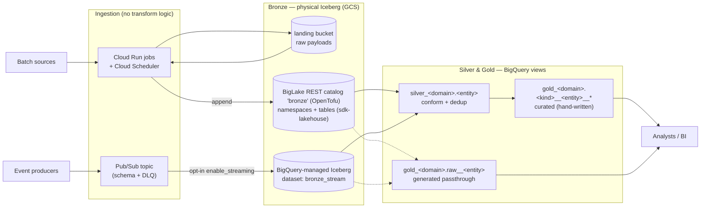

# Feature Spec: GCP Data Lakehouse Reference Architecture (`infra/lakehouse`)

- **Status:** Draft (Pending Approval)
- **Module / Component:** `platform_unified_data_gcp/infra/lakehouse` (separate Terragrunt stack per env) + `platform_unified_data_gcp/lakehouse/` (schema- and view-as-code)
- **Archetype:** Data Pipeline Contract + Infrastructure-as-Code & GitOps (Architecture Overview / Epic)
- **Tier:** Full Spec (architecture parent of Mini-Specs `06`–`13`)
- **Owner:** Xavier Ruiz
- **Depends On:** `specs/01_gcp_bootstrap_and_wif.md`, `specs/03_platform_and_terragrunt_envs.md`, `specs/04_github_actions_cicd.md`
- **Related:** `playground-data-engineering/maven_projects/sdk_lakehouse/specs/05_iceberg_gcp_biglake_plugin.md` (`gcp_biglake` SPI plugin)

---

## 1. Goal & Context

### Problem Statement
Specs 01–04 deliver per-environment GCP projects, networking, budgets and GitOps promotion, but no data layer (Spec 03 explicitly defers it to independent domain stacks). We need one architecture for how data lands, is stored, governed and served on GCP before writing implementation mini-specs. The chosen design is a **view-first ELT lakehouse**. Ingestion writes clean, append-only **Apache Iceberg bronze** tables. **Silver and gold are BigQuery views**, so there are no transformation pipelines and nothing runs while idle. Every curated view can be traced back to its source tables through enforced naming and lineage metadata.

### Success Metrics
- Every lakehouse resource is owned by exactly one Mini-Spec (`06`–`13`) and deployed through the `infra/lakehouse` stack with its own state prefix and tag namespace (`udp-lakehouse-vX.Y.Z`).
- With `enable_streaming = false`, an environment runs **zero always-on compute**, and idle cost stays within the existing Spec 03 budgets (`$50` / `$100` / `$250`).
- The reference domain (`football`) flows source → landing → bronze → silver → gold in `dev`. For every bronze table, analysts can find the matching `raw__` view and all curated views by name or by label.
- Full verification coverage of `TC-001` through `TC-015`.

---

## 2. Visual Architecture



---

## 3. Scope & Explicit Non-Goals

### In Scope
- **Stack boundary:** an `infra/lakehouse/` Terragrunt stack per env that consumes `infra/platform` outputs through a `dependency` block and has its own state (`envs/<env>/lakehouse`) and its own release tags.
- **Layer model:** a GCS landing zone; bronze as two physical Iceberg table classes (batch tables in the BigLake REST catalog, streaming tables as BigQuery-managed Iceberg); silver and gold as BigQuery view datasets per domain.
- **Ownership split:** OpenTofu provisions the infrastructure (buckets, the BigLake REST catalog, BigQuery datasets and connections). `sdk-lakehouse` manages only the **namespaces and tables** inside that catalog.
- **Ingestion paths:** batch through Cloud Run jobs (on by default), and streaming through Pub/Sub into BigQuery-managed Iceberg (opt-in per env).
- **Generated raw access:** one `raw__` gold view per bronze table, generated automatically.
- **Naming and lineage:** the conventions in §5.4, enforced by CI.
- **Cross-cutting rules:** the IAM access model, table maintenance, observability, and the selective-materialization escape hatch.
- **Roadmap:** the Mini-Spec roadmap (§5.7).

### Non-Goals (Do Not Implement)
- **No catalog lifecycle in `sdk-lakehouse`:** it never creates, alters or deletes catalogs; catalogs are platform-provisioned (Mini-Spec `07`).
- **No Spark/Dataflow transformation pipelines or Cloud Composer.** Silver and gold are views; orchestration is limited to Cloud Scheduler triggers.
- **No physical silver or gold tables by default.** Materialization only happens through the escape hatch (`REQ-10`).
- **No Iceberg catalog views.** View definitions live only in BigQuery.
- **No hand-written `raw__` views:** they are generated only (`REQ-13`).
- **Deferred to future specs:** CMEK, VPC Service Controls, Dataplex governance and lineage UI, column-level policy tags and data masking.
- **No resource-level HCL or job code in this spec:** Mini-Specs `06`–`13` own the implementation contracts.

---

## 4. Functional Requirements

- `REQ-01`: **Separate Lakehouse Stack.** All data-layer resources shall live in `infra/lakehouse/`. It reads `project_id`, `project_number`, `region` and `subnet_id` from the `infra/platform` outputs and follows Spec 04 promotion (`dev` tracks `main`; `uat`/`prod` pin `udp-lakehouse-vX.Y.Z`).
- `REQ-02`: **Landing Zone.** Batch sources shall first write raw, unmodified payloads to the landing bucket under `<domain>/<source>/ingest_date=YYYY-MM-DD/<run_id>/`. Objects are immutable, which allows replay and backfill without calling the source again.
- `REQ-03`: **Bronze Batch Tables.** OpenTofu shall provision one BigLake Iceberg REST catalog per env, whose warehouse is the bronze bucket. `sdk-lakehouse` (`gcp_biglake` provider) shall create and evolve only the **namespaces** (one per `<domain>`) and **tables** inside it, from YAML, under the same logical catalog name `bronze` in every env. Batch ingestion appends rows to those tables.
- `REQ-04`: **Bronze Streaming Tables.** When `enable_streaming = true`, Pub/Sub topics with an attached schema shall deliver events into BigQuery-managed Iceberg tables in dataset `bronze_stream`, with a dead-letter topic for rejected messages. When `false`, zero streaming resources exist.
- `REQ-05`: **Ingestion-Time Hygiene.** Every bronze row shall carry the standard metadata columns (§5.3). Records that fail schema checks shall be routed to quarantine (batch) or the dead-letter topic (streaming) and never dropped silently. Ingestion shall contain **no business logic**.
- `REQ-06`: **Silver Views.** Each bronze entity shall have exactly one `silver_<domain>.<entity>` view that types, renames, conforms and **deduplicates** rows on `_event_key`, keeping the latest `_ingested_at`. It merges the batch and streaming sources for the same entity. Dedup and conformance logic shall exist only in silver.
- `REQ-07`: **Curated Gold Views.** Hand-written gold views in `gold_<domain>` shall read **only silver views** and follow the §5.4 naming grammar. Gold datasets are authorized against their sources so consumers need no direct access to silver or bronze.
- `REQ-08`: **Definitions as Code.** Every bronze namespace and table, silver view and curated gold view shall be declared in Git under `platform_unified_data_gcp/lakehouse/` and deployed by CI. Manual DDL in the console or `bq` is forbidden in `uat`/`prod`.
- `REQ-09`: **Storage Layout for View Performance.** Bronze tables shall declare Iceberg partitioning (default `day(_ingested_at)`, overridable per table). BigQuery-managed tables shall declare clustering on `_event_key`, so that view predicates prune storage.
- `REQ-10`: **Selective Materialization Escape Hatch.** A curated gold view may be materialized into a BigQuery-managed Iceberg table refreshed by a scheduled query only when there is an entry in `lakehouse/materializations.yaml` with the measured scan cost or latency that justifies it. It keeps its exact name and labels, so consumers and lineage are unaffected.
- `REQ-11`: **Least-Privilege Access.** Access shall follow the principal matrix (§5.5): ingestion identities write only their own layer, the CI identity owns namespace/table/view DDL, and analysts can read only `gold_*`, which includes the `raw__` views.
- `REQ-12`: **Table Maintenance & Observability.** Bronze REST-catalog tables shall get scheduled snapshot expiry, orphan-file removal and compaction (BigQuery-managed tables rely on BigQuery's automatic storage optimization). Failed ingestion runs, DLQ backlog and maintenance failures shall alert the existing Spec 03 notification channel.
- `REQ-13`: **Generated Raw Views.** For every bronze table (batch and stream), the lakehouse stack shall automatically create `gold_<domain>.raw__<entity>` as a column-for-column passthrough, including the metadata columns. No hand-written SQL is involved. These are created or removed in the same apply as their source table, so analysts get raw access without being granted bronze.
- `REQ-14`: **Naming & Lineage Enforcement.** Every silver and gold object shall follow §5.4 and carry its lineage labels. CI shall fail if a view's declared `sources` differ from the tables BigQuery reports it actually references (dry-run), or if an object name breaks the grammar.

---

## 5. Interface & Data Contract

### 5.1 Directory & Module Boundary Tree

```text
platform_unified_data_gcp/
├── infra/
│   ├── platform/                 # Spec 03 — project, VPC, budget (unchanged)
│   └── lakehouse/                # Specs 06–13 — tagged udp-lakehouse-vX.Y.Z
│       ├── stack/                # OpenTofu root: buckets, REST catalog, datasets, IAM, jobs, views, raw__ generation
│       └── envs/{root.hcl, dev/, uat/, prod/}   # Terragrunt wrappers; dependency → platform outputs
└── lakehouse/                    # Domain-owned, env-agnostic definitions
    ├── materializations.yaml     # REQ-10 register
    └── domains/<domain>/
        ├── bronze/namespace.yaml + tables/<entity>.yaml   # sdk-lakehouse (batch) / stream table YAML
        ├── silver/<entity>.sql + <entity>.yaml            # view SQL + lineage sidecar
        └── gold/<view_name>.sql + <view_name>.yaml        # curated only (raw__ is generated)
```

### 5.2 Storage, Catalog & Dataset Inventory (per environment, `region` = platform region)

| Layer | Resource | Name Pattern | Provisioned By | Contents Managed By | Notes |
| :--- | :--- | :--- | :--- | :--- | :--- |
| Landing | GCS bucket | `udp-<env>-landing-<suffix>` | OpenTofu | Ingestion jobs | Nearline after 30d; deleted after `landing_retention_days` (`dev` 30, `prod` 365); `_quarantine/` prefix |
| Bronze (batch) | GCS bucket + BigLake Iceberg REST catalog | `udp-<env>-bronze-<suffix>`, logical catalog `bronze` | OpenTofu | `sdk-lakehouse` (namespaces, tables) | Iceberg format v2 |
| Bronze (stream) | GCS bucket + BigQuery dataset + connection | `udp-<env>-bronze-stream-<suffix>` / `bronze_stream` | OpenTofu | OpenTofu (tables) | Opt-in (`enable_streaming`) |
| Silver | BigQuery dataset | `silver_<domain>` | OpenTofu | OpenTofu (views) | Views only |
| Gold | BigQuery dataset | `gold_<domain>` | OpenTofu | OpenTofu (curated + generated `raw__`) | Views only, except `REQ-10` materializations |

All buckets: uniform bucket-level access, public access prevention `enforced`, soft delete enabled, and the mandatory Spec 03 labels plus `layer` and `domain`.

### 5.3 Bronze Row Contract (Mandatory Metadata Columns)

| Column | Type | Rule |
| :--- | :--- | :--- |
| `_ingested_at` | `timestamp` (UTC) | Set by the writer at commit; default partition source. |
| `_source` | `string` | `<domain>.<source>` identifier. |
| `_batch_id` | `string` | Cloud Run execution ID, or Pub/Sub message ID for streams. |
| `_source_uri` | `string` (nullable) | Landing object URI (batch only), used for replay lineage. |
| `_event_key` | `string` | Declared business key used by silver dedup (`REQ-06`). |

### 5.4 Naming & Lineage Convention

Names are `snake_case`. `__` (double underscore) is reserved as the token separator. `<entity>` is the bronze table name and is the anchor that makes every downstream object traceable.

| Object | Pattern | Example |
| :--- | :--- | :--- |
| Bronze batch table | `bronze.<domain>.<entity>` | `bronze.football.matches` |
| Bronze stream table | `bronze_stream.<domain>__<entity>` | `bronze_stream.football__match_events` |
| Silver view (1:1 with entity) | `silver_<domain>.<entity>` | `silver_football.matches` |
| Raw gold view (generated) | `gold_<domain>.raw__<entity>` | `gold_football.raw__matches` |
| Curated gold view | `gold_<domain>.<kind>__<entity>__<qualifier>`, where `kind` ∈ `dim`, `fct`, `agg`, `rpt` and `<entity>` is the grain-defining source | `gold_football.agg__matches__team_season_standings` |

**Lineage contract.** Every silver and curated gold view has a YAML sidecar declaring `description`, `grain`, `owner` and `sources` (fully qualified upstream objects). On deploy, every silver and gold view (including `raw__`) gets these BigQuery labels:
- `layer` and `view_kind` (`silver` | `raw` | `dim` | `fct` | `agg` | `rpt`);
- one `src_<entity>` label per upstream entity, valued `<domain>`.

To find everything built on an entity, either filter by name (`*__<entity>__*`) or query `INFORMATION_SCHEMA.TABLE_OPTIONS` for label `src_<entity>`.

```yaml
# lakehouse/domains/football/gold/agg__matches__team_season_standings.yaml
description: "Points, wins, goal difference per team per season"
grain: "team_id, season"
owner: "xavier"
sources:
  - silver_football.matches
  - silver_football.teams
```

### 5.5 IAM / Security Principal Matrix

| Principal | Auth / Condition | Scope | Access | Purpose |
| :--- | :--- | :--- | :--- | :--- |
| `sa-ingest-batch` | Cloud Run job identity | Landing bucket, `bronze` tables | Write landing; append rows; no DDL | Batch ingestion |
| Pub/Sub service agent | Google-managed | `bronze_stream` dataset | Write table data | Streaming delivery |
| `sa-lakehouse-ddl` | GitHub Actions WIF (`main` only for apply) | Namespaces and tables in `bronze`; lakehouse datasets | Namespace/table/view DDL; **no** catalog create/delete | `REQ-08` CI deployer |
| `sa-maintenance` | Scheduler-invoked job | `bronze` tables | Table maintenance only | `REQ-12` |
| BigQuery connection SA | Google-managed | Bronze buckets | Read (batch) / read-write (stream) objects | BigQuery reads and writes Iceberg data |
| `analysts` group | Google Group | `gold_*` datasets | Data viewer + project job user | Curated and `raw__` views only |

### 5.6 Architecture Decision Register

| ID | Decision | Rationale | Verify In |
| :--- | :--- | :--- | :--- |
| `ADR-01` | Separate `infra/lakehouse` stack with its own tag namespace | Isolates data-bearing resources from network/project blast radius | `06` |
| `ADR-02` | Silver and gold as BigQuery views (no ETL) | No idle compute, data always fresh, one copy of business logic | `12` |
| `ADR-03` | Catalog provisioned by OpenTofu; namespaces and tables managed by `sdk-lakehouse` | Keeps the infrastructure lifecycle separate from schema evolution, and matches the SDK's contract that catalogs are platform-provisioned | `07`, `09` |
| `ADR-04` | Streaming bronze as BigQuery-managed Iceberg | No streaming job to operate; automatic compaction handles small files | `11` |
| `ADR-05` | Logical catalog name `bronze` is identical in every env; env config maps it to physical warehouses | The same YAML deploys to every env (SDK catalog identity check) | `07`, `09` |
| `ADR-06` | Generated `raw__` gold views instead of granting analysts bronze access | Analysts stay inside `gold_*` and get one place to discover data | `12` |
| `ADR-07` | To confirm: how BigQuery references REST-catalog tables, whether authorized views work over them, and whether Pub/Sub BigQuery subscriptions support Iceberg tables | Depends on current GCP feature availability; the fallback is a Storage Write API writer and dataset-level grants | `07`, `08`, `11` |

### 5.7 Mini-Spec Roadmap

| Spec | Title | Delivers |
| :--- | :--- | :--- |
| `06` | Lakehouse stack scaffold & CI routing | `infra/lakehouse` Terragrunt stack, state prefix, `udp-lakehouse-v*` tags, Spec 04 routing |
| `07` | Bronze storage & BigLake catalog provisioning | Buckets, OpenTofu-managed REST catalog, BigQuery connection, lifecycle rules |
| `08` | Lakehouse IAM & access model | §5.5 principals, authorized-view wiring |
| `09` | Bronze namespace & table deployment | CI job applying `sdk-lakehouse` YAML (depends on `sdk-lakehouse` graduation/publish) |
| `10` | Batch ingestion framework | Cloud Run job contract, landing layout, quarantine, Scheduler |
| `11` | Streaming ingestion (opt-in) | Pub/Sub schemas, DLQ, BigQuery-managed Iceberg tables, `enable_streaming` |
| `12` | View-as-code, raw views & lineage checks | Silver/gold deployment, `raw__` generation, §5.4 naming/label/dry-run CI checks, `REQ-10` register |
| `13` | Maintenance, observability & alerting | Maintenance jobs, alert policies, cost dashboards |

---

## 6. Invariants, Edge Cases & Failure Modes

### Key Invariants
1. **Zero Idle Compute by Default:** With `enable_streaming = false`, no always-on compute exists.
2. **Curated Gold Never Reads Bronze:** Only generated `raw__` views reference bronze; curated gold views reference only `silver_*`.
3. **One Entity, One Silver View, One Raw View:** Every bronze table maps 1:1 to `silver_<domain>.<entity>` and `gold_<domain>.raw__<entity>`.
4. **Raw Data Is Replayable:** Landing objects are immutable within retention, so any bronze table can be rebuilt from landing.
5. **Co-Location & Env-Agnostic Definitions:** All layers share one region per env, and nothing under `lakehouse/domains/` contains project IDs, bucket names or env names.

### Failure Mode Matrix

| Failure Condition | Expected Behavior | Notes |
| :--- | :--- | :--- |
| Source payload fails schema validation | Written to `_quarantine/`; run marked failed and alert raised | Valid records still commit |
| Streaming message violates topic schema | Rejected by Pub/Sub; repeated delivery failures go to the DLQ | DLQ backlog alert (`REQ-12`) |
| Duplicate or late events | Bronze keeps every row; silver keeps the latest per `_event_key` | `raw__` views intentionally show the duplicates |
| A view's declared `sources` differ from what the dry-run reports | CI fails on the PR | `REQ-14` |
| View name breaks the §5.4 grammar, or a curated view reads bronze | CI fails on the PR | `REQ-07`, `REQ-14` |
| Bronze table dropped from YAML | Its `raw__` view is removed in the same apply; plan flags the dependent silver/gold views | Prevents orphaned or broken views |
| Gold view exceeds the cost/latency budget | Recorded in `materializations.yaml` and materialized under the same name | `REQ-10` |
| Manual DDL in `uat`/`prod` | Detected as drift by the next plan and reverted | `REQ-08` |

---

## 7. Acceptance Criteria & Verification Matrix

| Case ID | Scenario | Input / Precondition | Expected Outcome |
| :--- | :--- | :--- | :--- |
| `TC-001` | Stack isolation | Change only `infra/lakehouse/**` | CI plans and applies only the lakehouse stack for `dev`; platform state is untouched (`06`). |
| `TC-002` | Tag promotion | Promote `udp-lakehouse-v0.1.0` to `uat` | `uat` pins the tag; `prod` is unchanged (`06`). |
| `TC-003` | Resource inventory | Apply `dev` | Every §5.2 resource exists with the required names, labels, UBLA and public access prevention; the REST catalog exists before any `sdk-lakehouse` run (`07`). |
| `TC-004` | Zero idle compute | `enable_streaming = false` | No Dataflow jobs, clusters, Composer envs or always-on services; no `bronze_stream` resources (`07`, `11`). |
| `TC-005` | Least privilege | Impersonate `sa-ingest-batch` and `sa-lakehouse-ddl` | Ingest can append but not run DDL; DDL can manage namespaces/tables but catalog create/delete is denied (`08`). |
| `TC-006` | Analyst isolation | Query as an `analysts` member | `gold_*` curated and `raw__` views succeed; direct `silver_*`/`bronze` queries are denied (`08`, `12`). |
| `TC-007` | Namespace/table as code | Add `football` namespace + table YAML and merge | CI creates them in the existing `bronze` catalog; re-running is a no-op (`09`). |
| `TC-008` | Batch ingestion happy path | Run the `football` ingestion job | Raw payload lands under the `REQ-02` path; bronze rows carry all §5.3 columns (`10`). |
| `TC-009` | Quarantine | Batch contains a malformed record | Bad record goes to `_quarantine/`, valid rows commit, alert fires (`10`, `13`). |
| `TC-010` | Streaming path | `enable_streaming = true`; publish a valid and an invalid event | Valid event is queryable in `bronze_stream`; invalid one reaches the DLQ (`11`). |
| `TC-011` | Silver dedup | The same `_event_key` is ingested twice | `silver_football.matches` returns one row (latest); `raw__matches` returns two (`12`). |
| `TC-012` | Raw view generation | Add and later remove a bronze table | `gold_<domain>.raw__<entity>` appears and disappears in the same apply with matching columns (`12`). |
| `TC-013` | Naming & lineage check | PR adds a gold view with a bad name, a bronze reference, or undeclared sources | CI fails; a compliant view deploys with `layer`, `view_kind` and `src_<entity>` labels (`12`). |
| `TC-014` | Traceability query | Filter `TABLE_OPTIONS` by `src_matches` | Returns every silver and gold view built on `matches` (`12`). |
| `TC-015` | Maintenance & alerting | Run the maintenance job; force an ingestion failure | Snapshots expired and orphan files removed; alert reaches the Spec 03 channel (`13`). |
