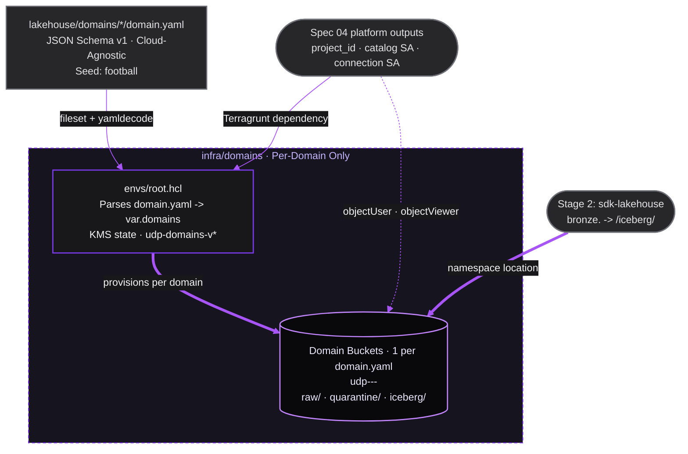

# Spec 05: Domain Manifest & Bronze Storage Layer

| Field | Value |
| :--- | :--- |
| **Status** | `Draft (Pending Approval)` |
| **Owner** | Xavier Ruiz |
| **Component** | `platform_unified_data_gcp/lakehouse/{schemas, domains}` · `platform_unified_data_gcp/infra/domains/{stack, envs}` |
| **Stack** | OpenTofu `>= 1.12.2` · Terragrunt `>= 0.72` · `google ~> 8.10` · CFF `v60.0.0` · JSON Schema Draft 2020-12 |
| **Archetype / Tier** | Infrastructure-as-Code & GitOps · Mini-Spec (`6 REQs`, `8 TCs`) |
| **Depends On** | [Spec 01](./01_platform_module_setup.md), [Spec 03](./03_data_lakehouse_architecture.md), [Spec 04](./04_lakehouse_platform_extension.md) |
| **Related** | `sdk_lakehouse/specs/05_iceberg_gcp_biglake_plugin.md` (`gcp_biglake` SPI) |

---

## 1. Overview & Design

### TL;DR
This Mini-Spec delivers the per-domain half of Spec 03's Stage 1. It defines the cloud-agnostic **`domain.yaml` manifest contract** (validated by JavaScript Object Notation (JSON) Schema and OpenTofu, seeded with `football`) and creates the `infra/domains` stack described in Spec 01 §4.3. That stack parses `lakehouse/domains/*/domain.yaml` and provisions **one hardened Google Cloud Storage (GCS) bucket per Data Mesh domain** with `raw/`, `quarantine/`, and `iceberg/` prefixes, granting the Spec 04 catalog and connection service accounts access to each bucket. It adds no project-level resources and no idle compute.

### Architecture



### Key Design Decisions
- **Cloud-agnostic manifest, dual-validated:** `domain.yaml` uses only cloud-neutral fields so a future `platform_unified_data_aws` can reuse it verbatim. JSON Schema gives fast CI and IDE feedback, and OpenTofu validations guard every plan.
- **Terragrunt parses manifests; the stack stays pure:** `infra/domains/envs/root.hcl` discovers manifests from the repository root and passes a typed `domains` map, so `uat`/`prod` can pull the stack from a remote tag and `tofu test` stays self-contained.
- **One bucket per domain with DNS/S3-safe slugs:** Bucket names replace `_` with `-` for Domain Name System (DNS) and Amazon S3 compatibility, while BigQuery datasets and Iceberg namespaces keep `snake_case`.
- **Prefix-scoped lifecycle without `dev` Nearline penalties:** Expiry applies only to `raw/` and `quarantine/`, never `iceberg/`, and the Nearline@30d step is omitted when effective retention is `<= 30` days.

### Done Looks Like
- `lakehouse/domains/football/domain.yaml` passes the schema and drives the `football` bucket in every environment.
- Every gate below passes offline.
- Acceptance cases `TC-001` through `TC-008` are verified.

| Gate | Command | Scope |
| :--- | :--- | :--- |
| Manifest Schema | `check-jsonschema --schemafile lakehouse/schemas/domain.schema.json lakehouse/domains/*/domain.yaml` | All manifests |
| Formatting | `tofu fmt -check` · `terragrunt hcl fmt --check` | `infra/domains` |
| Render & Schema | `terragrunt render` · `tofu validate` | `infra/domains` |
| Lint & Security | `tflint --recursive` · `trivy config` (`HIGH,CRITICAL`) | `infra/domains` |
| Unit Tests | `tofu test` (mocked provider) | `stack/tests/domain_storage.tftest.hcl` |

---

## 2. Scope

### In Scope
- The `domain.yaml` v1 contract (`lakehouse/schemas/domain.schema.json`) and the `football` seed manifest.
- The `infra/domains` stack and its `dev`/`uat`/`prod` Terragrunt wrappers, following Spec 01 §4.3.
- One hardened GCS bucket per manifest, plus bucket IAM for the Spec 04 service accounts.
- A multi-platform lockfile and offline mocked tests.

### Out of Scope (Non-Goals)
- **Project-level or shared resources:** APIs, project IAM, the catalog, and the connection belong to `infra/platform` (Spec 01 §4.1, Spec 04).
- **Shared landing bucket:** Raw and quarantined payloads stay in each domain's own bucket.
- **Iceberg namespaces & tables:** Created by `sdk-lakehouse` in Mini-Spec `08`.
- **CI/CD workflows & Silver/Gold datasets:** Mini-Spec `06`.
- **Domain and user principals:** Ingest service accounts, DDL principals, and owner/analyst groups belong to Mini-Spec `07`.
- **Streaming resources:** This spec validates and outputs `ingestion.enable_streaming`; Pub/Sub resources belong to Mini-Spec `10`.

---

## 3. Functional Requirements

Exact parameter names, defaults, and validation patterns live once in **Section 4**.

### Domain Manifest

| ID | What | Why | How |
| :--- | :--- | :--- | :--- |
| `REQ-01` | Cloud-agnostic `domain.yaml` & dual validation | Lets domains self-register with zero HCL and full portability to other clouds | Draft 2020-12 schema with `additionalProperties: false` (§4.1), the `football` seed, and matching OpenTofu validations on `var.domains`, including directory-to-`domain` parity |

### Stack & Environment Wiring

| ID | What | Why | How |
| :--- | :--- | :--- | :--- |
| `REQ-02` | Domains Terragrunt root | Keeps per-domain state and blast radius separate from the platform | `infra/domains/envs/root.hcl` pins `tofu`, generates KMS-encrypted state under `envs/<env>/domains`, mirrors the Spec 01 offline/ephemeral flags, sets `region` from `UDP_GCP_REGION`, and parses manifests into `domains` |
| `REQ-03` | Immutable env promotion | `uat`/`prod` deploy audited releases while `dev` iterates | `dev` tracks `../../stack//.`; `uat`/`prod` pin `domains_version` from `release.yaml` |
| `REQ-04` | Platform dependency & pinned modules | Reuses platform identities without duplicating config and prevents upstream drift | Each wrapper reads `project_id`, `biglake_service_account`, and `bigquery_connection_sa` through `dependency "platform"` with offline `mock_outputs`; `stack/module-versions.yaml` pins CFF |

### Bronze Storage

| ID | What | Why | How |
| :--- | :--- | :--- | :--- |
| `REQ-05` | Per-domain hardened buckets | One isolated bucket per domain for replay, quarantine, and Bronze tables, without `dev` early-deletion fees | CFF `gcs` module with `for_each` over `var.domains`, per §4.3 |
| `REQ-06` | Bucket IAM, outputs & tests | Unblocks `sdk-lakehouse` and later Mini-Specs with offline verification | Bucket IAM per §4.6, `domain_buckets` output per §4.5, multi-platform lockfile, and `tests/domain_storage.tftest.hcl` |

---

## 4. Contract & Blueprint

### 4.1 Domain Manifest Contract (`domain.yaml` v1)

Each domain declares `lakehouse/domains/<domain>/domain.yaml`. The schema sets `additionalProperties: false` at every level and contains no cloud-specific keys.

| Field | Type | Required / Default | Constraint |
| :--- | :--- | :--- | :--- |
| `schema_version` | `integer` | *required* | Must equal `1` |
| `domain` | `string` | *required* | `^[a-z][a-z0-9_]{1,30}[a-z0-9]$`; matches the parent directory name |
| `business_function` | `string` | *required* | 3–120 chars |
| `owner_group` | `string` | *required* | `^[a-zA-Z0-9._%+-]+@[a-zA-Z0-9.-]+\.[a-zA-Z]{2,}$` |
| `description` | `string` | *required* | 10–500 chars |
| `cost_center` | `string` | optional · `var.cost_center` | `^[a-z][a-z0-9-]{1,61}[a-z0-9]$` |
| `storage.raw_retention_days` | `integer` | optional · `var.default_raw_retention_days` | `7..3650`; applies to `raw/` and `quarantine/` only |
| `ingestion.enable_streaming` | `boolean` | optional · `false` | Consumed by Mini-Spec `10` |

```yaml
# lakehouse/domains/football/domain.yaml
schema_version: 1
domain: football
business_function: "Sports performance analytics"
owner_group: football-data-owners@example.com
description: "Premier League matches, teams, and player statistics"
storage:
  raw_retention_days: 30
ingestion:
  enable_streaming: false
```

### 4.2 Derivation Rules

| Derived Property | Rule |
| :--- | :--- |
| Bucket slug | `replace(domain, "_", "-")` |
| Effective `cost_center` | `coalesce(domain.cost_center, var.cost_center)` |
| Effective `raw_retention_days` | `coalesce(try(domain.storage.raw_retention_days, null), var.default_raw_retention_days)` |
| Effective `enable_streaming` | `coalesce(try(domain.ingestion.enable_streaming, null), false)` |

### 4.3 Domain Bucket (CFF `//modules/gcs`)

| Setting | Value |
| :--- | :--- |
| **Name** | `udp-<env>-<slug>-<suffix>` (domains stack random suffix) |
| **Location / Class** | `var.region` · `STANDARD` |
| **Access Control** | Uniform Bucket-Level Access (UBLA) enabled · Public Access Prevention (PAP) `enforced` |
| **Versioning / Soft Delete** | Enabled · `var.soft_delete_retention_seconds` (default 7 days) |
| **Destroy Protection** | `force_destroy = false` (the CFF `gcs` module cannot expose `prevent_destroy`) |
| **Labels** | Spec 01 mandatory labels with effective `cost_center`, plus `layer = "bronze"` and `domain = <domain>` |

| Prefix | Contents | Lifecycle |
| :--- | :--- | :--- |
| `raw/<source>/ingest_date=YYYY-MM-DD/<run_id>/` | Immutable raw payloads for replay | Nearline@30d only if retention `> 30` · Delete at effective retention |
| `quarantine/<source>/ingest_date=YYYY-MM-DD/<run_id>/` | Rejected batch records | Same as `raw/` |
| `iceberg/` | Bronze Iceberg metadata and Parquet for `bronze.<domain>` | Never expired by GCS lifecycle |

### 4.4 Stack Inputs

| Input | Type | Default | Constraint |
| :--- | :--- | :--- | :--- |
| `environment` | `string` | *required* | `dev`, `uat`, or `prod` |
| `project_id` | `string` | *required* | `^[a-z][a-z0-9-]{4,28}[a-z0-9]$` (platform output) |
| `region` | `string` | `"us-central1"` | `^[a-z]+-[a-z]+[0-9]+$` (`UDP_GCP_REGION`) |
| `domains` | `map(object)` | *required* | Non-empty; key equals `domain`; satisfies §4.1 |
| `biglake_service_account` | `string` | *required* | `^[a-z0-9._-]+@[a-z0-9.-]+\.iam\.gserviceaccount\.com$` (platform output) |
| `bigquery_connection_sa` | `string` | *required* | Same pattern (platform output) |
| `default_raw_retention_days` | `number` | `30` | Integer `7..3650` (`dev` 30, `uat` 90, `prod` 365) |
| `soft_delete_retention_seconds` | `number` | `604800` | Integer `604800..7776000` |
| `platform_name` | `string` | `"unified-data-platform"` | Label value |
| `cost_center` | `string` | `"engineering-playground"` | `^[a-z][a-z0-9-]{1,61}[a-z0-9]$` |

```yaml
# infra/domains/envs/{uat,prod}/release.yaml (must match ^(unreleased|udp-domains-v[0-9]+\.[0-9]+\.[0-9]+)$)
domains_version: "unreleased"
```

### 4.5 Stack Outputs

| Output | Value | Consumer |
| :--- | :--- | :--- |
| `domain_buckets` | Map `<domain>` → `{ name, uri, raw_uri, quarantine_uri, iceberg_uri, raw_retention_days, enable_streaming }` | Ingest jobs, Mini-Specs `06`–`10`, and `sdk-lakehouse` namespace locations |

### 4.6 Domain Bucket IAM

| Principal | Role on Every Domain Bucket | Purpose |
| :--- | :--- | :--- |
| BigLake catalog SA (`biglake_service_account`) | `roles/storage.objectUser` | Vended credentials for Iceberg clients |
| BigQuery connection SA (`bigquery_connection_sa`) | `roles/storage.objectViewer` | Read-only Bronze access for BigQuery |

---

## 5. Invariants & Failure Modes

### Key Invariants
- **Per-domain only:** `infra/domains` declares only buckets and bucket IAM derived from a `domain.yaml` (Spec 01 §4.1).
- **Manifest parity & neutrality:** Every manifest matches its directory name, passes the schema, and has no cloud-specific keys.
- **Prefix lifecycle isolation:** Expiry rules match only `raw/` and `quarantine/`; `iceberg/` is never expired by GCS.
- **No `dev` Nearline penalty:** Nearline@30d is omitted whenever effective retention is `<= 30` days.
- **Isolated & co-located:** State lives under `envs/<env>/domains`, all buckets share the platform region, and adding or removing a manifest never touches `infra/platform`.

### Failure Modes

| Condition | Expected Behavior | Guarantee |
| :--- | :--- | :--- |
| Unknown field, wrong `schema_version`, or bad format in `domain.yaml` | Schema check and OpenTofu validation fail | Malformed manifests never reach plan |
| Directory name differs from `domain` | `var.domains` validation fails | No misaligned buckets or namespaces |
| No manifests exist | `length(var.domains) > 0` fails | No empty applies |
| Invalid stack input or service-account email | Variable validation error | Fails before any GCP call |
| Malformed `release.yaml` or floating ref | Terragrunt or regex check fails | No unpinned `uat`/`prod` deploys |
| Platform outputs from Spec 04 are missing | Terragrunt `dependency` fails | Release ordering from Spec 01 holds |
| Manifest added or removed | Only that bucket and its IAM change | Platform and catalog untouched |
| Accidental destroy of a non-empty bucket | Blocked by `force_destroy = false`; soft delete recovers objects for 7 days | Teardown needs a deliberate override |

---

## 6. Acceptance & Verification (`TC-*`)

| Case | Scenario | Pass Condition |
| :--- | :--- | :--- |
| `TC-001` (`REQ-02`–`06`) | Static & security gates | `tofu fmt`, `terragrunt hcl fmt`, `tofu validate`, `tflint`, and `trivy config` (`HIGH,CRITICAL`) exit `0` for `infra/domains`. |
| `TC-002` (`REQ-02`–`04`) | Root, discovery & state isolation | `terragrunt render --json` shows `envs/<env>/domains` KMS state, `domains` populated from the manifests, platform `mock_outputs` wired, the local stack in `dev`, and pinned tags in `uat`/`prod`. |
| `TC-003` (`REQ-01`) | JSON Schema validation | `check-jsonschema` passes `football` and rejects fixtures with unknown or cloud-specific keys, `schema_version: 2`, a bad `domain`, or a missing required field. |
| `TC-004` (`REQ-05`) | Lifecycle & overrides | Mocked test: rules target only `["raw/", "quarantine/"]`; 30-day retention omits Nearline; 90/365-day and per-domain retention overrides apply; per-domain `cost_center` label override works. |
| `TC-005` (`REQ-05`) | Hardening & slug | Mocked test: UBLA, PAP, versioning, 7-day soft delete, `force_destroy = false`, and labels on a multi-domain map, with `player_ops` named `udp-<env>-player-ops-<suffix>`. |
| `TC-006` (`REQ-06`) | Bucket IAM & ownership boundary | Mocked test: `objectUser` for the BigLake SA and `objectViewer` for the connection SA on every domain bucket; no `google_project_service` or project IAM resource exists in `infra/domains`. |
| `TC-007` (`REQ-01`, `REQ-04`, `REQ-05`) | Negative validation | `expect_failures` triggers for empty `domains`, key != `domain`, bad `owner_group`, `schema_version != 1`, invalid `environment`, retention `< 7`, soft delete `< 604800`, and a malformed service-account email. |
| `TC-008` (`REQ-06`) | Outputs & lockfile | `domain_buckets` exposes every §4.5 field, and the stack lockfile covers `darwin_arm64` and `linux_amd64`. |
